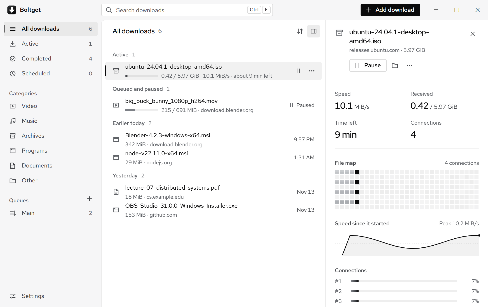

<p align="center">
  <picture>
    <source media="(prefers-color-scheme: dark)" srcset="brand/icon-on-dark.svg">
    
  </picture>
</p>

<h1 align="center">Boltget</h1>

<p align="center">
  <strong>Every byte, at full speed.</strong><br>
  A download manager that splits every file across many connections and resumes it after anything.
</p>

<p align="center">
  <a href="https://boltget.app/download/">Download</a> ·
  <a href="https://boltget.app">Website</a> ·
  <a href="docs/README.md">Docs</a> ·
  <a href="docs/ROADMAP.md">Roadmap</a> ·
  <a href="https://discord.gg/F8Cr6Whhnt">Discord</a>
</p>

<p align="center">
  <picture>
    <source media="(prefers-color-scheme: dark)" srcset=".github/assets/app-dark.png">
    
  </picture>
</p>

## Features

- **Dynamic segmentation.** Starts with a few connections, adds more only while they help, and splits the slowest part when one finishes early, so they all end together. [Benchmark](docs/BENCHMARK.md)
- **Crash-safe resume.** Progress is saved only after the bytes are on disk. Kill it or lose power and it picks up where it stopped.
- **Link refresh.** An expired link at 97% is not a restart: give it a new one and it checks the file is the same, then continues.
- **Browser capture.** The extension hands downloads to the app with their cookies, so files behind a sign-in work too.
- **Queues and schedules,** categories, bandwidth limits, checksums, proxies.
- **A scriptable CLI** with documented exit codes and JSON events.

## Install

| | |
|---|---|
| **Desktop app** | Windows 10 and 11: the installer from [boltget.app/download](https://boltget.app/download/). macOS and Linux are on the way. |
| **Browser extension** | [Chrome Web Store](https://chromewebstore.google.com/detail/boltget/aeobielfcjcidnadamggpnomipkijcbj). Edge and Firefox are next. |
| **Command line** | Windows and Linux builds on [GitHub Releases](https://github.com/boltget/boltget/releases). |

```console
$ boltget get https://example.com/ubuntu.iso --checksum sha256:<hex>
$ boltget list
$ boltget resume 7
```

Boltget is in preview: builds are not code-signed yet, so Windows SmartScreen asks once. To verify a download or build from source, see [docs/BUILDING.md](docs/BUILDING.md).

## Contributing

Start with [CONTRIBUTING.md](CONTRIBUTING.md). Questions and ideas go to [Discussions](https://github.com/boltget/boltget/discussions), bugs to [Issues](https://github.com/boltget/boltget/issues), and security reports to [SECURITY.md](SECURITY.md), never to a public issue. The design docs, from the engine spec to the architecture, are indexed in [docs/README.md](docs/README.md).

## License

[GPL-3.0-or-later](LICENSE). The Boltget name and icon identify the official project; please don't use them to brand a modified build.
