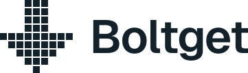

<p align="center">
  <picture>
    <source media="(prefers-color-scheme: dark)" srcset="brand/svg/lockup-horizontal-on-dark.svg">
    
  </picture>
</p>

<h3 align="center">Every byte, at full speed.</h3>

<p align="center">
  The download manager that splits every file across many connections and picks up where it stopped.
</p>

<p align="center">
  <a href="https://boltget.app/download/"><picture><source media="(prefers-color-scheme: dark)" srcset=".github/assets/readme/button-download-dark.svg"></picture></a>
  <a href="https://boltget.app"><picture><source media="(prefers-color-scheme: dark)" srcset=".github/assets/readme/button-website-dark.svg"></picture></a>
  <a href="docs/README.md"><picture><source media="(prefers-color-scheme: dark)" srcset=".github/assets/readme/button-docs-dark.svg"></picture></a>
  <a href="https://discord.gg/F8Cr6Whhnt"><picture><source media="(prefers-color-scheme: dark)" srcset=".github/assets/readme/button-discord-dark.svg"></picture></a>
</p>

<br>

<p align="center">
  <picture>
    <source media="(prefers-color-scheme: dark)" srcset=".github/assets/readme/platforms-dark.svg">
    
  </picture>
</p>

## Build from source

```sh
git clone https://github.com/boltget/boltget.git
cd boltget
pnpm install
pnpm --filter @boltget/desktop tauri dev
```

The command-line tool, the installer and the checks are in [docs/BUILDING.md](docs/BUILDING.md).

<br>

<p align="center">
  <picture><source media="(prefers-color-scheme: dark)" srcset=".github/assets/readme/stack-rust-dark.svg"></picture>
  <picture><source media="(prefers-color-scheme: dark)" srcset=".github/assets/readme/stack-tauri-dark.svg"></picture>
  <picture><source media="(prefers-color-scheme: dark)" srcset=".github/assets/readme/stack-svelte-dark.svg"></picture>
</p>

<p align="center">
  <a href="CONTRIBUTING.md">Contributing</a> ·
  <a href="https://github.com/boltget/boltget/issues">Issues</a> ·
  <a href="SECURITY.md">Security</a>
</p>

<p align="center">
  <sub>Open source under GPL-3.0-or-later. The Boltget name and icon identify the official project.</sub>
</p>
