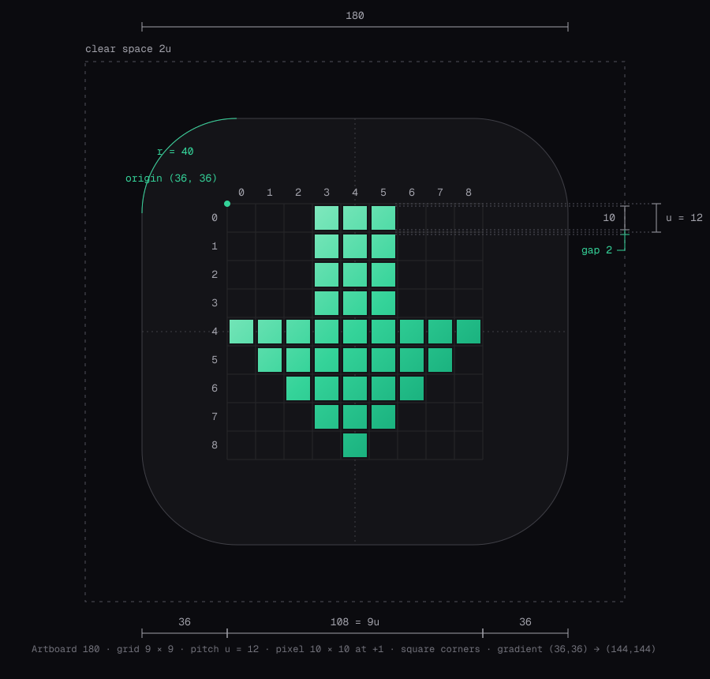

# BoltGet brand guidelines

BoltGet is a free, open-source download manager. The brand is built the way the
product works: quietly, precisely, and fast. This document is the reference for
anyone who puts the BoltGet name or mark on something — the app, the website
(boltget.app), the README, release notes, social media, slides.

Everything in this folder except this file and the two canonical icons is
generated by `scripts/build.mjs`. To change an asset, change the script and
rebuild (see [Rebuilding](#rebuilding)). Open `preview.html` to see the whole kit
on one page.

---

## 1. Concept

**Each pixel is a chunk.** A download manager splits a file into pieces, fetches
them in parallel, and assembles them on disk. The BoltGet mark is that idea drawn
literally: a down-arrow built from 37 square pixels on a 9 × 9 grid. Each pixel is
a chunk; together they make the arrow, the way chunks make the file.

**The arrow assembles like a download.** In motion, the rows light up top to
bottom, one after another, until the arrow is complete. Then it rests and starts
again. That "chunks arriving" sequence is the brand signature. Use it wherever
the mark moves.

**Simple, but it should make you look twice.** The brand holds back on purpose:
one shape, one hue, one typeface, a lot of dark space. Its impact comes from
precision (exact grid, square corners, even gaps), not from effects.

## 2. The mark

### Construction



| Property | Value |
|---|---|
| Artboard | 180 × 180 |
| Tile | squircle, corner radius 40, fill `#0B0B0F` |
| Grid | 9 × 9 cells, origin (36, 36), pitch **u = 12** |
| Pixel | 10 × 10 **square**, placed at +1 inside its cell, so there is a 2 gap between pixels |
| Rows | 0–3: cols 3–5 (shaft) · 4: cols 0–8 · 5: cols 1–7 · 6: cols 2–6 · 7: cols 3–5 · 8: col 4 |
| Fill | linear gradient in user space, (36, 36) → (144, 144) — see [Gradient](#gradient) |

The grid covers 108 of the 180 artboard (60%), so the margin around it is 36 (3u)
on every side. The arrow is centred on both axes.

The geometry is defined once, in `scripts/build.mjs` (`ROWS`, `GRID`). The build
checks that `icon.svg` and `icon-animated.svg` still match it and stops if they
don't.

### The grid unit, u

**u = 1/15 of the tile width** (12 at 180 px). Measure clear space, gaps and lockup
spacing in u so they scale with the mark.

### Clear space

- **App icon tile:** keep at least **2u** (≈ 13% of the tile width) clear on every side.
- **Mark without tile, and lockups:** keep at least **3u** (one third of the arrow's height) clear on every side.

Nothing goes inside clear space: no text, no edges, no other logos.

### Minimum sizes and which file to use

The canonical mark has 2-unit gaps. Below about 256 px those gaps fall between
device pixels and blur, so smaller sizes use pixel-snapped versions:

| Rendered size | Use | Why |
|---|---|---|
| 16, 32 px | `svg/icon-16.svg` | No gaps; one solid stepped outline drawn on the 16 px grid. The arrow is 10 px wide, an even width so it centres on whole pixels |
| 24, 48 px | `svg/icon-24.svg` | No gaps; the arrow is drawn in 2 px "chunks" (7 cells wide) |
| 64 px | `svg/icon-64.svg` | Gaps kept, snapped to whole pixels: 4 px pitch, 3 px pixels, 1 px gaps |
| 128 px | `svg/icon-128.svg` | Gaps kept, snapped to whole pixels: 8 px pitch, 7 px pixels, 1 px gaps |
| ≥ 256 px | `icon.svg` | The canonical geometry |

Minimum sizes:

- **App icon:** 16 px, always with the small-size design.
- **Mark without tile:** 24 px on screen, or 6 mm in print. Below that, use the tile.
- **Horizontal lockup:** 20 px tall on screen. Below that, use the icon alone.

The small designs are a little heavier than a straight scale-down (the 16 px
shaft is 40% of the arrow's width instead of 33%) so they hold their weight at
small sizes. Do not use them above 48 px.

### Variants

| Variant | File | Use on |
|---|---|---|
| Gradient, dark tile (primary) | `icon.svg` | Everywhere by default |
| Gradient, light tile | `svg/icon-light.svg` | Light UIs that need a light tile. The gradient is one step darker (`#34D399 → #047857`) so it holds contrast |
| Mark, gradient | `svg/mark.svg` | Dark backgrounds, no tile |
| Mark, gradient for light | `svg/mark-light.svg` | Light backgrounds, no tile |
| Mark, solid green | `svg/mark-green.svg` | One-colour use on dark: stickers, embroidery, small UI accents |
| Mark, white | `svg/mark-white.svg` | Photos, coloured backgrounds, one-colour print on dark |
| Mark, black | `svg/mark-black.svg` | One-colour print on light, fax-grade reproduction |

## 3. Wordmark and lockups

The wordmark is **BoltGet** in **Geist SemiBold** at −0.025 em tracking, converted
to outlines. On top of Geist's own kerning it has three optical adjustments, in
font units: **B·o −6, l·t +12, t·G +8**. They open the tight `lt` junction and
balance the space before the second capital, so the two capitals read as one word
rather than two. Always use the supplied files. Never retype the wordmark.

- **Horizontal lockup:** the wordmark's cap height is 4u, 2.5u after the arrow. The caps are centred on the arrow's vertical centre.
- **Stacked lockup:** the wordmark's cap height is 3u, 2.5u below the arrow, centred on the arrow's axis.
- The wordmark is a single colour: `#FAFAFA` on dark, `#0B0B0F` on light. The mark carries the colour; the type does not.

| File | Use |
|---|---|
| `svg/wordmark-on-dark.svg` / `-on-light.svg` | Where the mark is already present nearby |
| `svg/lockup-horizontal-on-dark.svg` / `-on-light.svg` | Site header, README, footers. The default lockup |
| `svg/lockup-stacked-on-dark.svg` / `-on-light.svg` | Square-ish spaces: splash screens, posters, stickers |
| `png/lockup-*.png` | The same lockups as 240 px-tall PNGs for slides and documents |

The lockups use the mark without a tile. On a busy or photographic background,
use the white mark and white wordmark.

## 4. Color

### Core palette

| Role | Hex | Notes |
|---|---|---|
| Ink | `#0B0B0F` | Canvas, app tile, primary dark background |
| Emerald | `#34D399` | The brand colour. Accent, links on dark, the mark in one colour |
| Paper | `#F4F4F5` | Light tile, light surfaces |
| White | `#FFFFFF` | Text on dark only when `#FAFAFA` is not available |

Emerald is used sparingly: the mark, one accent per screen, progress. If
everything is green, nothing is.

### Emerald scale

| Token | Hex | | Token | Hex |
|---|---|---|---|---|
| `emerald-50` | `#ECFDF5` | | `emerald-500` | `#10B981` |
| `emerald-100` | `#D1FAE5` | | `emerald-600` | `#059669` |
| `emerald-200` | `#A7F3D0` | | `emerald-700` | `#047857` |
| `emerald-300` | `#6EE7B7` | | `emerald-800` | `#065F46` |
| `emerald-400` | `#34D399` | | `emerald-900` | `#064E3B` |
| | | | `emerald-950` | `#022C22` |

### Neutral scale

A cool zinc grey that runs down into the brand ink. `850` is an extra step for
raised surfaces in dark UI.

| Token | Hex | | Token | Hex |
|---|---|---|---|---|
| `neutral-0` | `#FFFFFF` | | `neutral-600` | `#52525B` |
| `neutral-50` | `#FAFAFA` | | `neutral-700` | `#3F3F46` |
| `neutral-100` | `#F4F4F5` | | `neutral-800` | `#27272A` |
| `neutral-200` | `#E4E4E7` | | `neutral-850` | `#1C1C21` |
| `neutral-300` | `#D4D4D8` | | `neutral-900` | `#141418` |
| `neutral-400` | `#A1A1AA` | | `neutral-950` | `#0B0B0F` |
| `neutral-500` | `#71717A` | | | |

### Semantic colours

Muted, and at the same lightness as the emerald accent, so that no status shouts
louder than the brand. Warning is deliberately orange, not yellow.

| Meaning | Dark theme | Light theme | Typical use |
|---|---|---|---|
| Success | `#34D399` | `#047857` | Download complete, checksum verified |
| Warning | `#FB923C` | `#C2410C` | Slow mirror, resumable error, disk nearly full |
| Error | `#F87171` | `#DC2626` | Failed, server refused, file corrupted |
| Info | `#7DD3FC` | `#0369A1` | Queued, waiting, tips |

### Themes

Dark is the default theme. Light is fully supported.

| Token | Dark | Light |
|---|---|---|
| `--bg` | `#0B0B0F` | `#FFFFFF` |
| `--surface` | `#141418` | `#FAFAFA` |
| `--raised` | `#1C1C21` | `#F4F4F5` |
| `--border` | `#27272A` | `#E4E4E7` |
| `--border-strong` | `#3F3F46` | `#D4D4D8` |
| `--text` | `#FAFAFA` | `#0B0B0F` |
| `--text-muted` | `#A1A1AA` | `#52525B` |
| `--text-subtle` | `#71717A` | `#71717A` |
| `--accent` | `#34D399` | `#047857` |
| `--accent-hover` | `#6EE7B7` | `#065F46` |
| `--on-accent` | `#022C22` | `#FFFFFF` |
| `--accent-subtle` | `#34D399` at 10% | `#059669` at 10% |

On light backgrounds the accent is `emerald-700`, because `#34D399` on white
fails WCAG contrast for text. On dark backgrounds, `#34D399` on `#0B0B0F` is about
10:1. Ready-made tokens: `tokens/tokens.css` (CSS custom properties, with
`[data-theme="light"]`) and `tokens/tokens.json`.

### Gradient

The mark's gradient runs along the grid's diagonal, top-left to bottom-right, in
user space (36, 36) → (144, 144):

| | 0% | 50% | 100% |
|---|---|---|---|
| On dark | `#A7F3D0` emerald-200 | `#34D399` emerald-400 | `#059669` emerald-600 |
| On light | `#34D399` emerald-400 | `#10B981` emerald-500 | `#047857` emerald-700 |

The gradient belongs to the mark. Do not use it on buttons, text or backgrounds.
In CSS, use `--gradient-mark` only for small brand moments such as a progress bar
fill.

## 5. Typography

| Role | Typeface | Notes |
|---|---|---|
| Everything | **Geist** (SIL OFL 1.1, by Vercel) | Weights 400 / 500 / 600. Avoid 700+ in UI |
| Numbers, sizes, speeds, URLs, hashes, labels | **Geist Mono** | Tabular by nature, so download stats don't jitter |

The fonts are in `fonts/` (woff2 plus `OFL.txt`). They also come from the `geist`
npm package or Google Fonts.

Suggested scale. Headlines get tighter tracking as they grow:

| Style | Size / line height | Weight | Tracking |
|---|---|---|---|
| Display | 56 / 60 | 600 | −0.035 em |
| H1 | 40 / 44 | 600 | −0.03 em |
| H2 | 28 / 34 | 600 | −0.02 em |
| H3 | 20 / 28 | 500 | −0.01 em |
| Body | 15 / 24 | 400 | 0 |
| Small | 13 / 20 | 400 | 0 |
| Label (mono, uppercase) | 12–15 / 16 | 400 | +0.12–0.14 em, in emerald-400 on dark |
| Data (mono) | 13 / 20 | 400 | 0 |

Use the mono uppercase label sparingly: one per view, above a headline, as on the
social images.

## 6. Motion

The animated mark (`icon-animated.svg`, and `svg/mark-animated.svg` without the
tile) is the brand signature.

| Parameter | Value |
|---|---|
| Loop | 2.6 s, infinite |
| Stagger | 0.12 s per row, top (row 0) to bottom (row 8). The last row starts at 0.96 s |
| Per-row opacity keyframes | 0.15 → 1 → 1 → 0.15 at 0%, 12%, 85%, 100% of the loop |
| Rise | 0.31 s, linear |
| Hold | ≈ 1.9 s fully lit |
| Fade | 0.39 s, linear, back to 0.15 |
| Resting opacity | 0.15. Rows never disappear completely; the arrow's silhouette is always readable |

Rules:

- **Linear easing.** Chunks arrive at a constant rate. Do not bounce, overshoot or scale.
- Only opacity animates. Never animate position, size, colour or glow.
- **Reduced motion:** when `prefers-reduced-motion: reduce` is set, show the static icon. `svg/mark-animated.svg` does this itself (CSS animation with a media query). `icon-animated.svg` uses SMIL, which ignores the setting, so swap it for `icon.svg` in that case.
- Good places for it: splash and loading states, the website hero, "download started" moments. Don't loop it next to content people are reading.
- In product UI, the same rhythm (0.12 s stagger, linear) can drive chunk and progress indicators.

## 7. Do's and don'ts

**Do**

- Keep the pixels square, the gaps even, and the grid exact.
- Give the mark room. Dark, empty space is part of the look.
- Use the small-size icons at 48 px and below.
- Use the gradient mark on dark and `mark-light` on light. Use one colour (green, white, black) when the gradient can't print.
- Keep any ambient light faint and emerald: under about 15% opacity, very soft, behind the mark.

**Don't**

- **Don't round the pixels.** Square corners are part of the identity. (Rounded pixels were explored and rejected.)
- **Don't use yellow,** for the mark, accents or warnings. (Rejected direction; warnings use orange.)
- **Don't replace the arrow with a letter "B" monogram.** (Rejected direction.)
- Don't add glow, neon, bevels, drop shadows, outlines or 3D.
- Don't rotate the arrow. It always points down.
- Don't recolour the gradient, reverse it, or put other hues in it.
- Don't rearrange, add or remove pixels, or close the gaps on the canonical mark. Only the official small-size files are gapless.
- Don't stretch, skew or crop the mark. (The only exception is the deliberate large-format crop on social and hero art, where the full arrow stays visible.)
- Don't retype "BoltGet", change its weight, or make the two capitals different colours.
- Don't put the mark on a busy photo without the white one-colour version.

## 8. Voice and tone

BoltGet speaks like a good command-line tool's documentation: short, exact and
calm. It's confident because it's specific, not because it's loud.

- **Plain over clever.** Say what it does.
- **Specific over superlative.** "16 connections per file" beats "blazing fast".
- **Respect the user.** No dark patterns, no urgency, no exclamation marks in UI.
- **Open by default.** Credit contributors, link the source, say what we don't do (no ads, no tracking).

Tagline: **Every byte at full speed. Every line in the open.**
Descriptor: **The free, open-source download manager.**

| Context | Write | Avoid |
|---|---|---|
| Hero | Every byte at full speed. Every line in the open. | The ultimate blazing-fast download experience! |
| Feature | Splits each file into up to 16 parts and fetches them in parallel. | Turbocharged multi-threaded acceleration technology. |
| Pricing | Free. No ads, no account, no telemetry. Source on GitHub. | 100% FREE forever!!! |
| Download done | Done. 4.2 GB in 43 s. | Woohoo! Your download is complete! |
| Error | The server closed the connection. BoltGet will retry in 10 s. | Oops! Something went wrong :( |
| Empty state | Paste a link or drop one here. | Nothing to see here… yet! |

## 9. Social and web

| Asset | Size | Notes |
|---|---|---|
| `social/og-image.png` | 1200 × 630 | Open Graph / link previews |
| `social/github-social.png` | 1280 × 640 | GitHub → Settings → Social preview. Content stays inside the 40 px safe border |
| `social/x-header.png` | 1500 × 500 | X / Twitter header. Content stays in the centre band and clear of the avatar in the lower left |
| `social/avatar-400.png`, `avatar-512.png` | 400², 512² | Org and social avatars. Full bleed, so it survives circle and rounded crops |

The social art uses the same chunk grid as the mark, extended across the canvas
at about 4% white and fading out from the mark, so the arrow reads as the chunks
that have arrived. Three ghost rows above the shaft (28%, 13%, 6%) are the chunks
still arriving: a still frame of the motion. Every piece of text is outlined, so
the PNGs are exact.

Web snippet:

```html
<link rel="icon" href="/favicon.ico" sizes="48x48">
<link rel="icon" href="/favicon.svg" type="image/svg+xml">
<link rel="apple-touch-icon" href="/apple-touch-icon.png">
<link rel="manifest" href="/site.webmanifest">
<meta name="theme-color" content="#0B0B0F">
<meta property="og:image" content="https://boltget.app/og-image.png">
```

`favicon.svg` follows the browser's colour scheme. On light chrome it shows the
dark tile. On dark chrome, where a dark tile would vanish, it drops the tile and
shows a larger arrow in 2 px chunks. Both states are pixel-snapped to the 16 px
grid.

## 10. File index

| Path | What it is | Use for |
|---|---|---|
| `icon.svg` | **Canonical** app icon, dark tile | Master artwork. Sizes ≥ 256 px |
| `icon-animated.svg` | **Canonical** animated icon (SMIL) | Splash, hero, loading |
| `svg/mark.svg` | Arrow only, gradient, transparent | Dark backgrounds |
| `svg/mark-light.svg` | Arrow only, darker gradient | Light backgrounds |
| `svg/mark-white.svg` / `mark-black.svg` / `mark-green.svg` | One-colour arrows | Print, overlays, single-ink use |
| `svg/mark-animated.svg` | Arrow only, CSS animation, honours reduced motion | Web loaders, site hero |
| `svg/icon-light.svg` | Light tile `#F4F4F5` | Light-theme surfaces |
| `svg/icon-16.svg` | Gapless, 16 px grid | 16 and 32 px |
| `svg/icon-24.svg` | Gapless, 2 px chunks on a 24 px grid | 24 and 48 px |
| `svg/icon-64.svg`, `svg/icon-128.svg` | Gapped, pixel-snapped | 64 and 128 px |
| `svg/icon-maskable.svg` | Full bleed. The arrow sits inside the Android 66/108 safe circle (and the 80% PWA zone) | Maskable / adaptive icons |
| `svg/icon-square.svg` | Full bleed, canonical proportions | Apple touch icon, avatars |
| `svg/wordmark-on-dark.svg` / `-on-light.svg` | Outlined wordmark | Next to an existing mark |
| `svg/lockup-horizontal-on-dark.svg` / `-on-light.svg` | Mark + wordmark, side by side | Headers, README |
| `svg/lockup-stacked-on-dark.svg` / `-on-light.svg` | Mark above wordmark | Splash, posters |
| `svg/construction.svg` | Construction drawing | This document, contributors |
| `png/icon-{16…1024}.png` | App icon PNGs (16–48 from the small designs, 64/128 snapped) | Installers, stores, Linux `hicolor` |
| `png/icon-light-{256,512,1024}.png` | Light-tile PNGs | Light-themed listings |
| `png/lockup-*.png` | Lockups, 240 px tall | Slides, docs |
| `ico/app.ico` | Windows icon, 16/24/32/48/64/128/256 (BMP < 256, PNG at 256) | Windows executable and installer |
| `web/favicon.ico` | 16/32/48 | Legacy favicon |
| `web/favicon.svg` | Scheme-aware SVG favicon | Modern browsers |
| `web/apple-touch-icon.png` | 180 × 180, full bleed | iOS home screen |
| `web/icon-192.png`, `web/icon-512.png` | Rounded tile, transparent corners | PWA `any` icons |
| `web/icon-maskable-512.png` | Full bleed | PWA `maskable` icon |
| `web/site.webmanifest` | Sample manifest | Website |
| `social/og-image.png` | 1200 × 630 | Link previews |
| `social/github-social.png` | 1280 × 640 | GitHub social preview |
| `social/x-header.png` | 1500 × 500 | X / Twitter header |
| `social/avatar-400.png`, `avatar-512.png`, `avatar.svg` | Avatars | GitHub org, social profiles |
| `social/*.svg` | Sources of the social PNGs (outlined text) | Editing and re-export |
| `tokens/tokens.css`, `tokens/tokens.json` | Colour, gradient, font and motion tokens | App and website |
| `fonts/*.woff2`, `fonts/OFL.txt` | Geist and Geist Mono (OFL) | Web, `preview.html` |
| `preview.html` | Every asset on one page | Review |
| `scripts/build.mjs` | Generator for everything above | Rebuilding |

## Rebuilding

```sh
cd brand
pnpm install
pnpm build        # node scripts/build.mjs
```

The build wipes and regenerates `svg/`, `png/`, `ico/`, `web/`, `social/`,
`tokens/`, `fonts/` and `preview.html`. It verifies the canonical icons without
rewriting them, and fails if social text would collide with the mark. It needs
only Node: `@resvg/resvg-js` renders the images, `opentype.js` outlines the Geist
text, and the ICO encoder is built in. The generated files are committed, so
nobody needs to run the build just to use the assets.
