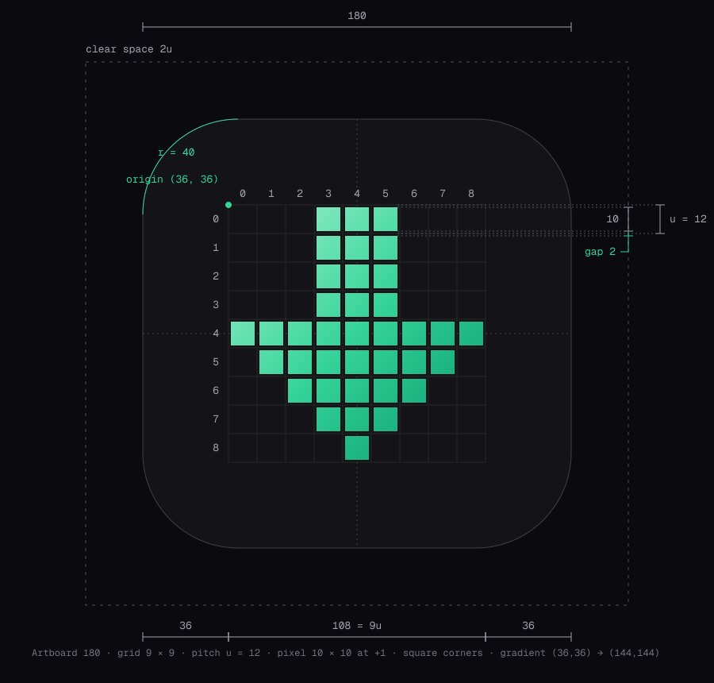

# Boltget brand guidelines

Boltget is a download manager built for speed. The brand is built the way the
product works: quietly, precisely, and fast. This document is the reference for
anyone who puts the Boltget name or mark on something — the app, the website
(boltget.app), the README, release notes, social media, slides.

Everything in this folder except this file is generated by
`scripts/build.mjs`, the two canonical icons included. To change an asset, change the script and
rebuild (see [Rebuilding](#rebuilding)). Open `preview.html` to see the whole kit
on one page.

---

## 1. Concept

**Each pixel is a chunk.** A download manager splits a file into pieces, fetches
them in parallel, and assembles them on disk. The Boltget mark is that idea drawn
literally: a down-arrow built from 37 square pixels on a 9 × 9 grid. Each pixel is
a chunk; together they make the arrow, the way chunks make the file.

**The arrow assembles like a download.** In motion, the rows light up top to
bottom, one after another, until the arrow is complete. Then it rests and starts
again. That "chunks arriving" sequence is the brand signature. Use it wherever
the mark moves.

**Simple, but it should make you look twice.** The brand holds back on purpose:
one shape, two colours, one typeface. Its impact comes from precision (an exact
grid, even gaps, pixels snapped to the screen at every size), not from effects.

*November 2026: the brand went monochrome. The app icon became **Onyx**, a
black tile with a white arrow, with a white twin (**Paper**) for dark
contexts; the palette became ink, paper, white and a graphite scale. There is
no green or blue anywhere: colour only says that a download is paused or has
failed. (It replaced the white-to-sky ramp on an ink tile, which had replaced
the emerald gradient.)*

## 2. The mark

### The app icon

The icon has **two modes**, the same drawing inverted:

| Mode | Look | Use on | Files |
|---|---|---|---|
| **Onyx** (primary) | Black tile lit from the top left, white arrow | Light contexts, and everywhere by default: the executable, installers, stores, the website, a light taskbar | `icon.svg`, `svg/icon-N.svg`, `png/icon-N.png`, `ico/app.ico`, `web/*`, `social/avatar*` |
| **Paper** (the twin) | White tile, black arrow | Dark contexts: a dark taskbar, dark browser tabs, the app's dark theme | `icon-on-dark.svg`, `svg/icon-on-dark-N.svg`, `png/icon-on-dark-N.png`, `ico/app-on-dark.ico` |

Use Onyx unless the icon sits on a dark surface you know about. Never put
Paper on a light background or Onyx on a black one without its edge.



| Property | Value |
|---|---|
| Artboard | 1024 × 1024 |
| Tile | smooth-corner squircle (corner radius 208, smoothing 0.6), inset 40, so 944 wide |
| Grid | 9 × 9 cells, pitch 58, centred (origin 255) |
| Pixel | 50 × 50 with a 6 corner, so an 8 gap between pixels |
| Rows | 0–3: cols 3–5 (shaft) · 4: cols 0–8 · 5: cols 1–7 · 6: cols 2–6 · 7: cols 3–5 · 8: col 4 |
| Onyx tile | 120° gradient `#2C2D31` → `#151618` → `#0A0A0B` (ink), a soft white light from above the top left (16%), a white top rim (32% fading out over 45% of the tile), a faint white bottom rim (8%) and a 1 px outer edge (black at 30%) |
| Onyx arrow | each pixel white, `#FFFFFF` → `#E4E5E8` from top to foot, a 2.5 px shaded foot (`#9A9DA3` at 35%) and a soft contact shadow (blur 6, 9 down, black 60%) |
| Paper tile | vertical gradient `#FFFFFF` → `#F3F4F5` (55%) → `#E1E3E6`, a white sheen at the top left, a shaded foot (black up to 10%) and a 1 px outer edge (black at 14%) |
| Paper arrow | each pixel `#26282B` → `#121315` (35%) → `#08090A`, a 2.5 px lit top edge (white 14%) and a soft contact shadow (blur 6, 8 down, `#3A3D44` 30%) |

The arrow covers 514 of the 944 tile (54%). At every size below 1024 the
build snaps the grid to whole device pixels: an integer pitch and gap,
centred, with the effects scaled along. No glow, no hue.

### The bare mark

Without a tile (lockups, the website, the app's empty state) the mark keeps
square pixels on a 180 artboard: grid origin (36, 36), pitch **u = 12**, pixel
10 × 10 at +1 in its cell (a 2 gap). It is a single colour: **ink `#0A0A0B`**
on light backgrounds, **white** on dark.

The geometry is defined once, in `scripts/build.mjs` (`ROWS`, `MASTER`, `GRID`).
### The grid unit, u

**u = 1/15 of the bare mark's artboard** (12 at 180 px). Measure clear space,
gaps and lockup spacing in u so they scale with the mark.

### Clear space

- **App icon tile:** keep at least **2u** (≈ 13% of the tile width) clear on every side.
- **Mark without tile, and lockups:** keep at least **3u** (one third of the arrow's height) clear on every side.

Nothing goes inside clear space: no text, no edges, no other logos.

### Small sizes

Below 180 px the gaps fall between device pixels and blur, so every size
Windows asks for has its own native design, in both modes. Small sizes use a
**resolution-reduced arrow**: the same arrow on a 5 × 5, 7 × 7 or 9 × 9 grid
(`GRIDS` in the build), with whole-pixel cells and **real 1 px gaps**, so the
chunks stay visible down to 16 px. The smaller the icon, the more of the tile
the arrow fills.

| Size | Arrow (grid · cell + gap) | Tile | Files |
|---|---|---|---|
| 16, 20 | 5 × 5 · 2 + 1 | Flat rounded tile (radius 3 or 4) with a 1 px edge: white at 14% on Onyx (it keeps the tile visible on a dark taskbar such as `#1C1C1E`), black at 22% on Paper. Onyx adds a 1 px lit top line | `svg/icon-{16,20}.svg` |
| 24 | 7 × 7 · 2 + 1 | The same | `svg/icon-24.svg` |
| 30, 32, 36, 40 | 9 × 9 · 2 + 1 | The same | `svg/icon-{30…40}.svg` |
| 48 | 9 × 9 · 3 + 1 | The squircle tile with its gradient and rim | `svg/icon-48.svg` |
| 60, 64, 72 | 9 × 9 · 4 + 1 | The same | `svg/icon-{60…72}.svg` |
| 80, 96 | 9 × 9 · 5 + 1 | The same; from 96 the cells have a 1 px corner | `svg/icon-80.svg`, `svg/icon-96.svg` |
| 128 | 9 × 9 · 7 + 1 | The same | `svg/icon-128.svg` |
| 180 and up | The master, snapped (`png/icon-256.png` and up, the web icons) | | `icon.svg` |

Each file has its Paper twin at `svg/icon-on-dark-N.svg`. Where a grid's width
comes out odd, its centre column is 1 px wider so the arrow centres.

Minimum sizes:

- **App icon:** 16 px, always with the small-size design.
- **Mark without tile:** 24 px on screen, or 6 mm in print. Below that, use the tile. The website header's lockup is drawn for its size (§3).
- **Horizontal lockup:** 20 px tall on screen. Below that, use the icon alone.

### The tray

The Windows tray shows the **bare arrow in one colour**, as the system's own
tray icons do: white on a dark taskbar, ink on a light one, following
Windows' colour mode (`SystemUsesLightTheme`) as it changes. The kit draws it
with the same resolution-reduced arrows on whole pixels, filling the square:
16 px 5 × 5 (2 + 1), 20 and 24 px 7 × 7 (2 + 1), 32 px 9 × 9 (2 + 1). Files:
`svg/tray-ink-N.svg` and `svg/tray-white-N.svg`, the PNGs, and
`ico/tray-ink.ico` / `ico/tray-white.ico` (16, 20, 24, 32). Its rows carry the
motion (§6). The taskbar button and the window keep the app icon, Onyx or
Paper by the same colour mode. The app embeds the tray PNGs
(`apps/desktop/src-tauri/src/mark.rs`) and the 16–128 px app icons in both
modes (`platform/windows.rs`).

### Variants

| Variant | File | Use on |
|---|---|---|
| App icon, Onyx (primary) | `icon.svg` | Everywhere by default |
| App icon, Paper | `icon-on-dark.svg` | Dark taskbars, dark tabs, dark UI |
| Mark, white | `svg/mark.svg`, `svg/mark-white.svg` | Dark backgrounds and photos, no tile |
| Mark, ink | `svg/mark-ink.svg` | Light backgrounds, no tile: the website, light UI |
| Mark, black | `svg/mark-black.svg` | One-colour print on light, fax-grade reproduction |
| Tile marks | `svg/tile-mark-light.svg`, `svg/tile-mark-dark.svg` | Flat illustrations of the icon (the website's installer window): Paper and Onyx without their lighting |

## 3. Wordmark and lockups

The wordmark is **Boltget** in **Geist SemiBold** at −0.025 em tracking, converted
to outlines. On top of Geist's own kerning it has three optical adjustments, in
font units: **B·o −6, l·t +12, t·G +8**. They open the tight `lt` junction and
balance the space before the second capital, so the two capitals read as one word
rather than two. Always use the supplied files. Never retype the wordmark.

- **Horizontal lockup:** the wordmark's cap height is 4u, 2.5u after the arrow. The caps are centred on the arrow's vertical centre.
- **Stacked lockup:** the wordmark's cap height is 3u, 2.5u below the arrow, centred on the arrow's axis.
- The wordmark is a single colour: white on dark, ink `#0A0A0B` on light, the same as the mark.

| File | Use |
|---|---|
| `svg/wordmark-on-dark.svg` / `-on-light.svg` | Where the mark is already present nearby |
| `svg/lockup-horizontal-on-dark.svg` / `-on-light.svg` | README, documents. The default lockup |
| `svg/lockup-header-on-light.svg` / `-on-dark.svg`, and `@2x` | The website header, footer and docs header: 28 px tall, the arrow on a 3 px pitch, gapless at 1x and with 1-device-pixel gaps in the `@2x` file (use both in `srcset`) |
| `svg/lockup-stacked-on-dark.svg` / `-on-light.svg` | Square-ish spaces: splash screens, posters, stickers |
| `png/lockup-*.png` | The same lockups as 240 px-tall PNGs for slides and documents |

The lockups use the mark without a tile: ink on light, white on dark.

## 4. Color

Black and white carry the brand; graphite carries structure. **Colour appears
only for state**: a download that is paused or has failed. There is no brand
hue, no green and no blue.

### Core palette

| Role | Token | Hex | Notes |
|---|---|---|---|
| Ink | `ink` | `#0A0A0B` | The mark, wordmark and text on light; the Onyx tile's deep end; the app's accent on light |
| Paper | `paper` | `#F5F5F3` | Warm off-white for the website and print |
| White | `white` | `#FFFFFF` | The mark and text on dark; the Paper tile; the app's accent on dark |

Tokens: `--ink`, `--paper`, `--white`, `--mark-ink`, `--gradient-tile` (Onyx)
and `--gradient-tile-paper` in `tokens/tokens.css`; `ink`, `paper`, `white`
and `mark` in `tokens/tokens.json`.

### Graphite scale

A cool, nearly neutral grey between paper and ink.

| Token | Hex | | Token | Hex |
|---|---|---|---|---|
| `graphite-50` | `#F7F7F8` | | `graphite-600` | `#5F6267` |
| `graphite-100` | `#EEEFF0` | | `graphite-700` | `#46484C` |
| `graphite-200` | `#DEDFE1` | | `graphite-800` | `#2E3033` |
| `graphite-300` | `#C4C6C9` | | `graphite-900` | `#1C1D1F` |
| `graphite-400` | `#A0A3A8` | | `graphite-950` | `#111213` |
| `graphite-500` | `#7D8086` | | | |

### State colours

The only colour in the system, used on small glyphs, progress fills and short
status text, never on buttons, links or the mark.

| Meaning | Dark theme | Light theme | Typical use |
|---|---|---|---|
| Paused | `#F5A524` | `#B45309` | Paused, waiting to resume, slow mirror, disk nearly full |
| Error | `#F87171` | `#DC2626` | Failed, server refused, file corrupted |

Done is the accent (ink or white), queued and other information graphite.

### Themes

Dark is the default theme. Light is fully supported. **The accent is ink on
light and white on dark**: the primary button is a solid ink pill on light
and a white one on dark, focus rings and selection use the same colour.

| Token | Dark | Light |
|---|---|---|
| `--bg` | `#0A0A0B` | `#FFFFFF` |
| `--surface` | `#111213` | `#F7F7F8` |
| `--raised` | `#1C1D1F` | `#EEEFF0` |
| `--border` | `#2E3033` | `#DEDFE1` |
| `--border-strong` | `#46484C` | `#C4C6C9` |
| `--text` | `#F7F7F8` | `#0A0A0B` |
| `--text-muted` | `#A0A3A8` | `#46484C` |
| `--text-subtle` | `#7D8086` | `#5F6267` |
| `--accent` | `#FFFFFF` | `#0A0A0B` |
| `--accent-hover` | `#DEDFE1` | `#2E3033` |
| `--on-accent` | `#0A0A0B` | `#FFFFFF` |
| `--accent-subtle` | white at 10% | ink at 8% |
| `--paused` | `#F5A524` | `#B45309` |
| `--error` | `#F87171` | `#DC2626` |

Ready-made tokens: `tokens/tokens.css` (CSS custom properties, with
`[data-theme="light"]`) and `tokens/tokens.json`. The desktop app derives its
own semantic colours from `tokens/tokens.json` in
`packages/ui/scripts/generate.mjs`.

### Gradients

**The Onyx tile** runs at 120°, lit from the top left. It belongs to the icon:
do not use it on buttons or backgrounds.

**Progress** rises from graphite to the accent at the head of the bar:

| | 0% | 50% | 100% |
|---|---|---|---|
| On dark | `#7D8086` graphite-500 | `#C4C6C9` graphite-300 | `#FFFFFF` white |
| On light | `#7D8086` graphite-500 | `#46484C` graphite-700 | `#0A0A0B` ink |

In CSS: `--gradient-progress` and `--gradient-progress-light`. A paused bar is
the paused colour, a failed one the error colour. A file map drawn as a field
of square pixels (the website's "block map", the app's details pane) colours
its squares along the graphite ramp, with the square being written in the
accent.

### Atmosphere (website)

*November 2026: the "pearl sky".* The website's mood is a grey cloud sky
washed toward paper (`apps/web/src/assets/sky.webp`, from
`source/sky-master.webp`). Its `--atmosphere-*` tokens, top to bottom:

| Stop | Hex |
|---|---|
| Haze | `#C4C6C9` (graphite-300) |
| Pearl | `#DEDFE1` (graphite-200) |
| Mist | `#EEEFF0` (graphite-100) |
| Paper | `#F5F5F3` |
| White | `#FFFFFF` |

Rules:

- Text on the sky is ink. The primary call to action is a solid ink pill.
- The mark keeps its own colours (ink on light, white on dark); it is never
  tinted to the sky.
- No hue is added to the sky, its clouds or its chunks.

### Pixels on the web

How squares (the mark's pixels, the hero's chunks, file maps and progress
bars) are rendered on the website, so they read as material rather than flat
swatches:

- **One continuous ramp across the whole field.** File maps run along the
  graphite scale toward the accent; the mark stays one colour.
- **Inner light and depth.** A filled square may carry a faint white light on
  its top ~40% (at most 25% opacity) and a hairline of ink at its bottom edge
  (at most 18%). A large mark may sit on a very soft drop shadow in ink (at
  most 16% opacity, blur ≥ 24 px). No outer glow on the mark.
- **Arrival.** A square eases in (≈ 0.45 s, ease-out) and carries a brief
  light that fades in about half a second. The square being written may have
  a soft 2 px halo in the accent at ≈ 22%.
- **Organic dissolve.** Where squares thin out into the page, their opacity
  varies per square and eases around the threshold, so the edge is uneven,
  not a stair-step. Empty squares on paper vary slightly in tone.
- **One light sweep** may pass over a large mark after its row-by-row
  signature, once.
- Squares stay square with even gaps; pixel-related shapes are never rounded.
  Under `prefers-reduced-motion` everything shows its settled state.

## 5. Typography

| Role | Typeface | Notes |
|---|---|---|
| Headlines, titles and large figures | **Red Hat Display** (SIL OFL 1.1, by Red Hat) | Weight 600, −0.02 em tracking on the web (the app's 15 and 20 px titles use −0.005 and −0.015 em). Variable, 300–900 |
| Body, UI and everything else | **Red Hat Text** (SIL OFL 1.1, by Red Hat) | Reads thin at 400 on screen, so body text sits at **450**, emphasis at 550, titles at 600. Avoid 700+ in UI. Variable, 300–700 |
| Code, URLs, hashes, headers and logs | **Geist Mono** (SIL OFL 1.1, by Vercel) | In the desktop app's dense lists, numbers use Red Hat Text with tabular figures (`tnum`), and Mono is kept for URLs, hashes, headers and logs ([APP-DESIGN.md](../docs/APP-DESIGN.md)) |
| The wordmark | **Geist SemiBold**, outlined | Only inside the logo artwork (The wordmark, above); never set as live text |
| Website ledes and the italic accent line | **Source Serif 4** (SIL OFL 1.1, by Adobe) | The website only, 400 and 400 italic, never in the app or for UI ([docs/WEBSITE.md](../docs/WEBSITE.md#character)) |

The families, weights and tracking are tokens (`font` in `tokens/tokens.json`,
`--font-display`, `--font-sans`, `--font-mono` and friends in `tokens.css`). The
files are in `fonts/`, shared by the app and the website: Red Hat Display and
Red Hat Text as variable Latin subsets (the Google Fonts subsets of
[RedHatOfficial/RedHatFont](https://github.com/RedHatOfficial/RedHatFont),
`RedHat-OFL.txt`) and Geist Mono 400 and 500 (`Geist-OFL.txt`). *Until
November 2026 the brand set everything in Geist; it read as generic.*

Suggested scale for the web and print. Headlines get tighter tracking as they grow. The desktop app uses its own compact scale (13 / 12 / 15 px), defined in [APP-DESIGN.md](../docs/APP-DESIGN.md#visual-system):

| Style | Size / line height | Weight | Tracking |
|---|---|---|---|
| Display | 56 / 60 | 600 | −0.035 em |
| H1 | 40 / 44 | 600 | −0.03 em |
| H2 | 28 / 34 | 600 | −0.02 em |
| H3 | 20 / 28 | 500 | −0.01 em |
| Body | 15 / 24 | 400 | 0 |
| Small | 13 / 20 | 400 | 0 |
| Label (mono, uppercase) | 12–15 / 16 | 400 | +0.12–0.14 em, in graphite-400 on dark, graphite-600 on light |
| Data (mono) | 13 / 20 | 400 | 0 |

Use the mono uppercase label sparingly: one per view, above a headline, as on the
social images.

## 6. Motion

The animated mark (`icon-animated.svg`, and `svg/mark-animated.svg` without the
tile) is the brand signature.

| Parameter | Value |
|---|---|
| Loop | 2.6 s, infinite |
| Stagger | 0.12 s per row, top (row 0) to bottom (row 8). The last row starts at 0.96 s |
| Per-row opacity keyframes | 0.15 → 1 → 1 → 0.15 at 0%, 12%, 85%, 100% of the loop |
| Rise | 0.31 s, linear |
| Hold | ≈ 1.9 s fully lit |
| Fade | 0.39 s, linear, back to 0.15 |
| Resting opacity | 0.15. Rows never disappear completely; the arrow's silhouette is always readable |

Rules:

- **Linear easing.** Chunks arrive at a constant rate. Do not bounce, overshoot or scale.
- Only opacity animates. Never animate position, size, colour or glow.
- **Reduced motion:** when `prefers-reduced-motion: reduce` is set, show the static icon. `svg/mark-animated.svg` does this itself (CSS animation with a media query). `icon-animated.svg` uses SMIL, which ignores the setting, so swap it for `icon.svg` in that case.
- Good places for it: splash and loading states, the website hero, "download started" moments. Don't loop it next to content people are reading.
- In product UI, the same rhythm (0.12 s stagger, linear) can drive chunk and progress indicators.

## 7. Do's and don'ts

**Do**

- Keep the gaps even and the grid exact; snap pixels to the screen.
- Give the mark room.
- Use the native small-size icons at 128 px and below.
- Use ink on light and white on dark. Use the Paper icon on dark surfaces.

**Don't**

- **Don't round the bare mark's pixels.** Only the app icon's own pixels carry their slight corner (6 of 50) at large sizes.
- **Don't add a brand hue.** No green, no blue, no yellow, for the mark, accents or buttons. Colour is for paused and failed only.
- **Don't replace the arrow with a letter "B" monogram.** (Rejected direction.)
- Don't add glow, neon, outlines or other effects to the mark. The app icon's depth (rims, per-pixel light, contact shadow) is part of the icon and stays as drawn. (App UI that floats, such as menus and dialogs, uses the elevation tokens in [APP-DESIGN.md](../docs/APP-DESIGN.md#visual-system).)
- Don't rotate the arrow. It always points down.
- Don't put grey or a gradient in the bare mark, and don't put the Paper icon on a light background.
- Don't rearrange, add or remove pixels. Only the official small-size files use the reduced 5 × 5 and 7 × 7 grids.
- Don't stretch, skew or crop the mark.
- Don't retype "Boltget", change its weight, or colour its letters differently. Write it with one capital: Boltget, never BoltGet (the camel-case spelling was retired on 2026-11-01).
- Don't put the mark on a busy photo without the white one-colour version.

## 8. Voice and tone

Boltget speaks like a good command-line tool's documentation: short, exact and
calm. It's confident because it's specific, not because it's loud.

- **Lead with capability.** Open with what Boltget does and what it aims for:
  speed, reliability, craft. Concrete capabilities over adjectives.
- **Plain over clever.** Say what it does.
- **Specific over superlative.** "16 connections per file" beats "blazing fast".
  No hype words ("blazing", "revolutionary", "ultimate") and no emoji.
- **"Free" and "open source" at most once per surface**, low on the page (the
  license section, the footer, the pricing line). Never in a headline, tagline,
  badge row or social image.
- **No comparisons or jabs on front surfaces.** The README, the website hero,
  social images and store listings talk about Boltget, not other products.
  Comparisons belong in [docs/FEATURES.md](../docs/FEATURES.md).
- **Respect the user.** No dark patterns, no urgency, no exclamation marks in UI.
- **Credit and link.** Credit contributors, link the source, say what we don't
  do (no ads, no tracking) where it is relevant.

Tagline: **Every byte, at full speed.**
Descriptor: **A download manager built for speed.** Long form (GitHub About,
store listings): "A download manager built for speed. Dynamic segmentation,
crash-proof resume and seamless browser capture." Subline on social images:
**The fast, resumable download manager.** Social copy does not name one
platform: Boltget ships for Windows first, then macOS and Linux.
Social label (mono, uppercase): **DOWNLOAD MANAGER**

| Context | Write | Avoid |
|---|---|---|
| Hero | Every byte, at full speed. | The ultimate blazing-fast download experience! |
| Feature | Splits each file into up to 16 parts and fetches them in parallel. | Turbocharged multi-threaded acceleration technology. |
| Reliability | Kill it mid-download. It resumes where it stopped. | Never lose a download again, guaranteed! |
| Pricing / license | GPL-3.0-or-later. No ads, no account, no telemetry. | 100% FREE forever!!! |
| Positioning | Starts with 4 connections and adds more only while they help. | Faster than the one you paid for. |
| Download done | Done. 4.2 GB in 43 s. | Woohoo! Your download is complete! |
| Error | The server closed the connection. Boltget will retry in 10 s. | Oops! Something went wrong :( |
| Empty state | Paste a link or drop one here. | Nothing to see here… yet! |

## 9. Social and web

| Asset | Size | Notes |
|---|---|---|
| `social/og-image.png` | 1200 × 630 | Open Graph / link previews |
| `social/github-social.png` | 1280 × 640 | GitHub → Settings → Social preview |
| `social/x-header.png` | 1500 × 500 | X / Twitter header. Text stays in the centre band and clear of the avatar in the lower left |
| `social/avatar-400.png`, `avatar-512.png` | 400², 512² | Org and social avatars: Onyx, full bleed, so it survives circle and rounded crops |

The Open Graph and GitHub cards are built from the source art
`source/og-art.png` (see *Source art*): the headline "Every byte," and "at full
speed.", the subline "The fast, resumable download manager.", a large Onyx
icon in the clouds and the icon and wordmark top left. The build covers the
art's small icon with the real one (the small-size Onyx design, 9 × 9 arrow,
drawn at its exact size on a soft patch of the art's own ground), because
generated art cannot hold the grid at 50 px. The GitHub card is the same art
scaled to cover 1280 × 640.

The X header is built from the pearl sky (`apps/web/src/assets/sky.webp`): the
headline on one line in Geist and Source Serif 4 italic and the serif
subline, all in ink. Every text is outlined; the build is deterministic.

### Source art

`source/` holds inputs the build reads but does not generate:

| File | What it is |
|---|---|
| `source/og-art.png` | The Open Graph card, 1200 × 630, AI-generated (Codex, gpt-6-astra) and approved by the maintainers |
| `source/sky-master.webp` | The master of the pearl sky photograph, 2880 × 1600, AI-generated the same way; `apps/web/src/assets/sky.webp` is made from it |

Treat them as source inputs: replace them deliberately (and rebuild), never
edit them by hand to fix a detail the build should draw. Anything the brand
defines exactly (the icon, the mark) is drawn by the build on top.

Web snippet:

```html
<link rel="icon" href="/favicon.ico" sizes="48x48">
<link rel="icon" href="/favicon.svg" type="image/svg+xml">
<link rel="apple-touch-icon" href="/apple-touch-icon.png">
<link rel="manifest" href="/site.webmanifest">
<meta property="og:image" content="https://boltget.app/og-image.png">
```

`favicon.svg` is the bare mark in one colour: ink (`#0A0A0B`) on light browser
chrome, white on dark (`prefers-color-scheme`). At 32 device pixels it is the
9 × 9 arrow (2 + 1 px cells); at tab size (16 to 24 px) it switches to the
5 × 5 arrow. `favicon.ico` (16/32/48) is the Onyx tile for places that ignore
SVG. `apple-touch-icon.png` (180) and the avatars are full bleed;
`icon-maskable-512.png` is full bleed with the arrow inside the central 80%
(the build checks it).

## 10. File index

| Path | What it is | Use for |
|---|---|---|
| `icon.svg` | **Canonical** app icon, Onyx, the 1024 master | Sizes ≥ 180 px |
| `icon-on-dark.svg` | The Paper twin, the 1024 master | Dark contexts, sizes ≥ 180 px |
| `icon-animated.svg` | Onyx with the row-by-row motion (SMIL) | Splash, hero, loading |
| `svg/icon-{16…128}.svg` | Native small sizes, Onyx (§2) | Exactly their size |
| `svg/icon-on-dark-{16…128}.svg` | Native small sizes, Paper | Exactly their size, on dark |
| `svg/icon-square.svg`, `svg/icon-maskable.svg` | Onyx, full bleed | Apple touch icon, avatars, maskable icons |
| `svg/tray-ink-{16,20,24,32}.svg`, `svg/tray-white-…` | Bare tray glyphs | The tray on a light / dark taskbar |
| `svg/mark.svg`, `svg/mark-white.svg` | Arrow only, white | Dark backgrounds |
| `svg/mark-ink.svg` | Arrow only, ink | Light backgrounds |
| `svg/mark-black.svg` | Arrow only, pure black | Print, single-ink use |
| `svg/mark-animated.svg` | Arrow only, ink or white by `prefers-color-scheme`, CSS animation, honours reduced motion | Web loaders |
| `svg/tile-mark-light.svg` / `-dark.svg` | Flat tile marks | Illustrations |
| `svg/wordmark-on-dark.svg` / `-on-light.svg` | Outlined wordmark | Next to an existing mark |
| `svg/lockup-horizontal-on-dark.svg` / `-on-light.svg` | Mark + wordmark, side by side | README, documents |
| `svg/lockup-header-on-*.svg` (+ `@2x`) | Pixel-snapped 28 px lockup | Website header, footer, docs |
| `svg/lockup-stacked-on-dark.svg` / `-on-light.svg` | Mark above wordmark | Splash, posters |
| `svg/construction.svg` | Construction drawing | This document, contributors |
| `png/icon-{16…1024}.png` | Onyx PNGs, each size native | Installers, stores, Linux `hicolor` |
| `png/icon-on-dark-{16…1024}.png` | Paper PNGs, each size native | Dark contexts |
| `png/tray-ink-N.png`, `png/tray-white-N.png` | Tray glyph PNGs | The tray |
| `png/lockup-*.png` | Lockups, 240 px tall | Slides, docs |
| `ico/app.ico` | Windows icon, Onyx: 16, 20, 24, 30, 32, 36, 40, 48, 60, 64, 72, 80, 96 (BMP) and 256 (PNG) | Windows executable and installer |
| `ico/app-on-dark.ico` | The same set, Paper | A dark taskbar |
| `ico/tray-ink.ico`, `ico/tray-white.ico` | Tray glyphs, 16/20/24/32 | The tray on a light / dark taskbar |
| `web/favicon.ico` | Onyx, 16/32/48 | Legacy favicon |
| `web/favicon.svg` | Scheme-aware bare mark | Modern browsers |
| `web/apple-touch-icon.png` | 180 × 180, full bleed | iOS home screen |
| `web/icon-192.png`, `web/icon-512.png` | Rounded tile, transparent corners | PWA `any` icons |
| `web/icon-maskable-512.png` | Full bleed | PWA `maskable` icon |
| `web/site.webmanifest` | Sample manifest | Website |
| `social/og-image.png` | 1200 × 630 | Link previews |
| `social/github-social.png` | 1280 × 640 | GitHub social preview |
| `social/x-header.png` | 1500 × 500 | X / Twitter header |
| `social/avatar-400.png`, `avatar-512.png`, `avatar.svg` | Avatars | GitHub org, social profiles |
| `tokens/tokens.css`, `tokens/tokens.json` | Colour, gradient, font and motion tokens | App and website |
| `fonts/*.woff2`, `fonts/*-OFL.txt` | Red Hat Display, Red Hat Text and Geist Mono (OFL) | App, website, `preview.html` |
| `source/og-art.png`, `source/sky-master.webp` | Source art (not generated) | Input to the build |
| `source/fonts/` | Red Hat woff2 and the upright Source Serif 4 (not generated; OFL beside them) | Input to the build: copied to `fonts/`, the serif outlined in the X header |
| `preview.html` | Every asset on one page | Review |
| `scripts/build.mjs` | Generator for everything above except `source/` | Rebuilding |

## Rebuilding

```sh
cd brand
pnpm install
pnpm build        # node scripts/build.mjs
```

The build wipes and regenerates `icon.svg`, `icon-on-dark.svg`,
`icon-animated.svg`, `svg/`, `png/`, `ico/`, `web/`, `social/`, `tokens/`,
`fonts/` and `preview.html`; it never writes to `source/`. It fails if the
maskable arrow would leave its safe zone. `@resvg/resvg-js` renders the
images, `opentype.js` outlines Geist (the wordmark), `fontkitten` outlines
Source Serif 4 (`source/fonts/` and the website's italic), `sharp` reads the source art and the sky and
compresses the social PNGs, and the ICO encoder is built in. After changing
colours or fonts, run `pnpm --filter @boltget/ui generate` so the app's tokens follow;
after changing the web icons, `pnpm --filter @boltget/web brand` copies them
into the site. The generated files are committed, so nobody needs to run the
build just to use the assets.
