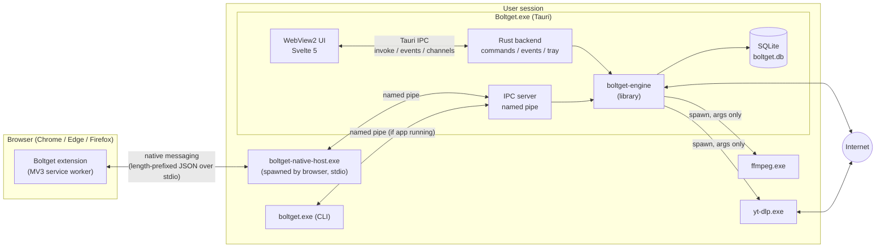
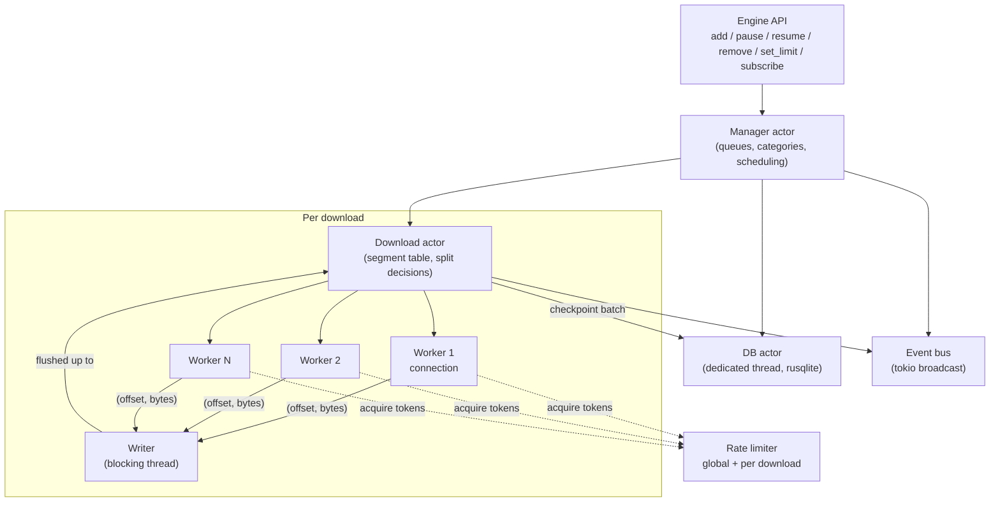
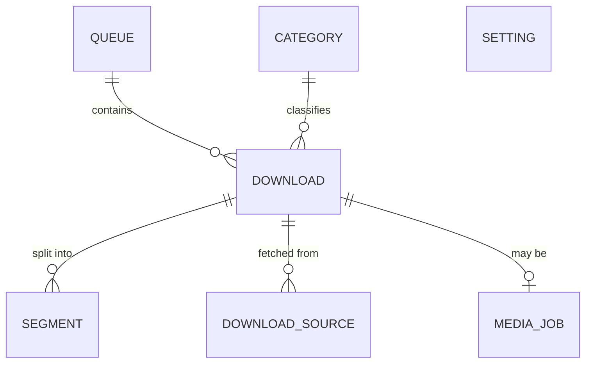
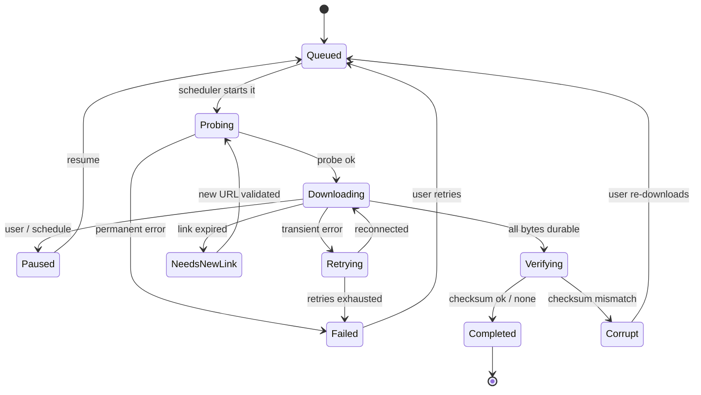

# Architecture

This document describes how Boltget is put together: the components, which process runs what, how they talk, what is stored where, how concurrency works, how errors flow, and the security model. The download engine itself is specified in [ENGINE.md](ENGINE.md); this document treats it as a component.

Status: design. Names of crates, types and tables are the intended names; they may be refined during implementation, but changes to the structure should go through an RFC (see [CONTRIBUTING.md](../CONTRIBUTING.md#rfcs)).

## Components

| Component | Path | Language | Ships as | Responsibility |
|---|---|---|---|---|
| Engine | `crates/engine` | Rust | library crate `boltget-engine` | Probing, segmentation, connections, disk I/O, rate limiting, persistence, integrity, events |
| IPC | `crates/ipc` | Rust | library crate `boltget-ipc` | The named pipe between the engine's owner and its clients: framing, messages, server, client, the pipe's security |
| CLI | `crates/cli` | Rust | `boltget.exe` | Command-line front end; embeds the engine or talks to the running app |
| Desktop backend | `apps/desktop/src-tauri` | Rust | inside `Boltget.exe` | Hosts the engine, exposes Tauri commands/events, tray, single-instance, updater, IPC server |
| Desktop UI | `apps/desktop/src` | Svelte 5 + TS | bundled web assets | Everything the user sees in the window |
| Native messaging host | `crates/native-host` | Rust | `boltget-native-host.exe` | Bridge spawned by the browser: stdio native messaging to the app's IPC pipe; registers itself with the browsers |
| Browser extension | `apps/extension` | TS (WXT) | `.zip`/`.xpi` per store | Captures downloads, detects media, forwards cookies/headers |
| Shared UI | `packages/ui` | Svelte 5 + TS | workspace package | Components and design tokens shared by app and website |
| Website and docs | `apps/web` | Astro + Svelte, Starlight | static site | boltget.app; see [WEBSITE.md](WEBSITE.md) |
| Sidecars | downloaded at runtime | n/a | `yt-dlp.exe`, `ffmpeg.exe` | Media extraction and muxing; see [VIDEO.md](VIDEO.md) |

The engine is a **library, not a daemon**. There is exactly one engine instance per user session that owns the database, and it lives inside whichever process started first (normally the desktop app). See [Single owner rule](#single-owner-rule).

## Process model



### The desktop app (`Boltget.exe`)

- Single instance per user session (`tauri-plugin-single-instance`). A second launch forwards its arguments (for example a URL passed by a shell association) to the running instance and exits.
- Can start hidden in the tray (`--background`), which is how the native host and autostart launch it.
- Hosts the engine on a Tokio multi-threaded runtime (the same runtime Tauri uses).
- Owns the IPC server: a Windows named pipe, `\\.\pipe\boltget-<user SID>`, used by the native host and the CLI. On macOS/Linux (post-1.0) the equivalent is a Unix domain socket in the user's runtime directory with `0600` permissions.

> **Implemented (v0.2).** A second `Boltget.exe` hands its command line to the first and exits: links (`http`/`https` arguments) open the add sheet prefilled, anything else just brings the window forward; the first instance's own links wait until its engine is ready. `--background` starts with the window hidden (the tray only). The pipe is named per data directory as well as per user, `\\.\pipe\boltget-<user SID>-<key>`, where `<key>` is 16 hex digits of FNV-1a over the canonical, case-folded data directory path: a CLI given `--state <dir>` (or an app started with `BOLTGET_DATA_DIR`) reaches exactly the process that owns that database, and never another. On Unix the socket is `boltget-<key>.sock` in `$XDG_RUNTIME_DIR`, or in the data directory when that is unset. The app serves the pipe from the moment it starts, before its engine is open (see [CLI to app](#3-cli-to-app-named-pipe)). Closing the window hides it to the tray; the app quits from the tray's menu, or when the session ends.

### The native messaging host (`boltget-native-host.exe`)

Browsers start native messaging hosts as a **new process per connection** (`runtime.connectNative`) or per message (`runtime.sendNativeMessage`) and talk to them over stdin/stdout. So the host must be small and stateless:

1. Read a native message from stdin (4-byte length prefix in native byte order, then UTF-8 JSON).
2. Validate it against the schema (see [Security](#security)).
3. Connect to the app's named pipe. If the pipe does not exist, launch `Boltget.exe --background` and retry with backoff for a few seconds.
4. Forward the message, relay the reply to stdout, and repeat until stdin closes.

It never touches the database or the network itself. Keeping it a separate tiny binary (rather than making `Boltget.exe` the host) means the browser does not start a full WebView process every time the extension sends a message. Details of registration: [BROWSER-INTEGRATION.md](BROWSER-INTEGRATION.md#native-messaging-host-registration-on-windows).

> **Implemented (v0.3 step 1).** The host is its own crate, `crates/native-host` (package and binary `boltget-native-host`), not a second `[[bin]]` of the desktop crate as first planned: it then links neither Tauri nor WebView2, builds and tests on Linux CI like the CLI, and the desktop app uses its registration code as a library for Settings. It reads with blocking stdio and runs the pipe client on a single-threaded Tokio runtime. If the pipe does not answer it starts `Boltget.exe --background` and retries with backoff (50 ms doubling to 400 ms) for up to 8 s, only for messages that bring a download (`hello` and `status` never start the app). Every failure becomes a reply that lets the browser keep the download; it exits when stdin closes (code 0) or the stream breaks (code 1). It has no `unsafe` code. The same binary takes `--register`, `--unregister` and `--status` for the installer and for support.

### The CLI (`boltget.exe`)

Two modes, chosen automatically:

- **Client mode** (app is running): the CLI connects to the named pipe and asks the running engine to add, list, pause or resume downloads. Progress is streamed back over the pipe. This avoids two engines writing the same database.
- **Standalone mode** (app is not running, or `--standalone`): the CLI embeds the engine directly, takes the [single owner lock](#single-owner-rule), and runs to completion. This is what `boltget bench` and server/CI usage rely on. Standalone mode can use a separate database (`--state <path>`) or none at all (`--no-state`, keeps resume data in a sidecar file next to the download).

> **Implemented (v0.2): client mode.** Every command that uses the database (`get` without `--no-state`, `list`, `pause`, `resume`, `refresh`, `remove`, `config`) first asks for the app on the data directory's pipe, and runs there if the app owns the database. `get` adds the download to the app and follows it on the terminal (the same progress display and `--json` lines; `--detach` returns once it is added); the first Ctrl-C pauses it in the app, a second stops following. `pause` reaches a download running anywhere in the app, and any number of terminals work at once. Options that change the engine itself (`--ca-cert`, `--max-connections`, and the hidden test knobs) are refused in client mode (exit 2), and the app's proxy settings apply rather than the shell's proxy variables (`--proxy` still works). `--standalone` skips the app. Exit code 10: an app runs but cannot be reached, speaks another protocol version, or the connection was lost (the download goes on in the app). `boltget list` without an app no longer opens the database as its owner: it reads it, and shows a download that a dead process left running as paused, so it does not take over the app's recovery (see [Recovery on start](#recovery-on-start)).
>
> **Implementation note (v0.1):** only standalone mode exists; client mode arrives with the desktop app's IPC server (v0.2). `--state <dir>` (also `BOLTGET_DATA_DIR`) is a directory holding `boltget.db`, not a database path. `get --no-state` records nothing and keeps no sidecar yet, so such a download cannot be resumed. While one `boltget` owns the database, a second invocation that needs it exits with code 7 and says why (`pause` explains that Ctrl-C in the owning terminal pauses it); `boltget list` instead opens the database read-only, without the lock, and shows the owner's last checkpoint (WAL lets a reader in another process see committed data safely).

### Sidecars

`yt-dlp.exe` and `ffmpeg.exe` are child processes started by the engine with an explicit argument vector (never through a shell), with stdout parsed for progress. They are installed on demand and verified before first use. See [VIDEO.md](VIDEO.md) and [Security](#security).

### Single owner rule

Exactly one process at a time may own the engine state for a given database:

- Ownership is a lock file (`boltget.db.lock`, held with an exclusive OS file lock for the lifetime of the owner) next to the database.
  - *Implemented (v0.1)* with `std::fs::File::try_lock` (`LockFileEx` on Windows, `flock` on Unix), taken before the database is opened and released only after it is closed. The OS drops the lock when the owner dies, so a crash never leaves a stale lock. A second owner gets `Error::DatabaseLocked`.
- The desktop app takes it on start. If it cannot (a standalone CLI is running), the app shows a "Boltget CLI is running a download" state and becomes a client until the lock is released.
  - *Implemented (v0.2, engine bridge):* the app opens the engine in the background, so the window never waits for it. While a CLI owns the database the engine status is `locked` (with the directory) and engine commands fail with `error.engine_unavailable`; the app tries again every 2 s and becomes ready on its own when the lock is released. It is not a client of that CLI (a standalone CLI serves no pipe); meanwhile its own pipe tells clients it owns nothing (`error.not_owner`), so they open the database themselves and find it locked, or read it.
- Clients talk to the owner over IPC. This is simpler and safer than having multiple processes coordinate on SQLite rows.

## Engine internals at a glance



The full algorithm for workers, splits and checkpoints is in [ENGINE.md](ENGINE.md).

> **Implemented (v0.2): queues.** The manager's queues and scheduling live in the engine (`crates/engine/src/queue.rs`, run from `engine.rs`), so every front end sees the same queues: one scheduler task per engine, turned on with `Engine::start_queues` by a long-running owner (the desktop app), never by a standalone CLI run. It is woken by changes (a download's task ending, an add, a move, a queue change) and by the next timed event. Categories stay an app setting for now (see [App settings](#app-settings)). The rules: [ENGINE.md, Queues](ENGINE.md#queues).

## IPC and events

There are three IPC boundaries. All of them carry the same logical message types, defined once in Rust (types with `serde`), and exported to TypeScript so the UI and extension never hand-write message shapes.

> **Decided in v0.2:** `tauri-specta` generates the UI's bindings, calls included ([TECH-STACK.md, ADR-017](TECH-STACK.md#adr-017-tauri-specta-for-generated-ipc-bindings)). The types are the app's own (`apps/desktop/src-tauri/src/bridge/dto.rs`), mapped from the engine's, not the engine's types themselves: the engine stays free of the generator, and the UI does not depend on engine internals. The named-pipe protocol does **not** reuse them, as first planned: it has its own types in `boltget-ipc` (`proto.rs`), versioned on their own, because the UI's types change with the window's needs while the pipe is a contract with other programs (the CLI, later the native host), and its JSON matches the CLI's `--json` output rather than the page's camelCase.

### 1. UI to backend (Tauri)

- **Commands** (`invoke`) for request/response: `add_download`, `pause`, `resume`, `remove`, `set_speed_limit`, `get_settings`, `update_settings`, `list_downloads`, `probe_url`, and so on. Commands return `Result<T, UiError>` where `UiError` carries a message-catalog key and parameters, not a hard-coded string.
- **Events** (`emit`) for low-frequency state changes: download added, state changed, completed, failed, settings changed, update available.
- **Channels** (`tauri::ipc::Channel`) for high-frequency progress. The backend coalesces progress for all visible downloads into one message per tick. Design target: a tick of 250 ms (4 Hz) for the list, up to 100 ms for the download currently in the details pane. The UI never receives one event per network read.

Progress message (sketch):

```json
{
  "t": 1729791234567,
  "items": [
    { "id": "01J...", "done": 734003200, "total": 4294967296, "bps": 48234112,
      "conns": 12, "segments": [[0, 268435456, 268435456], [268435456, 536870912, 401604608]] }
  ]
}
```

Segment arrays are sent only for the download whose details are open, and only when they changed.

> **Implemented (v0.2, engine bridge).** The contract as built; the generated `apps/desktop/src/lib/bindings.ts` is the reference.
>
> - **Queues (step 7).** `add_download` also takes `queue` and `startAt` (Unix ms) and lets the download wait in its queue (the engine's `enqueue`) rather than start at once; `resume_download` still starts one now. New commands: `requeue_download(id)`, `set_start_at(id, at | null)`, `create_queue(name)`, `update_queue(id, { name?, maxConcurrent?, times?: { start, stop }, onFinish? })` (a refusal is an `error.queue.*` key), `delete_queue(id)`, `start_queue(id)`, `stop_queue(id)`, `move_downloads(ids, queue, before | null)`, `shift_download(id, up | down | top | bottom)` and `cancel_finish_action()`. Rows carry `queue`, `queuePosition` and `startAt`; the snapshot carries `queues` and `countdown`, and two messages follow changes: `queues` (all of them, when any changed; the rows whose place changed come in the next batch, since the backend reads the queues again at the next tick after the engine's `QueuesChanged`) and `countdown` (a finished queue's sleep or shut down: `{ queue, action, deadline }`, or `null` once it acted or was cancelled).
> - **Commands** return `{ status: "ok", data } | { status: "error", error: UiError }`, where `UiError` is `{ key, message }`: a catalog key plus an English diagnostic that is never shown. Engine: `engine_status`, `subscribe_engine(onMessage: Channel<EngineMessage>)`, `list_downloads`, `probe_url(url)` (name, size, type, resumable, `webPage`, redirects, the server's checksum), `add_download({ url, directory?, fileName?, connections?, speedLimit?, checksum?, paused? })` (returns the new row at once; the folder defaults to the user's Downloads folder; a typed name may not contain a folder; the folder becomes the first of the three recent folders), `add_defaults` (the Downloads folder and the recent folders), `check_destination(directory, fileName)` (the name it would be saved under after the collision rule, whether the folder exists, the free space), `choose_folder(start)` (the system folder picker, run from Rust with `tauri-plugin-dialog`; the capability grants the page none of the plugin's commands), `pause_download(id)`, `resume_download(id, restart)`, `remove_download(id, deleteFile)`, `refresh_link(id, url)`, `set_speed_limit(scope: { kind: "global" } | { kind: "download", id }, bytesPerSecond)`, `get_settings`, `update_settings(patch)` (every setting; see [App settings](#app-settings)), `system_proxy` (what Windows' proxy settings say, for Settings), `open_downloads_folder`, `quit_app`, `download_segments(id)`, `download_details(id)` (the checksum and its verification, the links used and the partial file, for the details pane), `open_download(id)` and `show_download_in_folder(id)` (the page names a download, never a path, so it can open or reveal nothing else; Rust resolves the path from the database and uses `tauri-plugin-opener`'s Rust API without registering the plugin's page commands), `set_focused_download(id | null)`, `set_ui_visible(visible)` (the page also reports it right after subscribing, since a reloaded page starts visible without an event). The window commands (`app_info`, `show_main_window`, `set_window_chrome`, `set_caption_layout`) and the `caption-maximize`, `shell-request` and `clipboard-offer` events are generated the same way.
> - **One channel instead of events plus a channel.** A page subscribes once with a `Channel<EngineMessage>`; everything about the engine arrives on it, in order. The first message is a `snapshot` (status, every row, settings), taken inside the task that produces the stream, so nothing between the snapshot and the first update can be lost. That ordering is why low-frequency changes do not travel as separate Tauri events. Then: `status` (`starting`, `ready`, `locked { dir }`, `failed { error }`), `settings`, and `batch`.
> - **Coalescing.** One backend task owns a copy of the list. Engine events (added, probed, state changed, resumed, segments changed, completed) and command results only mark rows dirty. Every **250 ms** it samples progress of running downloads only (one short lock each) and sends **at most one `batch` per tick** to each page: `rows` (each changed row once, whole), `removed` ids, `progress` (`{ id, downloaded, total, bps, connections, segments }`, only for downloads whose numbers moved, and not for rows already in the batch) and `events` (`added`, `stateChanged { state, error }`, `completed { path }`, `removed`) for toasts and motion. `bps` is a 3 s moving average computed in the backend. A quiet tick sends nothing; 500 rows with 20 running cost 20 samples and one message per tick.
> - **The file map** (`segments`: `{ start, end | null, received, connection | null }`) travels only for the focused download (`set_focused_download`, the details pane), and only when it changed or after a split. Other downloads' maps are available on demand with `download_segments`. One tick rate serves both: the map draws at 30 fps or less anyway.
> - **Hidden window.** The page reports `visibilitychange` with `set_ui_visible`. While hidden it receives no batches (the backend keeps its copy and the speeds current); when shown again it receives one snapshot (APP-DESIGN #30).
> - **Missed engine events** (a lagging broadcast receiver) make the backend read the list again and send a snapshot.
> - Paths are strings; byte counts are JSON numbers (exact up to 2^53).

### 2. Extension to app (native messaging, through the host)

Request/response JSON with a `v` (protocol version) and `type`:

| `type` | Direction | Purpose |
|---|---|---|
| `hello` | ext → app | Version handshake; app replies with its version and capabilities |
| `capture` | ext → app | A download the extension intercepted: URL, final URL, filename hint, size hint, MIME, referrer, cookies, selected headers, tab URL |
| `add_links` | ext → app | User picked "Download all links" or a selection |
| `media_page` | ext → app | "Download media from this page": page URL plus detected media hints (see [VIDEO.md](VIDEO.md)) |
| `refresh_link` | ext → app | Offer a fresh URL for a download waiting on link refresh |
| `status` | ext → app | Lightweight query for the popup (active count, speed) |
| `settings` | app → ext (reply to `hello`) | Capture rules so the extension and app agree |

Versioning: the protocol version is an integer. The app supports the current and previous version; the extension shows an "update Boltget" message if the app is older.

> **Implemented (v0.3 step 1), version 1** ([BROWSER-INTEGRATION.md, Protocol](BROWSER-INTEGRATION.md#protocol) has the message shapes; the reference is `crates/ipc/src/browser.rs`, its TypeScript in `packages/native-messaging`). Changes against the table: the capture rules are the `rules` field of the `hello` reply rather than a `settings` message; `refresh_link` is not a message (the app matches a re-captured download instead); every message may carry an `id` the reply echoes. The browser's version is separate from the pipe's: the host relays each message as the pipe request `browser {v, message}` and the reply as `browser {reply}`, on a connection that said hello with `"role": "browser"` (pipe protocol 3), which may send nothing else.

### 3. CLI to app (named pipe)

Same framing as native messaging (4-byte little-endian length prefix + JSON) so both clients share one server implementation. The CLI uses a superset of message types (`list`, `pause`, `resume`, `remove`, `subscribe_progress`).

> **Implemented (v0.2), `boltget-ipc` protocol version 2; version 3 in v0.3** (version 1 and 2 clients are still served). The reference is `crates/ipc/src/proto.rs`. Version 2 added `queue` to `add`: a queue's name (ignoring case) or id; the download then waits there for its turn instead of starting now (`error.unknown_queue` for a queue that does not exist). `list` reports each download's `queue`, `queue_name`, `queue_position` and `start_at`. Version 3 (v0.3) added `role` to hello and the `browser` request for the native host; see [Extension to app](#2-extension-to-app-native-messaging-through-the-host).
>
> - **Transport.** The pipe named in [The desktop app](#the-desktop-app-boltgetexe), one connection per client, many at once. Each message is a 4-byte little-endian length, then that many bytes of UTF-8 JSON, at most 1 MiB either way; a larger length or a stream that ends inside a message closes the connection.
> - **Handshake.** The client's first message is `{"type":"hello","v":1,"client":"boltget-cli 0.2.0"}`, within 5 s. The owner answers `{"type":"hello","v":1,"server":"Boltget 0.2.0"}` when it serves that version (1 to 1 today), else `{"type":"error","error":{"kind":"protocol","key":"error.protocol_version","message":"Boltget 0.2.0 speaks pipe protocol 1, boltget-cli 0.3.0 speaks 2: use the same release of both"}}` and hangs up; the CLI prints the message and exits with 10. A hello that arrives while the app's engine is still opening waits for it (up to 8 s); one that arrives while another process owns the database is answered with the key `error.not_owner`, and the client runs standalone.
> - **Requests**, each with a `type`, one at a time; each gets one response. Requests are strict: an unknown type or field is answered with `error.invalid_request` and the connection is closed, so a client never believes an option was applied. A request gaining a field changes the version; a response gaining one does not (clients ignore what they do not know).
>
>   | Request | Response |
>   |---|---|
>   | `list` | `downloads`: each download as `boltget list --json` prints it, `downloaded` live for running ones |
>   | `add` `{url, destination, to_file, overwrite, connections, limit, checksum, server_digest, paused, queue, request}` | `added {id}` |
>   | `pause {id}` | `paused {id, state}` (the state it is in: `paused`, or that of a download that was not running) |
>   | `resume {id, restart, connections, limit, checksum, no_checksum, request}` | `ok` |
>   | `remove {id, delete_file}` | `removed {id, deleted}` |
>   | `refresh {id, url, request}` | `refreshed {outcome}` (the engine's `RefreshOutcome`); the download stays stopped, resume it |
>   | `settings` | `settings {limit}` |
>   | `set_limit {id?, bps?}` | `settings {limit}` (no `id`: the global limit; no or 0 `bps`: none) |
>   | `watch {id}` | a stream: `event {event}` (engine events of that download, as `get --json` prints them), `progress {id, state, downloaded, total, connections, segments}` every 500 ms, then one `finished {id, state, path, partial_path, downloaded, total, verified, error}` when it completes or stops; the connection then takes requests again |
>
>   `request` is `{headers: [[name, value]], cookies: [[name, value]], cookie_file, proxy}` (`proxy`: `direct` or a URL); paths are absolute, resolved by the client. A failure is `{"type":"error","error":{kind, key, message}}` with the engine's `ErrorKind` and catalog key, from which the CLI takes its exit code and hints; the connection stays usable.
> - **Who may connect, and what they may do.** Only the same user in the same logon session (see [Named pipe hardening](#browser--app-channel)), which could run the engine itself, so the CLI gets the full set of verbs, credentials included (headers, cookies, proxy passwords travel over the pipe and are never logged). The native host's messages (v0.3) are a separate, narrower set that can only propose downloads: it says hello with `"role": "browser"` and may then send only `browser {v, message}` requests (anything else is `error.invalid_request`), and a connection without that role may not send them.
> - **The app's side** (`apps/desktop/src-tauri/src/pipe.rs`) runs these on its own engine and tells its list about changes the engine does not announce as events (a pause of a download that was not running, a new link, a limit), so the window stays current.

## Data model

All persistent state lives in one SQLite database per user:

- Windows: `%LOCALAPPDATA%\Boltget\boltget.db`
- macOS (post-1.0): `~/Library/Application Support/app.boltget/boltget.db`
- Linux (post-1.0): `$XDG_DATA_HOME/boltget/boltget.db`

Decided in v0.1 (this was an open question between `%APPDATA%` and `%LOCALAPPDATA%`): the local, non-roaming directory, because download state references local file paths and a roaming profile would sync stale state to other machines. Logs go next to it; settings will be exportable as a file. The directory is resolved with the `directories` crate (`boltget_engine::default_data_dir`); the CLI overrides it with `--state <dir>` or `BOLTGET_DATA_DIR`, the app with `BOLTGET_DATA_DIR` (in every build since v0.2 step 8, so an app and a CLI started with the same variable share one database and one pipe), and tests always use a temporary directory.

### Entities



### Schema (initial draft)

IDs are ULIDs stored as `TEXT` (sortable by creation time, safe to expose). Sizes and offsets are `INTEGER` (SQLite integers are 64-bit). Times are Unix milliseconds.

```sql
CREATE TABLE download (
  id                TEXT PRIMARY KEY,           -- ULID
  kind              TEXT NOT NULL,              -- 'http' | 'media' | later 'ftp', 'torrent'
  state             TEXT NOT NULL,              -- see state machine below
  url               TEXT NOT NULL,              -- URL as given by the user / browser
  final_url         TEXT,                       -- after redirects, last successful
  file_name         TEXT NOT NULL,
  dest_dir          TEXT NOT NULL,
  temp_path         TEXT,                       -- '<name>.boltget' while in progress
  total_size        INTEGER,                    -- NULL if unknown
  downloaded        INTEGER NOT NULL DEFAULT 0, -- durable bytes (sum of segment progress)
  mime              TEXT,
  etag              TEXT,                       -- as received, including W/ prefix
  last_modified     TEXT,                       -- HTTP-date as received
  resumable         INTEGER NOT NULL,           -- 0/1: server supports byte ranges
  max_connections   INTEGER,                    -- NULL = use default
  speed_limit_bps   INTEGER,                    -- NULL = unlimited
  checksum_algo     TEXT,                       -- 'sha256' | 'sha512' | 'sha1' | 'md5'
  checksum_expected TEXT,                       -- lowercase hex
  checksum_actual   TEXT,
  request_ctx       BLOB,                       -- DPAPI-encrypted JSON: cookies, auth, headers, referrer
  queue_id          TEXT REFERENCES queue(id) ON DELETE SET NULL,
  category_id       TEXT REFERENCES category(id) ON DELETE SET NULL,
  queue_position    INTEGER,
  priority          INTEGER NOT NULL DEFAULT 0,
  error_kind        TEXT,                       -- machine-readable, see Error handling
  error_detail      TEXT,
  created_at        INTEGER NOT NULL,
  started_at        INTEGER,
  completed_at      INTEGER,
  updated_at        INTEGER NOT NULL
);

CREATE TABLE segment (
  download_id  TEXT NOT NULL REFERENCES download(id) ON DELETE CASCADE,
  idx          INTEGER NOT NULL,      -- stable identifier within the download
  start        INTEGER NOT NULL,      -- inclusive byte offset
  end          INTEGER NOT NULL,      -- exclusive byte offset
  done         INTEGER NOT NULL,      -- durable bytes written from start (start + done = cursor)
  PRIMARY KEY (download_id, idx)
) WITHOUT ROWID;

CREATE TABLE download_source (        -- mirrors / alternate URLs (post-1.0), and link-refresh history
  download_id  TEXT NOT NULL REFERENCES download(id) ON DELETE CASCADE,
  url          TEXT NOT NULL,
  role         TEXT NOT NULL,         -- 'primary' | 'mirror' | 'refreshed'
  added_at     INTEGER NOT NULL,
  last_error   TEXT,
  PRIMARY KEY (download_id, url)
) WITHOUT ROWID;

CREATE TABLE media_job (              -- yt-dlp jobs, see VIDEO.md
  download_id  TEXT PRIMARY KEY REFERENCES download(id) ON DELETE CASCADE,
  page_url     TEXT NOT NULL,
  format_spec  TEXT NOT NULL,         -- yt-dlp -f expression chosen in the picker
  info_json    BLOB                   -- cached metadata (compressed)
);

CREATE TABLE queue (
  id              TEXT PRIMARY KEY,
  name            TEXT NOT NULL,
  max_concurrent  INTEGER NOT NULL DEFAULT 3,
  speed_limit_bps INTEGER,
  schedule        TEXT,               -- JSON: time windows, days, on-complete action
  is_default      INTEGER NOT NULL DEFAULT 0
);

CREATE TABLE category (
  id          TEXT PRIMARY KEY,
  name_key    TEXT,                   -- message-catalog key for built-ins ('category.video'), NULL for user-defined
  name        TEXT,                   -- user-defined name
  extensions  TEXT NOT NULL,          -- JSON array: ["mp4","mkv"]
  dest_dir    TEXT,                   -- NULL = default download folder
  sort_order  INTEGER NOT NULL
);

CREATE TABLE setting (
  key    TEXT PRIMARY KEY,            -- 'engine.max_connections', 'ui.theme', ...
  value  TEXT NOT NULL                -- JSON
);

CREATE INDEX download_state_idx ON download(state);
CREATE INDEX download_queue_idx ON download(queue_id, queue_position);
```

Settings are typed in Rust (`struct Settings` with `serde` defaults) and stored as one row per key, so adding a setting never needs a migration and unknown keys from a newer version are preserved.

> **Implemented in v0.1 (schema version 1, `crates/engine/src/store/migrations/0001_initial.sql`):** the `download`, `segment` and `setting` tables. Differences from the draft above:
> - **Ids are integers** (`INTEGER PRIMARY KEY AUTOINCREMENT`), not ULIDs: a CLI user types them (`boltget resume 7`), and `AUTOINCREMENT` guarantees an id is never reused after a remove. Events and JSON output carry the same number (`DownloadId(u64)`).
> - `download` also stores how the destination was requested (`requested_kind` `dir`/`file`, `requested_dest`, `conflict`), so a download that never got past the probe can be started again exactly as added; `file_name` and `dest_dir` are `NULL` until the probe resolves them. `validator_date` (the probe's `Date`, needed for the `If-Range` rule), `encoded` (a `Content-Encoding` makes resuming impossible) and `error_key` (message-catalog key) are added.
> - `segment."end"` is `NULL` while the total size is unknown (a single open segment).
> - `request_ctx` is plain JSON **without secrets** (no `Authorization`) instead of a DPAPI-encrypted blob, until cookies make encryption necessary; see [Security](#security).
> - `queue`, `category`, `download_source` and `media_job` are not created yet; they arrive with their features as new migrations (`queue` arrived in schema version 5, below). `setting` exists but is unused. (*v0.2:* `DownloadSummary` also reports the download's `speed_limit_bps`, for the app's rows; no schema change.)
> - Segment rows of a completed download are deleted.
>
> **Schema versions 2–4 (v0.1 phase 3):** v2 adds `download.speed_limit_bps`; v3 adds `checksum_algo`, `checksum_expected`, `checksum_source` (`user` or the response header it came from) and `checksum_actual`; v4 creates `download_source` as drafted (`primary` and `refreshed` rows; after a link refresh `download.url` is the new link). The `setting` table is now used, one JSON value per key: `engine.speed_limit_bps` (global limit) and `engine.host_ceilings` (`{"scheme://host:port": [ceiling, until_unix_ms]}`, learned connection ceilings). *Later in phase 3:* `engine.host_starts`, same format, holds learned start counts for hosts that limit each connection (no schema change). `request_ctx` may also hold the cookie file path and the proxy URL without credentials, still no secrets.

> **Schema version 5 (v0.2, queues):** the `queue` table, as built: `id INTEGER PRIMARY KEY AUTOINCREMENT` (like downloads), `name` (`NULL` for the default queue, id 1, which front ends name "Main"; it cannot be deleted), `is_default`, `sort_order`, `max_concurrent` (default 3), `started`, `start_minute` and `stop_minute` (daily times, minutes after local midnight) with `window_applied` (the last daily time acted on), and `on_finish` (`nothing` | `sleep` | `shut_down`) instead of the draft's `schedule` JSON: v0.2 has one start time, one stop time and one finish action per queue, so plain columns can be queried and checked; days of the week and speed by time come with the v0.5 scheduler as a new migration. The draft's `speed_limit_bps` is not created (per-queue limits are v0.5). `download` gains `queue_id` (`REFERENCES queue(id) ON DELETE SET NULL`; `NULL` reads as the default queue, and every insert sets it), `queue_position` (smaller goes first; renumbered on moves) and `start_at` (Unix ms; the draft had no start time). `priority` is not created: the order is the queue position. Existing downloads join the default queue in id order. Index `download_queue_idx` as drafted.

### Download state machine



`Postprocessing` (ffmpeg muxing) sits between `Verifying` and `Completed` for media jobs.

> **v0.2, queues:** `Queued` now means "waiting in its queue": the scheduler moves it to `Probing` when its turn comes or its start time arrives. `Paused`, `Failed` and `Cancelled` go back to `Queued` with `requeue` (or a start time), or straight to running with `resume` ("start now"); stopping a queue moves its running downloads back to `Queued`. See [ENGINE.md, Queues](ENGINE.md#queues).

> **Phase 3:** `Verifying` (hashing what is left after the last byte), `Corrupt` (checksum mismatch; the partial file is kept, resume with `restart` downloads again, resume without a checksum keeps it) and `NeedsNewLink` (expired link; `refresh_link` validates a new one and sets `Paused`) are implemented. `Verifying` is entered only when there is a checksum, and only for the part not yet hashed during the download.
>
> **Implemented in v0.1:** `Queued`, `Probing`, `Downloading`, `Retrying`, `Paused`, `Completed`, `Failed` and `Cancelled` (stopped by the caller; resumable like `Paused`). There is no scheduler yet, so resuming goes straight from `Paused`/`Failed`/`Cancelled` to `Downloading` (or `Probing` when it has to start over) instead of through `Queued`, and `Verifying`, `NeedsNewLink` and `Corrupt` arrive with checksums and link refresh. A download a dead process left in `Probing`/`Downloading`/`Retrying` is set to `Paused` when the database is next opened.

### Recovery on start

The roadmap promises that the app survives a forced kill during active downloads and resumes everything on the next start. *Implemented (v0.2):*

- `Engine::open` marks downloads a dead process left `probing`/`downloading`/`retrying`/`verifying` as `paused` (their checkpoint never claims more than was durable) and now also reports them: `Engine::recovered()` returns their ids.
- The app resumes exactly those right after the engine opens, then turns the queue scheduler on, so they continue in the slots they had and the queues' limits hold (*step 7*; before queues the app also resumed downloads left `queued`, which now wait for their queue). A download that cannot continue (partial file gone, file changed on the server) fails with its error as usual; one whose server cannot resume starts over, as [ENGINE.md](ENGINE.md) promises.
- Downloads the user paused stay paused. Downloads that were running when the user **quit** from the tray stop (each writes its final checkpoint; the app waits at most 5 s) and go back to waiting in their place in their queue (`Engine::shutdown` with the scheduler on), so a started queue continues them on the next start; one started by hand in a stopped queue is paused and waits for the user. (*Changed in step 7*: quitting used to leave them all paused.)
- **The end of the session** (logoff, restart, shutdown, or Restart Manager) is the other way the app exits, since closing the window only hides it: Tauri exits on `WM_ENDSESSION`, and the app first records the downloads that run in the app setting `app.resume_on_start`, then stops them all within 4 s (Windows ends a busy process after about 5 s); as on quit, those of started queues go back to waiting in their place. The next start continues those on the list that are still paused, once, and clears the list; the queues continue the rest. If Windows ends the process before that, the downloads were left running in the database and are recovered as after a kill.
- A `boltget` CLI killed mid-download is recovered the same way when the app takes the database over.
- `boltget list` reads the database without owning it, so it does not mark a dead app's downloads paused and take the recovery away from the app. A standalone command that owns the database (`resume`, `pause`, `remove`, `get` of another download) between a crash and the next start still does; those downloads are then paused and wait for the user. Making the recovery list itself persistent in the engine would close that gap; it is not needed for the roadmap's criteria.

### App settings

*Implemented (v0.2).* The desktop app's settings live in the engine's `setting` table, one JSON value per key, like the engine's own (`engine.speed_limit_bps` stays the global speed limit): `app.max_connections`, `app.download_folder`, `app.categories` (the six built-in categories with their extensions and optional folder), `app.proxy` (`{mode: none|system|manual, url, bypass}`), `app.theme`, `app.notifications`, `app.close_to_tray` and `app.clipboard`. A missing or unreadable value is the default, so a setting never needs a migration. Start with Windows is not stored: the current user's Run key (`HKCU\Software\Microsoft\Windows\CurrentVersion\Run`, value `Boltget` = `"<exe>" --background`) is the truth, read when settings load. The NSIS uninstaller must remove that value (v1.0 exit criterion).

- **One shape for the page.** `AppSettings` (generated into `bindings.ts`) carries every setting; it travels in the engine stream's snapshot and `settings` messages, so every page and the tray see a change at once. `get_settings` returns it; `update_settings(patch)` takes a `SettingsPatch` of optional fields (one category at a time), validates it in Rust (`src-tauri/src/settings.rs`; the page checks the same rules first, to say what is wrong next to the field), stores what changed and applies it before it returns. A refused change returns a `settings.problem.*` key and changes nothing. The global speed limit keeps its own command, `set_speed_limit`, which the tray and the CLI also use.
- **Applied while running.** Proxy rules and the connection cap go to the engine (`Engine::set_proxy`, `Engine::set_max_connections`; [ENGINE.md](ENGINE.md#proxies)) and apply to downloads that start or resume from then on; notifications and close to tray are read where they act; clipboard monitoring starts or stops its listener; the theme is the page's.
- **No secrets.** A manual proxy is kept without credentials: a proxy URL with a user name or password is refused (`settings.problem.proxy_credentials`) until secrets can be kept encrypted (see [Security](#security)).

### System proxy

*Implemented (v0.2).* With the proxy setting on "Use the Windows proxy", the app reads the current user's WinINet settings with `WinHttpGetIEProxyConfigForCurrentUser` (the static proxy, its bypass list and any setup script URL) and gives the engine `ProxyRules::from_windows(server, bypass)`. A thread watches `HKCU\…\Internet Settings` with `RegNotifyChangeKeyValue` (no polling) and applies a change about half a second after it, so switching a VPN's proxy on or off reaches the next download. A PAC script is not run (post-1.0); Settings says when Windows uses one. The app only ever reads these settings.

### Clipboard monitoring

*Implemented (v0.2).* Off by default. While it is on, a message-only window on a thread of its own is registered with `AddClipboardFormatListener` and wakes only when the clipboard changes; turning the setting off destroys it, so the clipboard is never read while the setting is off. Text Boltget put there itself, and text marked `ExcludeClipboardContentFromMonitorProcessing` (password managers), is skipped without being read; text over 64 K characters is ignored. The text is offered only when it consists of nothing but http(s) links (at most 50) and a link names a file of a known category (by its path, or a `filename` in its query); a link offered once is not offered again in that session. An offer never adds anything: the page shows a quiet notice with "Download…", and while the window is not in front a notification offers it too (if notifications are on).

## Persistence

- **Library:** `rusqlite` with the bundled SQLite build, accessed only from a dedicated **DB actor thread**. Async code sends commands over a channel and awaits a oneshot reply. This keeps SQLite usage single-threaded and off the Tokio worker threads. (Rationale and the sqlx alternative: [TECH-STACK.md](TECH-STACK.md#adr-005-sqlite-via-rusqlite-on-a-dedicated-thread).)
- **Pragmas:** `journal_mode=WAL`, `synchronous=NORMAL`, `foreign_keys=ON`, `busy_timeout=5000`.
  - With WAL + `NORMAL`, a power loss can lose the most recent commits but never corrupts the database. For Boltget this is the safe direction: the DB can only lag behind the data file, never run ahead of it (see [ENGINE.md, Checkpointing](ENGINE.md#checkpointing-and-crash-safe-resume)).
- **Migrations:** plain SQL files embedded in the binary (`include_str!`), applied in order, tracked with `PRAGMA user_version`. Migrations are forward-only. Before applying a migration, the DB file is copied to `boltget.db.bak-<version>`.
  - *Implemented (v0.1):* each migration runs in one transaction together with its `user_version` bump, so a failing migration leaves the previous version intact. The backup is written with `VACUUM INTO` (a consistent copy that includes WAL content) and only for an existing database, not a new one. A database with a higher version than the build knows is refused rather than opened.
- **Write batching:** segment checkpoints for all active downloads are written in one transaction per checkpoint interval, not one transaction per segment update.
  - *v0.1 deviation:* one transaction per download per writer flush (see [ENGINE.md, Checkpointing](ENGINE.md#checkpointing-and-crash-safe-resume)); still never one per segment update.
- **Secrets in the DB:** `request_ctx` (cookies, Authorization header, proxy credentials) is encrypted with Windows DPAPI (`CryptProtectData`, current-user scope) before storage. It is deleted when the download completes, unless the user opts to keep it for re-downloads. On other platforms: the OS keychain via the `keyring` crate holds a per-install key used to encrypt this column.
  - *v0.1 deviation:* no secret is stored yet, so nothing needs encrypting: cookies come from a `cookies.txt` whose path is saved and which is read again on resume; `Authorization`, `--cookie` values and proxy passwords are passed again to `resume`. DPAPI arrives with browser-captured cookies (v0.2/v0.3). See [ENGINE.md, Request context](ENGINE.md#request-context).
  - *v0.3:* browser-captured cookies and `Authorization` are held in the engine's memory per download while it runs (never written to the database), so a download keeps them across queue starts, pauses and resumes; after a restart they are gone and a download whose server wants them asks for a new link.
- **Logs:** rotating files in `%LOCALAPPDATA%\Boltget\logs` via `tracing` + `tracing-appender`. URLs are logged with query strings redacted by default (signed URLs are credentials).

## Threading and async model

- **Runtime:** one Tokio multi-threaded runtime (shared with Tauri in the app; created by `#[tokio::main]` in the CLI).
- **Actors:** long-lived state is owned by a single task and mutated only through messages:
  - *Manager actor:* the set of downloads, queues, schedules, concurrency limits.
  - *Download actor* (one per active download): the segment table and all split/merge decisions. Workers never mutate the segment table directly; they report progress and ask for work.
  - *DB actor:* a plain OS thread owning the `rusqlite::Connection`.
- **Workers:** one Tokio task per active connection. A worker owns its HTTP connection and loops: acquire rate-limit tokens, read a chunk, send it to the writer, report progress.
- **Writer:** one blocking writer per download (on a dedicated thread from a small pool, not `spawn_blocking` per chunk), consuming a **bounded** channel of `(offset, Bytes)`. The bound provides backpressure: if the disk is slow, workers stop reading, TCP windows close, and the server slows down. Memory stays bounded.
- **Cancellation:** `tokio_util::sync::CancellationToken` in a tree: engine → download → worker. Pausing a download cancels its token; workers stop at the next await point; the writer drains and flushes; the actor writes a final checkpoint.
- **Shared counters:** per-download byte counters for the UI are `AtomicU64`s read by the progress ticker, so progress reporting never contends with the data path.
- **No locks across await points.** If a `Mutex` is needed, it is `parking_lot`/`std` and held only for non-async critical sections.

## Error handling

- The engine defines a typed error, `boltget_engine::Error` (with `thiserror`), and a classification used by retry logic and the UI:

  | `ErrorKind` | Examples | Engine behaviour |
  |---|---|---|
  | `Transient` | timeout, connection reset, DNS temporary failure, 5xx, 429 | Retry the connection with backoff; download stays `Downloading`/`Retrying` |
  | `Throttled` | 429/503 with `Retry-After`, repeated resets when adding connections | Retry after the indicated delay; lower the connection cap for that host |
  | `LinkExpired` | 401/403/410 on a URL that previously worked, redirect to an HTML login page | Re-resolve from the original URL once; then move to `NeedsNewLink` |
  | `ResourceChanged` | `If-Range` mismatch (200 instead of 206), size changed, ETag changed | Stop; ask the user to restart from zero or keep the partial file |
  | `RangeUnsupported` | server ignores `Range` | Fall back to a single connection; resume impossible after interruption |
  | `Disk` | disk full, access denied, path too long | Pause the download; tell the user exactly what to fix |
  | `Permanent` | 404, TLS certificate invalid, unsupported scheme | Fail |
  | `Integrity` | checksum mismatch | `Corrupt` state |
  | `Internal` | bugs, invariant violations | Fail the download, log with context, never crash the app |

- Workers never panic on network input. A panic in a worker task is caught at the task boundary (`JoinError::is_panic`), logged, and treated as `Internal` for that download only.
- `anyhow` is allowed only at the edges (CLI `main`, Tauri setup), never in the engine API.
- User-facing errors are message-catalog keys plus structured parameters (`{"key": "error.disk_full", "params": {"path": "D:\\", "needed": 4294967296}}`). The UI formats them from the central string catalog (see [DESIGN-PRINCIPLES.md](DESIGN-PRINCIPLES.md#copy-and-strings)), which keeps wording consistent and leaves the door open to community translations later.

## Security

The attack surface of a download manager is real: it parses untrusted network data, writes files to disk, talks to a browser extension, executes helper binaries and updates itself. The rules:

### Browser ↔ app channel

- **Native messaging only.** No localhost HTTP/WebSocket server. A localhost server can be reached by any website the user visits (CSRF, DNS rebinding); native messaging can only be used by the extension IDs we list.
- **Allowlisted origins.** The host manifest's `allowed_origins` (Chrome/Edge) and `allowed_extensions` (Firefox) contain only the published Boltget extension IDs. Development IDs are registered only by development builds.
- **Schema validation.** Every message is deserialized into a strict Rust type (`#[serde(deny_unknown_fields)]`), with size limits (URLs ≤ 32 KiB, cookie headers ≤ 64 KiB, whole message ≤ 1 MiB). Invalid messages are rejected and logged.
  - *Implemented (v0.3 step 1):* `boltget_ipc::browser::decode` in the host and `Message::validate` again in the app; the full list of limits is in [BROWSER-INTEGRATION.md](BROWSER-INTEGRATION.md#protocol). Only `http`/`https` URLs, only the allowlisted request headers, and nothing that names a path: the app chooses the folder. Invalid messages are answered with `error: invalid` (the browser keeps the download); the host writes diagnostics to stderr, which the browsers log. The decoder is fuzzed nightly.
- **No privileged verbs.** Messages can only *propose* downloads. There is no message that runs a command, changes the destination to an arbitrary path outside the configured folders without user confirmation, or alters settings.
- **Named pipe hardening.** The pipe is created with a DACL granting access only to the current user's SID, with `PIPE_REJECT_REMOTE_CLIENTS`, and the server verifies the client process belongs to the same session.
  - *Implemented (v0.2, `crates/ipc/src/platform/windows.rs`):* every instance is created with the security descriptor `O:<user SID>D:P(A;;GA;;;<user SID>)` (owned by the user; a protected DACL that grants the user everything and nobody else anything) and `PIPE_REJECT_REMOTE_CLIENTS`; the first instance with `FILE_FLAG_FIRST_PIPE_INSTANCE`, so a pipe someone else created first is noticed (the app then serves no pipe) rather than joined. The server drops a client whose session (`GetNamedPipeClientSessionId`) is not its own. Because names are global, the client checks the server too: same session (`GetNamedPipeServerSessionId`) and a pipe owned by the current user (`GetSecurityInfo`), so another user who created the name first cannot receive the CLI's headers or cookies. On Unix the socket is `0600` in the user's own runtime or data directory, and the server compares the client's uid (`SO_PEERCRED`) with its own.

### No remote code

- The UI is bundled into the binary. The WebView never loads remote content; navigation to external URLs opens the system browser.
- Strict Content Security Policy in `tauri.conf.json` (no `unsafe-eval`, no remote scripts).
- Tauri 2 **capabilities** grant the window only the commands it needs; no generic shell or filesystem plugin access from the UI.
- The extension contains no remotely hosted code (also a Manifest V3 requirement).

### Files written to disk

- Destination paths are canonicalized and must resolve inside the chosen directory (no `..` escapes from server-provided filenames). Filenames from `Content-Disposition` are sanitized (see [ENGINE.md](ENGINE.md#filename-resolution-content-disposition)).
- In-progress files use a `.boltget` suffix and are renamed atomically on completion.
- Completed files get the Windows **Mark of the Web** (`Zone.Identifier` alternate data stream with `ZoneId=3` and the `ReferrerUrl`/`HostUrl`), exactly as browsers do, so SmartScreen and Office Protected View keep working. This is a deliberate choice: bypassing MotW would be a security regression compared with downloading in the browser.
- Boltget never auto-opens or auto-executes a downloaded file unless the user asked for it.

### Sidecars

- yt-dlp and ffmpeg are downloaded only from pinned sources and verified against pinned signatures or SHA-256 hashes before they are made executable. See [VIDEO.md](VIDEO.md#install-verification-and-updates).
- They are started with an explicit argument vector (`std::process::Command`, never `cmd /c`), a fixed working directory, a sanitized environment, and inside a Windows **Job Object** with `JOB_OBJECT_LIMIT_KILL_ON_JOB_CLOSE` so they cannot outlive Boltget.
- User-supplied values passed to yt-dlp (URLs, output templates) are validated and passed after `--` where applicable. Options that execute commands (`--exec`, and similar) are never passed.
- "Sandboxed" in v1 means the above isolation, not an OS sandbox. Running sidecars in an AppContainer or with a restricted token is a post-1.0 hardening item.

### Updates and binaries

- Release binaries are Authenticode-signed (Azure Trusted Signing).
- Updates are verified by the Tauri updater against the Boltget updater public key embedded in the app before anything is executed. A compromised download host cannot push an update. See [RELEASE.md](RELEASE.md).
- TLS uses rustls with the platform certificate verifier, so corporate root CAs in the Windows store work, and there is no option to globally disable certificate validation. A per-download "ignore certificate errors" is deliberately not offered in v1.

### Privacy

- No telemetry by default. Crash reporting, if added, is opt-in and shows the report before sending.
- The update check sends only the current version, OS and architecture (as part of the request path or headers needed by the updater).
- Signed URLs, cookies and auth headers are treated as secrets: redacted in logs, encrypted at rest, deleted after completion.
- The clipboard is read only while clipboard monitoring is on, only when it changes, and never for content another app marked private ([Clipboard monitoring](#clipboard-monitoring)).

## Cross-platform notes (post-1.0)

The engine is written to be platform-neutral from day one; platform-specific code is isolated in `crates/engine/src/platform/{windows,unix}.rs` (sparse files, preallocation, MotW / quarantine attributes, secrets). On macOS the equivalent of MotW is the `com.apple.quarantine` extended attribute. Native messaging host registration differs per OS (manifest files in well-known directories rather than registry keys); see [BROWSER-INTEGRATION.md](BROWSER-INTEGRATION.md).
