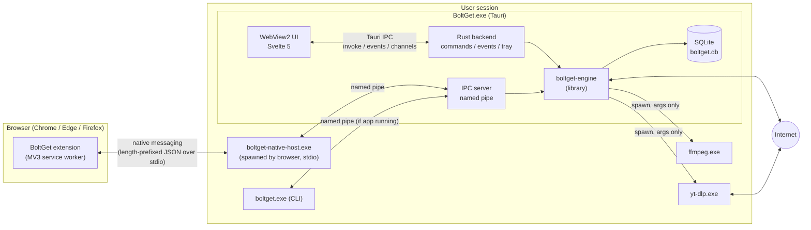
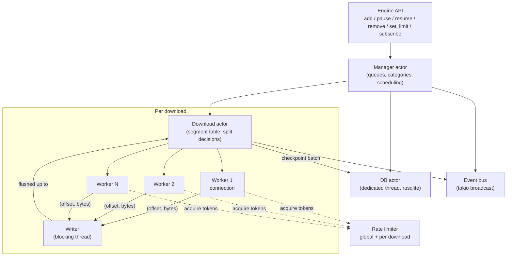
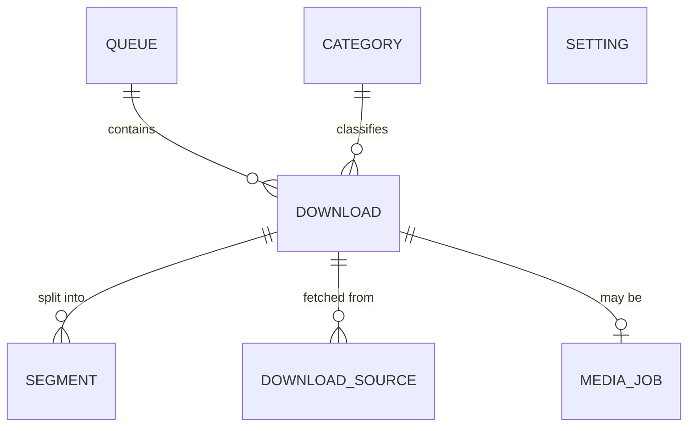
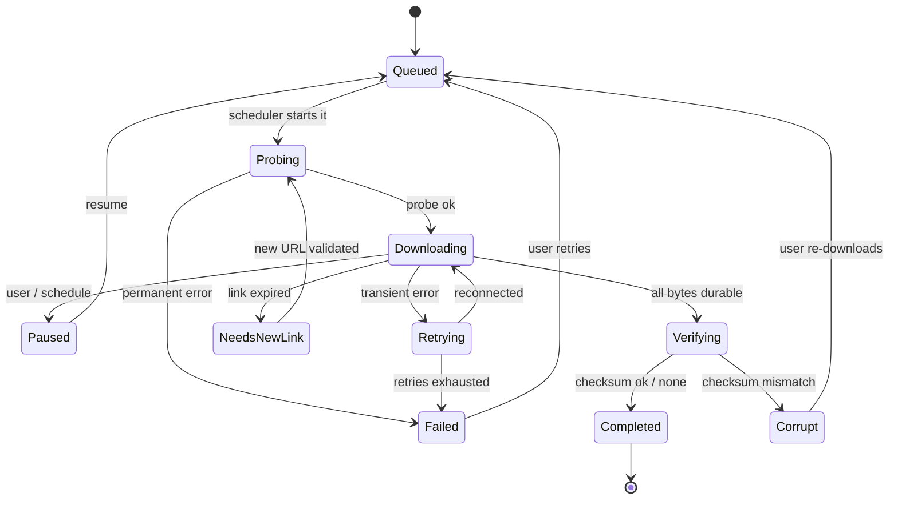

# Architecture

This document describes how BoltGet is put together: the components, which process runs what, how they talk, what is stored where, how concurrency works, how errors flow, and the security model. The download engine itself is specified in [ENGINE.md](ENGINE.md); this document treats it as a component.

Status: design. Names of crates, types and tables are the intended names; they may be refined during implementation, but changes to the structure should go through an RFC (see [CONTRIBUTING.md](../CONTRIBUTING.md#rfcs)).

## Components

| Component | Path | Language | Ships as | Responsibility |
|---|---|---|---|---|
| Engine | `crates/engine` | Rust | library crate `boltget-engine` | Probing, segmentation, connections, disk I/O, rate limiting, persistence, integrity, events |
| CLI | `crates/cli` | Rust | `boltget.exe` | Command-line front end; embeds the engine or talks to the running app |
| Desktop backend | `apps/desktop/src-tauri` | Rust | inside `BoltGet.exe` | Hosts the engine, exposes Tauri commands/events, tray, single-instance, updater, IPC server |
| Desktop UI | `apps/desktop/src` | Svelte 5 + TS | bundled web assets | Everything the user sees in the window |
| Native messaging host | `apps/desktop/src-tauri` (separate `[[bin]]`) | Rust | `boltget-native-host.exe` | Bridge spawned by the browser: stdio native messaging to the app's IPC pipe |
| Browser extension | `apps/extension` | TS (WXT) | `.zip`/`.xpi` per store | Captures downloads, detects media, forwards cookies/headers |
| Shared UI | `packages/ui` | Svelte 5 + TS | workspace package | Components and design tokens shared by app and website |
| Website and docs | `apps/web` | Astro + Svelte, Starlight | static site | boltget.app; see [WEBSITE.md](WEBSITE.md) |
| Sidecars | downloaded at runtime | n/a | `yt-dlp.exe`, `ffmpeg.exe` | Media extraction and muxing; see [VIDEO.md](VIDEO.md) |

The engine is a **library, not a daemon**. There is exactly one engine instance per user session that owns the database, and it lives inside whichever process started first (normally the desktop app). See [Single owner rule](#single-owner-rule).

## Process model



### The desktop app (`BoltGet.exe`)

- Single instance per user session (`tauri-plugin-single-instance`). A second launch forwards its arguments (for example a URL passed by a shell association) to the running instance and exits.
- Can start hidden in the tray (`--background`), which is how the native host and autostart launch it.
- Hosts the engine on a Tokio multi-threaded runtime (the same runtime Tauri uses).
- Owns the IPC server: a Windows named pipe, `\\.\pipe\boltget-<user SID>`, used by the native host and the CLI. On macOS/Linux (post-1.0) the equivalent is a Unix domain socket in the user's runtime directory with `0600` permissions.

### The native messaging host (`boltget-native-host.exe`)

Browsers start native messaging hosts as a **new process per connection** (`runtime.connectNative`) or per message (`runtime.sendNativeMessage`) and talk to them over stdin/stdout. So the host must be small and stateless:

1. Read a native message from stdin (4-byte length prefix in native byte order, then UTF-8 JSON).
2. Validate it against the schema (see [Security](#security)).
3. Connect to the app's named pipe. If the pipe does not exist, launch `BoltGet.exe --background` and retry with backoff for a few seconds.
4. Forward the message, relay the reply to stdout, and repeat until stdin closes.

It never touches the database or the network itself. Keeping it a separate tiny binary (rather than making `BoltGet.exe` the host) means the browser does not start a full WebView process every time the extension sends a message. Details of registration: [BROWSER-INTEGRATION.md](BROWSER-INTEGRATION.md#native-messaging-host-registration-on-windows).

### The CLI (`boltget.exe`)

Two modes, chosen automatically:

- **Client mode** (app is running): the CLI connects to the named pipe and asks the running engine to add, list, pause or resume downloads. Progress is streamed back over the pipe. This avoids two engines writing the same database.
- **Standalone mode** (app is not running, or `--standalone`): the CLI embeds the engine directly, takes the [single owner lock](#single-owner-rule), and runs to completion. This is what `boltget bench` and server/CI usage rely on. Standalone mode can use a separate database (`--state <path>`) or none at all (`--no-state`, keeps resume data in a sidecar file next to the download).

> **Implementation note (v0.1):** only standalone mode exists; client mode arrives with the desktop app's IPC server (v0.2). `--state <dir>` (also `BOLTGET_DATA_DIR`) is a directory holding `boltget.db`, not a database path. `get --no-state` records nothing and keeps no sidecar yet, so such a download cannot be resumed. While one `boltget` owns the database, a second invocation that needs it exits with code 7 and says why (`pause` explains that Ctrl-C in the owning terminal pauses it); `boltget list` instead opens the database read-only, without the lock, and shows the owner's last checkpoint (WAL lets a reader in another process see committed data safely).

### Sidecars

`yt-dlp.exe` and `ffmpeg.exe` are child processes started by the engine with an explicit argument vector (never through a shell), with stdout parsed for progress. They are installed on demand and verified before first use. See [VIDEO.md](VIDEO.md) and [Security](#security).

### Single owner rule

Exactly one process at a time may own the engine state for a given database:

- Ownership is a lock file (`boltget.db.lock`, held with an exclusive OS file lock for the lifetime of the owner) next to the database.
  - *Implemented (v0.1)* with `std::fs::File::try_lock` (`LockFileEx` on Windows, `flock` on Unix), taken before the database is opened and released only after it is closed. The OS drops the lock when the owner dies, so a crash never leaves a stale lock. A second owner gets `Error::DatabaseLocked`.
- The desktop app takes it on start. If it cannot (a standalone CLI is running), the app shows a "BoltGet CLI is running a download" state and becomes a client until the lock is released.
- Clients talk to the owner over IPC. This is simpler and safer than having multiple processes coordinate on SQLite rows.

## Engine internals at a glance



The full algorithm for workers, splits and checkpoints is in [ENGINE.md](ENGINE.md).

## IPC and events

There are three IPC boundaries. All of them carry the same logical message types, defined once in the engine crate (Rust types with `serde`), and exported to TypeScript with `ts-rs` or `specta` (decided in v0.2) so the UI and extension never hand-write message shapes.

### 1. UI to backend (Tauri)

- **Commands** (`invoke`) for request/response: `add_download`, `pause`, `resume`, `remove`, `set_speed_limit`, `get_settings`, `update_settings`, `list_downloads`, `probe_url`, and so on. Commands return `Result<T, UiError>` where `UiError` carries a message-catalog key and parameters, not a hard-coded string.
- **Events** (`emit`) for low-frequency state changes: download added, state changed, completed, failed, settings changed, update available.
- **Channels** (`tauri::ipc::Channel`) for high-frequency progress. The backend coalesces progress for all visible downloads into one message per tick. Design target: a tick of 250 ms (4 Hz) for the list, up to 100 ms for the download currently in the details pane. The UI never receives one event per network read.

Progress message (sketch):

```json
{
  "t": 1729791234567,
  "items": [
    { "id": "01J...", "done": 734003200, "total": 4294967296, "bps": 48234112,
      "conns": 12, "segments": [[0, 268435456, 268435456], [268435456, 536870912, 401604608]] }
  ]
}
```

Segment arrays are sent only for the download whose details are open, and only when they changed.

### 2. Extension to app (native messaging, through the host)

Request/response JSON with a `v` (protocol version) and `type`:

| `type` | Direction | Purpose |
|---|---|---|
| `hello` | ext → app | Version handshake; app replies with its version and capabilities |
| `capture` | ext → app | A download the extension intercepted: URL, final URL, filename hint, size hint, MIME, referrer, cookies, selected headers, tab URL |
| `add_links` | ext → app | User picked "Download all links" or a selection |
| `media_page` | ext → app | "Download media from this page": page URL plus detected media hints (see [VIDEO.md](VIDEO.md)) |
| `refresh_link` | ext → app | Offer a fresh URL for a download waiting on link refresh |
| `status` | ext → app | Lightweight query for the popup (active count, speed) |
| `settings` | app → ext (reply to `hello`) | Capture rules so the extension and app agree |

Versioning: the protocol version is an integer. The app supports the current and previous version; the extension shows an "update BoltGet" message if the app is older.

### 3. CLI to app (named pipe)

Same framing as native messaging (4-byte little-endian length prefix + JSON) so both clients share one server implementation. The CLI uses a superset of message types (`list`, `pause`, `resume`, `remove`, `subscribe_progress`).

## Data model

All persistent state lives in one SQLite database per user:

- Windows: `%LOCALAPPDATA%\BoltGet\boltget.db`
- macOS (post-1.0): `~/Library/Application Support/app.boltget/boltget.db`
- Linux (post-1.0): `$XDG_DATA_HOME/boltget/boltget.db`

Decided in v0.1 (this was an open question between `%APPDATA%` and `%LOCALAPPDATA%`): the local, non-roaming directory, because download state references local file paths and a roaming profile would sync stale state to other machines. Logs go next to it; settings will be exportable as a file. The directory is resolved with the `directories` crate (`boltget_engine::default_data_dir`); the CLI overrides it with `--state <dir>` or `BOLTGET_DATA_DIR`, and tests always use a temporary directory.

### Entities



### Schema (initial draft)

IDs are ULIDs stored as `TEXT` (sortable by creation time, safe to expose). Sizes and offsets are `INTEGER` (SQLite integers are 64-bit). Times are Unix milliseconds.

```sql
CREATE TABLE download (
  id                TEXT PRIMARY KEY,           -- ULID
  kind              TEXT NOT NULL,              -- 'http' | 'media' | later 'ftp', 'torrent'
  state             TEXT NOT NULL,              -- see state machine below
  url               TEXT NOT NULL,              -- URL as given by the user / browser
  final_url         TEXT,                       -- after redirects, last successful
  file_name         TEXT NOT NULL,
  dest_dir          TEXT NOT NULL,
  temp_path         TEXT,                       -- '<name>.boltget' while in progress
  total_size        INTEGER,                    -- NULL if unknown
  downloaded        INTEGER NOT NULL DEFAULT 0, -- durable bytes (sum of segment progress)
  mime              TEXT,
  etag              TEXT,                       -- as received, including W/ prefix
  last_modified     TEXT,                       -- HTTP-date as received
  resumable         INTEGER NOT NULL,           -- 0/1: server supports byte ranges
  max_connections   INTEGER,                    -- NULL = use default
  speed_limit_bps   INTEGER,                    -- NULL = unlimited
  checksum_algo     TEXT,                       -- 'sha256' | 'sha512' | 'sha1' | 'md5'
  checksum_expected TEXT,                       -- lowercase hex
  checksum_actual   TEXT,
  request_ctx       BLOB,                       -- DPAPI-encrypted JSON: cookies, auth, headers, referrer
  queue_id          TEXT REFERENCES queue(id) ON DELETE SET NULL,
  category_id       TEXT REFERENCES category(id) ON DELETE SET NULL,
  queue_position    INTEGER,
  priority          INTEGER NOT NULL DEFAULT 0,
  error_kind        TEXT,                       -- machine-readable, see Error handling
  error_detail      TEXT,
  created_at        INTEGER NOT NULL,
  started_at        INTEGER,
  completed_at      INTEGER,
  updated_at        INTEGER NOT NULL
);

CREATE TABLE segment (
  download_id  TEXT NOT NULL REFERENCES download(id) ON DELETE CASCADE,
  idx          INTEGER NOT NULL,      -- stable identifier within the download
  start        INTEGER NOT NULL,      -- inclusive byte offset
  end          INTEGER NOT NULL,      -- exclusive byte offset
  done         INTEGER NOT NULL,      -- durable bytes written from start (start + done = cursor)
  PRIMARY KEY (download_id, idx)
) WITHOUT ROWID;

CREATE TABLE download_source (        -- mirrors / alternate URLs (post-1.0), and link-refresh history
  download_id  TEXT NOT NULL REFERENCES download(id) ON DELETE CASCADE,
  url          TEXT NOT NULL,
  role         TEXT NOT NULL,         -- 'primary' | 'mirror' | 'refreshed'
  added_at     INTEGER NOT NULL,
  last_error   TEXT,
  PRIMARY KEY (download_id, url)
) WITHOUT ROWID;

CREATE TABLE media_job (              -- yt-dlp jobs, see VIDEO.md
  download_id  TEXT PRIMARY KEY REFERENCES download(id) ON DELETE CASCADE,
  page_url     TEXT NOT NULL,
  format_spec  TEXT NOT NULL,         -- yt-dlp -f expression chosen in the picker
  info_json    BLOB                   -- cached metadata (compressed)
);

CREATE TABLE queue (
  id              TEXT PRIMARY KEY,
  name            TEXT NOT NULL,
  max_concurrent  INTEGER NOT NULL DEFAULT 3,
  speed_limit_bps INTEGER,
  schedule        TEXT,               -- JSON: time windows, days, on-complete action
  is_default      INTEGER NOT NULL DEFAULT 0
);

CREATE TABLE category (
  id          TEXT PRIMARY KEY,
  name_key    TEXT,                   -- message-catalog key for built-ins ('category.video'), NULL for user-defined
  name        TEXT,                   -- user-defined name
  extensions  TEXT NOT NULL,          -- JSON array: ["mp4","mkv"]
  dest_dir    TEXT,                   -- NULL = default download folder
  sort_order  INTEGER NOT NULL
);

CREATE TABLE setting (
  key    TEXT PRIMARY KEY,            -- 'engine.max_connections', 'ui.theme', ...
  value  TEXT NOT NULL                -- JSON
);

CREATE INDEX download_state_idx ON download(state);
CREATE INDEX download_queue_idx ON download(queue_id, queue_position);
```

Settings are typed in Rust (`struct Settings` with `serde` defaults) and stored as one row per key, so adding a setting never needs a migration and unknown keys from a newer version are preserved.

> **Implemented in v0.1 (schema version 1, `crates/engine/src/store/migrations/0001_initial.sql`):** the `download`, `segment` and `setting` tables. Differences from the draft above:
> - **Ids are integers** (`INTEGER PRIMARY KEY AUTOINCREMENT`), not ULIDs: a CLI user types them (`boltget resume 7`), and `AUTOINCREMENT` guarantees an id is never reused after a remove. Events and JSON output carry the same number (`DownloadId(u64)`).
> - `download` also stores how the destination was requested (`requested_kind` `dir`/`file`, `requested_dest`, `conflict`), so a download that never got past the probe can be started again exactly as added; `file_name` and `dest_dir` are `NULL` until the probe resolves them. `validator_date` (the probe's `Date`, needed for the `If-Range` rule), `encoded` (a `Content-Encoding` makes resuming impossible) and `error_key` (message-catalog key) are added.
> - `segment."end"` is `NULL` while the total size is unknown (a single open segment).
> - `request_ctx` is plain JSON **without secrets** (no `Authorization`) instead of a DPAPI-encrypted blob, until cookies make encryption necessary; see [Security](#security).
> - `queue`, `category`, `download_source` and `media_job` are not created yet; they arrive with their features as new migrations. `setting` exists but is unused.
> - Segment rows of a completed download are deleted.
>
> **Schema versions 2–4 (v0.1 phase 3):** v2 adds `download.speed_limit_bps`; v3 adds `checksum_algo`, `checksum_expected`, `checksum_source` (`user` or the response header it came from) and `checksum_actual`; v4 creates `download_source` as drafted (`primary` and `refreshed` rows; after a link refresh `download.url` is the new link). The `setting` table is now used, one JSON value per key: `engine.speed_limit_bps` (global limit) and `engine.host_ceilings` (`{"scheme://host:port": [ceiling, until_unix_ms]}`, learned connection ceilings). `request_ctx` may also hold the cookie file path and the proxy URL without credentials, still no secrets.

### Download state machine



`Postprocessing` (ffmpeg muxing) sits between `Verifying` and `Completed` for media jobs.

> **Phase 3:** `Verifying` (hashing what is left after the last byte), `Corrupt` (checksum mismatch; the partial file is kept, resume with `restart` downloads again, resume without a checksum keeps it) and `NeedsNewLink` (expired link; `refresh_link` validates a new one and sets `Paused`) are implemented. `Verifying` is entered only when there is a checksum, and only for the part not yet hashed during the download.
>
> **Implemented in v0.1:** `Queued`, `Probing`, `Downloading`, `Retrying`, `Paused`, `Completed`, `Failed` and `Cancelled` (stopped by the caller; resumable like `Paused`). There is no scheduler yet, so resuming goes straight from `Paused`/`Failed`/`Cancelled` to `Downloading` (or `Probing` when it has to start over) instead of through `Queued`, and `Verifying`, `NeedsNewLink` and `Corrupt` arrive with checksums and link refresh. A download a dead process left in `Probing`/`Downloading`/`Retrying` is set to `Paused` when the database is next opened.

## Persistence

- **Library:** `rusqlite` with the bundled SQLite build, accessed only from a dedicated **DB actor thread**. Async code sends commands over a channel and awaits a oneshot reply. This keeps SQLite usage single-threaded and off the Tokio worker threads. (Rationale and the sqlx alternative: [TECH-STACK.md](TECH-STACK.md#adr-005-sqlite-via-rusqlite-on-a-dedicated-thread).)
- **Pragmas:** `journal_mode=WAL`, `synchronous=NORMAL`, `foreign_keys=ON`, `busy_timeout=5000`.
  - With WAL + `NORMAL`, a power loss can lose the most recent commits but never corrupts the database. For BoltGet this is the safe direction: the DB can only lag behind the data file, never run ahead of it (see [ENGINE.md, Checkpointing](ENGINE.md#checkpointing-and-crash-safe-resume)).
- **Migrations:** plain SQL files embedded in the binary (`include_str!`), applied in order, tracked with `PRAGMA user_version`. Migrations are forward-only. Before applying a migration, the DB file is copied to `boltget.db.bak-<version>`.
  - *Implemented (v0.1):* each migration runs in one transaction together with its `user_version` bump, so a failing migration leaves the previous version intact. The backup is written with `VACUUM INTO` (a consistent copy that includes WAL content) and only for an existing database, not a new one. A database with a higher version than the build knows is refused rather than opened.
- **Write batching:** segment checkpoints for all active downloads are written in one transaction per checkpoint interval, not one transaction per segment update.
  - *v0.1 deviation:* one transaction per download per writer flush (see [ENGINE.md, Checkpointing](ENGINE.md#checkpointing-and-crash-safe-resume)); still never one per segment update.
- **Secrets in the DB:** `request_ctx` (cookies, Authorization header, proxy credentials) is encrypted with Windows DPAPI (`CryptProtectData`, current-user scope) before storage. It is deleted when the download completes, unless the user opts to keep it for re-downloads. On other platforms: the OS keychain via the `keyring` crate holds a per-install key used to encrypt this column.
  - *v0.1 deviation:* no secret is stored yet, so nothing needs encrypting: cookies come from a `cookies.txt` whose path is saved and which is read again on resume; `Authorization`, `--cookie` values and proxy passwords are passed again to `resume`. DPAPI arrives with browser-captured cookies (v0.2/v0.3). See [ENGINE.md, Request context](ENGINE.md#request-context).
- **Logs:** rotating files in `%LOCALAPPDATA%\BoltGet\logs` via `tracing` + `tracing-appender`. URLs are logged with query strings redacted by default (signed URLs are credentials).

## Threading and async model

- **Runtime:** one Tokio multi-threaded runtime (shared with Tauri in the app; created by `#[tokio::main]` in the CLI).
- **Actors:** long-lived state is owned by a single task and mutated only through messages:
  - *Manager actor:* the set of downloads, queues, schedules, concurrency limits.
  - *Download actor* (one per active download): the segment table and all split/merge decisions. Workers never mutate the segment table directly; they report progress and ask for work.
  - *DB actor:* a plain OS thread owning the `rusqlite::Connection`.
- **Workers:** one Tokio task per active connection. A worker owns its HTTP connection and loops: acquire rate-limit tokens, read a chunk, send it to the writer, report progress.
- **Writer:** one blocking writer per download (on a dedicated thread from a small pool, not `spawn_blocking` per chunk), consuming a **bounded** channel of `(offset, Bytes)`. The bound provides backpressure: if the disk is slow, workers stop reading, TCP windows close, and the server slows down. Memory stays bounded.
- **Cancellation:** `tokio_util::sync::CancellationToken` in a tree: engine → download → worker. Pausing a download cancels its token; workers stop at the next await point; the writer drains and flushes; the actor writes a final checkpoint.
- **Shared counters:** per-download byte counters for the UI are `AtomicU64`s read by the progress ticker, so progress reporting never contends with the data path.
- **No locks across await points.** If a `Mutex` is needed, it is `parking_lot`/`std` and held only for non-async critical sections.

## Error handling

- The engine defines a typed error, `boltget_engine::Error` (with `thiserror`), and a classification used by retry logic and the UI:

  | `ErrorKind` | Examples | Engine behaviour |
  |---|---|---|
  | `Transient` | timeout, connection reset, DNS temporary failure, 5xx, 429 | Retry the connection with backoff; download stays `Downloading`/`Retrying` |
  | `Throttled` | 429/503 with `Retry-After`, repeated resets when adding connections | Retry after the indicated delay; lower the connection cap for that host |
  | `LinkExpired` | 401/403/410 on a URL that previously worked, redirect to an HTML login page | Re-resolve from the original URL once; then move to `NeedsNewLink` |
  | `ResourceChanged` | `If-Range` mismatch (200 instead of 206), size changed, ETag changed | Stop; ask the user to restart from zero or keep the partial file |
  | `RangeUnsupported` | server ignores `Range` | Fall back to a single connection; resume impossible after interruption |
  | `Disk` | disk full, access denied, path too long | Pause the download; tell the user exactly what to fix |
  | `Permanent` | 404, TLS certificate invalid, unsupported scheme | Fail |
  | `Integrity` | checksum mismatch | `Corrupt` state |
  | `Internal` | bugs, invariant violations | Fail the download, log with context, never crash the app |

- Workers never panic on network input. A panic in a worker task is caught at the task boundary (`JoinError::is_panic`), logged, and treated as `Internal` for that download only.
- `anyhow` is allowed only at the edges (CLI `main`, Tauri setup), never in the engine API.
- User-facing errors are message-catalog keys plus structured parameters (`{"key": "error.disk_full", "params": {"path": "D:\\", "needed": 4294967296}}`). The UI formats them from the central string catalog (see [DESIGN-PRINCIPLES.md](DESIGN-PRINCIPLES.md#copy-and-strings)), which keeps wording consistent and leaves the door open to community translations later.

## Security

The attack surface of a download manager is real: it parses untrusted network data, writes files to disk, talks to a browser extension, executes helper binaries and updates itself. The rules:

### Browser ↔ app channel

- **Native messaging only.** No localhost HTTP/WebSocket server. A localhost server can be reached by any website the user visits (CSRF, DNS rebinding); native messaging can only be used by the extension IDs we list.
- **Allowlisted origins.** The host manifest's `allowed_origins` (Chrome/Edge) and `allowed_extensions` (Firefox) contain only the published BoltGet extension IDs. Development IDs are registered only by development builds.
- **Schema validation.** Every message is deserialized into a strict Rust type (`#[serde(deny_unknown_fields)]`), with size limits (URLs ≤ 32 KiB, cookie headers ≤ 64 KiB, whole message ≤ 1 MiB). Invalid messages are rejected and logged.
- **No privileged verbs.** Messages can only *propose* downloads. There is no message that runs a command, changes the destination to an arbitrary path outside the configured folders without user confirmation, or alters settings.
- **Named pipe hardening.** The pipe is created with a DACL granting access only to the current user's SID, with `PIPE_REJECT_REMOTE_CLIENTS`, and the server verifies the client process belongs to the same session.

### No remote code

- The UI is bundled into the binary. The WebView never loads remote content; navigation to external URLs opens the system browser.
- Strict Content Security Policy in `tauri.conf.json` (no `unsafe-eval`, no remote scripts).
- Tauri 2 **capabilities** grant the window only the commands it needs; no generic shell or filesystem plugin access from the UI.
- The extension contains no remotely hosted code (also a Manifest V3 requirement).

### Files written to disk

- Destination paths are canonicalized and must resolve inside the chosen directory (no `..` escapes from server-provided filenames). Filenames from `Content-Disposition` are sanitized (see [ENGINE.md](ENGINE.md#filename-resolution-content-disposition)).
- In-progress files use a `.boltget` suffix and are renamed atomically on completion.
- Completed files get the Windows **Mark of the Web** (`Zone.Identifier` alternate data stream with `ZoneId=3` and the `ReferrerUrl`/`HostUrl`), exactly as browsers do, so SmartScreen and Office Protected View keep working. This is a deliberate choice: bypassing MotW would be a security regression compared with downloading in the browser.
- BoltGet never auto-opens or auto-executes a downloaded file unless the user asked for it.

### Sidecars

- yt-dlp and ffmpeg are downloaded only from pinned sources and verified against pinned signatures or SHA-256 hashes before they are made executable. See [VIDEO.md](VIDEO.md#install-verification-and-updates).
- They are started with an explicit argument vector (`std::process::Command`, never `cmd /c`), a fixed working directory, a sanitized environment, and inside a Windows **Job Object** with `JOB_OBJECT_LIMIT_KILL_ON_JOB_CLOSE` so they cannot outlive BoltGet.
- User-supplied values passed to yt-dlp (URLs, output templates) are validated and passed after `--` where applicable. Options that execute commands (`--exec`, and similar) are never passed.
- "Sandboxed" in v1 means the above isolation, not an OS sandbox. Running sidecars in an AppContainer or with a restricted token is a post-1.0 hardening item.

### Updates and binaries

- Release binaries are Authenticode-signed (Azure Trusted Signing).
- Updates are verified by the Tauri updater against the BoltGet updater public key embedded in the app before anything is executed. A compromised download host cannot push an update. See [RELEASE.md](RELEASE.md).
- TLS uses rustls with the platform certificate verifier, so corporate root CAs in the Windows store work, and there is no option to globally disable certificate validation. A per-download "ignore certificate errors" is deliberately not offered in v1.

### Privacy

- No telemetry by default. Crash reporting, if added, is opt-in and shows the report before sending.
- The update check sends only the current version, OS and architecture (as part of the request path or headers needed by the updater).
- Signed URLs, cookies and auth headers are treated as secrets: redacted in logs, encrypted at rest, deleted after completion.

## Cross-platform notes (post-1.0)

The engine is written to be platform-neutral from day one; platform-specific code is isolated in `crates/engine/src/platform/{windows,unix}.rs` (sparse files, preallocation, MotW / quarantine attributes, secrets). On macOS the equivalent of MotW is the `com.apple.quarantine` extended attribute. Native messaging host registration differs per OS (manifest files in well-known directories rather than registry keys); see [BROWSER-INTEGRATION.md](BROWSER-INTEGRATION.md).
