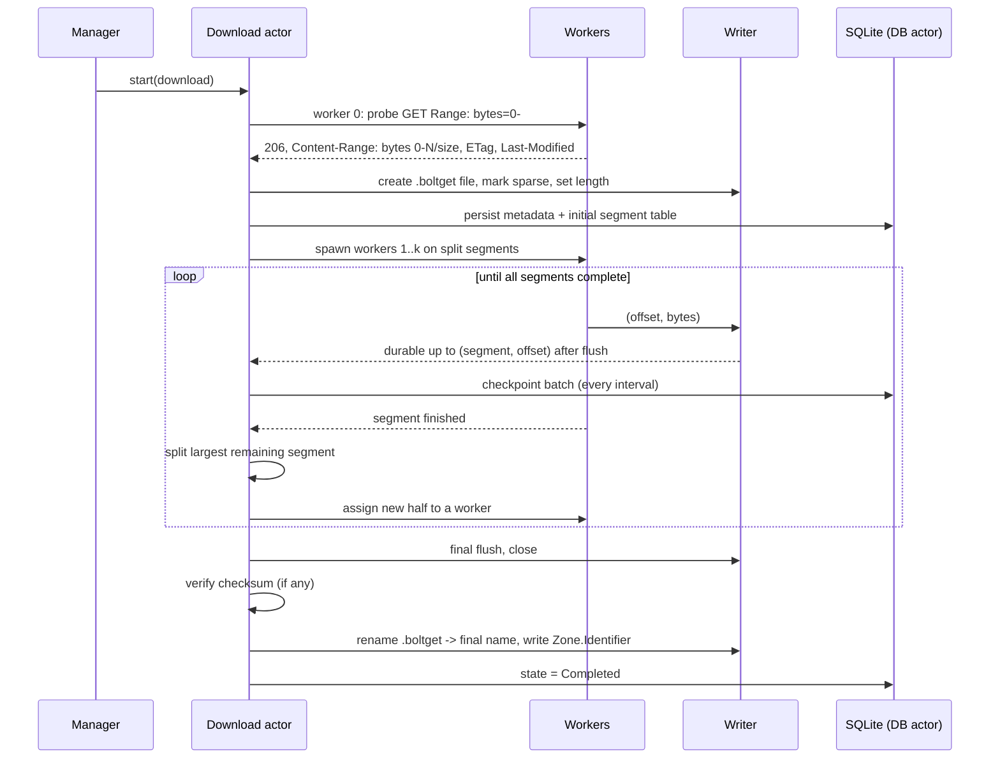

# Engine specification

The engine (`crates/engine`, crate name `boltget-engine`) is the heart of BoltGet. It is a Rust library used by the desktop app and by the CLI. This document specifies its behaviour in enough detail to implement it and to review implementations against it.

Conventions used here:

- **MUST / SHOULD / MAY** are used in the RFC 2119 sense.
- **Design target** marks a number chosen as a starting point. Every design target is a tunable setting and will be revisited with benchmark data from v0.1. None of them is a measured result.
- Byte ranges are written half-open, `[start, end)`. HTTP `Range` headers are inclusive, so `[start, end)` is sent as `bytes=start-(end-1)`.

Related documents: [ARCHITECTURE.md](ARCHITECTURE.md) (process model, data model, threading), [BROWSER-INTEGRATION.md](BROWSER-INTEGRATION.md) (where cookies and headers come from), [VIDEO.md](VIDEO.md) (media downloads, which bypass most of this engine).

## Contents

1. [Goals](#goals)
2. [Overview of a download](#overview-of-a-download)
3. [Request context](#request-context)
4. [Probing](#probing)
5. [Filename resolution (Content-Disposition)](#filename-resolution-content-disposition)
6. [Redirects](#redirects)
7. [Dynamic segmentation](#dynamic-segmentation)
8. [Connection management and adaptive concurrency](#connection-management-and-adaptive-concurrency)
9. [HTTP/2 considerations](#http2-considerations)
10. [Preallocation and sparse files](#preallocation-and-sparse-files)
11. [Write path](#write-path)
12. [Checkpointing and crash-safe resume](#checkpointing-and-crash-safe-resume)
13. [Retries, backoff and stall detection](#retries-backoff-and-stall-detection)
14. [Link refresh](#link-refresh)
15. [Bandwidth limiting](#bandwidth-limiting)
16. [Integrity](#integrity)
17. [Proxies](#proxies)
18. [Authentication and cookies](#authentication-and-cookies)
19. [Mirrors and multi-source (later)](#mirrors-and-multi-source-later)
20. [Public API sketch](#public-api-sketch)
21. [Testing strategy](#testing-strategy)
22. [Benchmarks plan vs IDM](#benchmarks-plan-vs-idm)
23. [Open questions](#open-questions)

## Goals

In priority order:

1. **Never corrupt or lose completed bytes.** The file on disk plus the checkpoint in SQLite are always consistent after a crash at any instruction.
2. **Saturate the available path.** Use as many connections as help, and no more.
3. **Keep every connection busy until the end.** The last few percent of a download must not run on one slow connection while others sit idle.
4. **Be a good citizen.** Respect per-host limits, `Retry-After`, and server signals that we are opening too many connections.
5. **Bounded resources.** Memory use per download is bounded by configuration, independent of file size.

## Overview of a download



## Request context

Every download carries a `RequestContext`, captured when the download is created and persisted (encrypted, see [ARCHITECTURE.md](ARCHITECTURE.md#persistence)):

| Field | Source | Notes |
|---|---|---|
| `url` | user, browser | The original URL. Kept forever: re-resolving redirects starts here. |
| `method` | browser | Almost always `GET`. `POST`-initiated downloads (form submissions) are supported only if the browser gives us the body; otherwise we report that the download must be handled by the browser. |
| `headers` | browser | Allowlist: `User-Agent`, `Referer`, `Accept`, `Accept-Language`, `Authorization`, `Origin`, plus site-specific headers explicitly allowlisted later. Hop-by-hop headers (`Connection`, `Keep-Alive`, `Transfer-Encoding`, `TE`, `Upgrade`, `Proxy-*`) and `Range`, `If-*`, `Accept-Encoding`, `Host`, `Content-Length` are never copied. |
| `cookies` | browser | Stored as cookie records (name, value, domain, path, secure, httpOnly, expiry), not as one header string. Loaded into a per-download cookie jar. See [Authentication and cookies](#authentication-and-cookies). |
| `proxy` | settings | Resolved per download. |
| `auth` | user | Basic/Digest credentials, stored in the OS credential store. |

Every request the engine sends adds:

- `Accept-Encoding: identity`. Byte ranges apply to the *encoded* representation. If a server compresses on the fly, ranges and sizes become meaningless. We always request the raw bytes.
- `User-Agent`: the browser's if provided, otherwise `BoltGet/<version>`. (Some servers block non-browser agents; the browser-provided value is preferred for that reason, not to impersonate.)

> **Implementation note (v0.1 phase 1):** `RequestContext` carries the URL, the allowlisted headers and the browser-suggested name. Cookies, proxy and auth fields arrive with their features in later phases.
>
> **Implementation note (v0.1 phase 3):** cookies and proxies arrive; the "no secrets at rest" rule of phase 2 stays. The saved context holds the **path** of a `cookies.txt` file (read again on every resume, so no cookie value is stored) and the proxy URL **without** its credentials (or `"direct"`); cookies given on the command line (`--cookie`), `--user` credentials and proxy passwords are never saved and must be passed again to `resume`. DPAPI encryption of `request_ctx` is therefore deferred to the first secret that must survive a restart without a file to re-read it from: browser-captured cookies (v0.2/v0.3). `auth` (Basic) is a header (`Authorization: Basic`, built by `boltget_engine::basic_auth`), sent only to the original origin like any `Authorization` header; Digest is not implemented yet.
>
> **Implementation note (v0.1 phase 2):** the context is persisted as plain JSON (`download.request_ctx`) **without secrets**: `Authorization` is never written to the database, so a resumed download that needs it must be given it again (`ResumeOptions::header`, CLI `resume -H`). DPAPI encryption of the column arrives together with cookies, the first secret that has to survive a restart. The URL itself is stored as given; signed URLs carry credentials in the query, which is why every URL in logs, events and `boltget list` is redacted.

## Probing

The probe determines: total size, whether byte ranges work, validators, filename, MIME type and the final URL. It MUST NOT waste a round trip: **the probe connection becomes worker 0.**

### Why not HEAD

`HEAD` looks like the obvious probe, but it is unreliable in practice:

- Pre-signed URLs (for example S3 and S3-compatible storage) are signed for a specific method. A URL signed for `GET` returns 403 to `HEAD`.
- Some servers and CDNs return different headers (or no `Content-Length`) for `HEAD`, or do not implement it at all.
- Some download endpoints perform side effects (counting a download, consuming a one-time token) on any request, so an extra request can break the real one.

So the engine probes with the request it needs anyway.

### Probe algorithm

1. Send `GET <url>` with `Range: bytes=0-`. (An open-ended range starting at 0 is valid for any non-empty resource and asks for the whole thing.)
2. Interpret the response:

| Response | Meaning | Action |
|---|---|---|
| `206 Partial Content` with `Content-Range: bytes 0-(n-1)/n` | Ranges supported, size `n` known | `resumable = true`. Keep reading on this connection as worker 0 for segment `[0, n)`; split immediately (see [Initial split](#initial-split)). |
| `206` with `Content-Range: bytes 0-x/*` | Ranges supported, total size unknown | Single connection; resumable from the current offset, cannot split. |
| `200 OK` with `Content-Length: n` and `Accept-Ranges: bytes` | Server ignored the range on this request but advertises support (some servers treat `bytes=0-` as "everything" and answer 200) | Keep reading worker 0. Issue one **verification request** `Range: bytes=m-` with `m = n/2` on a second connection. If it returns `206` with a matching `Content-Range`, `resumable = true` and segmentation proceeds with worker 0's segment shrunk to `[0, m)`. If not, `resumable = false`. |
| `200 OK` with `Content-Length: n`, no `Accept-Ranges` or `Accept-Ranges: none` | No range support (probably) | Single connection. Still try the verification request once, because many servers support ranges without advertising them. |
| `200 OK` without `Content-Length` (chunked or close-delimited) | Unknown size, no ranges | Single connection, not resumable. Progress shows bytes only. |
| `416 Range Not Satisfiable` with `Content-Range: bytes */0` | Empty resource | Create an empty file, complete. |
| `3xx` | Redirect | See [Redirects](#redirects). |
| `401`, `403`, `407` | Auth needed or link expired | `407` → proxy auth. `401`/`403` on a fresh download → permanent failure with a clear message (often missing cookies). |
| `4xx` / `5xx` other | | Classified per [Retries](#retries-backoff-and-stall-detection). |

3. Record validators from the response: `ETag` (verbatim, including any `W/` prefix), `Last-Modified`, `Content-Type`, `Content-Disposition`, and the `Date` header (needed to judge whether `Last-Modified` is usable for `If-Range`, see below).
4. Check `Content-Encoding`. If it is present and not `identity` despite our `Accept-Encoding: identity`, the server is compressing anyway: ranges are unsafe. Fall back to a single connection and mark not resumable.
5. Resolve the filename ([below](#filename-resolution-content-disposition)) and destination, then check free disk space for `n` bytes plus a safety margin. If insufficient, fail with `Disk` before writing anything.

> **Implementation notes (v0.1 phase 1):**
> - The verification request is skipped when it cannot pay off (fewer than 2 connections allowed, or `n < 2 × min_split_size`); the download then runs on one connection. `Engine::probe` (for the add dialog) does send it, so it can report range support.
> - A response with a non-identity `Content-Encoding` is treated as unknown size even if it has a `Content-Length` (that length describes the encoded bytes).
> - The free-space check (safety margin design target: 16 MiB) is implemented on Windows only; on Unix it is skipped until the Unix port. The FAT32 4 GiB check needs a file handle, so it runs right after creating the empty `.boltget` file, which is deleted again on failure.

### Validators on every subsequent range request

Every range request after the probe MUST carry a validator so a changed resource is detected instead of silently mixing two versions of a file:

- If the probe returned a **strong ETag** (no `W/` prefix): send `If-Range: "<etag>"`.
- Else if it returned `Last-Modified` that is **at least one second earlier than the response `Date`** (the condition RFC 9110 sets for treating a date as a strong validator): send `If-Range: <Last-Modified>`.
- Else: send no `If-Range`, and instead check every `206` response's `Content-Range` total against the known size, and the response `ETag`/`Last-Modified` (if present) against the recorded ones.

Weak ETags MUST NOT be used in `If-Range` (RFC 9110 forbids it).

If a range request with `If-Range` returns `200` instead of `206`, the resource changed. The worker MUST NOT write those bytes at the requested offset. The download moves to `ResourceChanged`.

> **Implementation note (v0.1 phase 1):** one exception: a `200` to a range that *starts at offset 0* is accepted if its `ETag`/`Last-Modified` and `Content-Length` match the probe. The bytes are then at the right offset, and some servers answer every range starting at 0 with `200` (the "ignores `bytes=0-`" row above). Any `206` whose `ETag`/`Last-Modified` differ from the probe's is also `ResourceChanged`, with or without `If-Range`.

### Initial split

After a successful probe with known size `n` and range support:

- Compute the initial worker count `k = min(initial_connections, per_host_available, floor(n / min_split_size))`, at least 1.
  - `initial_connections`: design target 8 (IDM's default connection count is also 8, which makes comparison straightforward). *v0.1 phase 3: 4, measured; see [open question 1](#open-questions). The benchmark compares at fixed counts with `-c`.*
  - `min_split_size`: design target 1 MiB. Below this, a new connection's setup cost (TCP + TLS handshake, slow start) outweighs the parallelism.
- Worker 0 keeps its open-ended request but its segment is set to `[0, n/k)`. It stops reading when it reaches its segment end (see [Ending a segment early](#ending-a-segment-early)).
- Segments `[i·n/k, (i+1)·n/k)` for `i = 1..k-1` are created, with boundaries aligned down to 64 KiB (alignment keeps writes page- and cluster-friendly and makes logs readable). The last segment ends at `n`.
- Workers 1..k-1 are started. They are not all started at once: they are started with a short stagger (design target: 50 ms) to avoid a synchronized burst of TLS handshakes that some servers rate-limit.

> **Implementation note (v0.1 phase 1):** `per_host_available` counts the free per-host and global slots at the time of the split (plus the probe's own slot). Workers that cannot get a slot wait for one.

## Filename resolution (Content-Disposition)

Order of precedence:

1. A name the user typed in the add dialog.
2. `Content-Disposition` header (RFC 6266):
   - Prefer `filename*` (RFC 8187 extended value, for example `filename*=UTF-8''na%C3%AFve%20file.txt`). Decode the percent-encoding using the declared charset; support `UTF-8` and `ISO-8859-1`.
   - Else `filename` (quoted-string). Many servers put raw UTF-8 bytes or percent-encoded UTF-8 here, against the spec. Heuristic: if the bytes are valid UTF-8, use them; if the value contains `%XX` sequences that decode to valid UTF-8, decode them.
   - `attachment` vs `inline` does not matter for naming.
3. The browser's suggested filename (passed in the request context), because the browser may have already applied its own logic.
4. The last non-empty path segment of the **final** URL, percent-decoded, query string removed.
5. If the result has no extension and `Content-Type` maps to a well-known one (`application/pdf` → `.pdf`, `application/zip` → `.zip`, and so on, from a small built-in table), append it.
6. Fallback: `download` + extension.

Sanitization (Windows rules applied on all platforms, so a file name that works on Windows works everywhere):

- Strip any directory components (`/`, `\`), so a server cannot write outside the destination.
- Replace `< > : " / \ | ? *` and control characters `0x00–0x1F` with `_`.
- Remove trailing dots and spaces.
- If the stem (case-insensitive, before the first dot) is a reserved device name (`CON`, `PRN`, `AUX`, `NUL`, `COM1`–`COM9`, `LPT1`–`LPT9`, also with superscript digits `COM¹`–`COM³`, `LPT¹`–`LPT³`), prefix `_`.
- Truncate to 255 UTF-16 code units per component, preserving the extension.
- Long paths: the engine uses `\\?\`-prefixed paths internally (or relies on the process being long-path aware via the application manifest), so destinations deeper than 260 characters work.

Collision handling: if the target exists (or another queued download targets the same path), append ` (1)`, ` (2)`, ... before the extension. The add dialog shows the final name before starting.

> **Implementation notes (v0.1 phase 1):** a name typed by the user (`Destination::File`, CLI `-o file`) is sanitized but gets no MIME-based extension. Collision checks also treat an existing `<name>.boltget` as taken, and the check is repeated just before the final rename. Callers can choose `Overwrite` or `Fail` instead of renaming. `\\?\` long-path prefixes are not applied yet; the desktop app is expected to be long-path aware through its manifest.

## Redirects

- Follow up to 10 redirects (`301`, `302`, `303`, `307`, `308`). `303` switches to `GET`; the engine only downloads with `GET` anyway.
- Record the chain. `final_url` is stored in the DB and used for segment requests.
- On a redirect to a different origin:
  - Drop `Authorization` (unless the user configured credentials for that origin).
  - Cookies are not a concern because they come from a cookie jar that matches by domain (see [Authentication and cookies](#authentication-and-cookies)), never from a blanket `Cookie` header.
  - Keep `Referer` as provided by the browser.
- Redirect from `https` to `http` is allowed only if the user opted in (setting off by default); otherwise fail with a clear error.
- **Expiring redirect targets.** Many hosts redirect a stable URL to a short-lived signed URL (release assets on code-hosting sites, cloud storage, CDNs). When a segment request to `final_url` fails with `LinkExpired`, the engine MUST first re-resolve from the original `url` (fresh redirect chain), validate the new `final_url` like a [link refresh](#link-refresh), and continue. Only if that fails does the download move to `NeedsNewLink`.

> **Implementation notes (v0.1 phase 1):** re-resolution happens on every expiry (a signed URL can expire several times during a long download), not once per download; it fails the download only if the request that started from the original URL is itself rejected. The new target is validated like any range response (status, `Content-Range` start and total, validators), not with the link-refresh sample bytes. `NeedsNewLink` does not exist yet, so the download fails with `LinkExpired` (phase 3: it stops in `NeedsNewLink`, see [Link refresh](#link-refresh)). `Authorization` is dropped on every request to an origin other than the original one (per-origin credentials come with auth support).

## Dynamic segmentation

This is the core of what makes a segmented downloader fast at the end of a download, not just at the start.

### Segment table

The download actor owns a table of segments. Each segment has:

```rust
struct Segment {
    idx: u32,          // stable id
    start: u64,        // inclusive
    end: u64,          // exclusive; may shrink when split
    received: u64,     // bytes received from network (start + received = receive cursor)
    durable: u64,      // bytes known durable on disk (durable <= received)
    worker: Option<WorkerId>,
}
```

Invariants (checked in debug builds and property tests):

1. Segments are disjoint and their union is `[0, n)`.
2. `start + durable <= start + received <= end`.
3. A byte is written to disk by exactly one worker.
4. The persisted checkpoint for a segment never exceeds its `durable` value.

> **Implementation notes (v0.1 phase 1), concurrency model:** the table (`boltget_engine::segment::SegmentTable`, pure logic, property-tested) lives behind a `std::sync::Mutex` shared by the supervisor ("download actor") and its workers, instead of being owned by a single task. A worker *claims* each coalesced chunk (at most 1 MiB) under the lock immediately before handing it to the writer, after reserving a slot in the writer channel so no `.await` separates claim and send; a split shrinks `end` under the same lock. Claims and splits are therefore linearised: a claim is truncated at the current `end`, and a split never moves `end` below the claim cursor. That is what makes invariant 3 hold by construction (`received` = claimed bytes). The lock is held for a few instructions, never across an `.await`. An idle worker runs the split rule itself under the lock rather than asking the actor. The writer additionally checks that every segment's chunks arrive contiguously and fails with `Internal` otherwise. `SegmentTable::checkpoint()` exposes what phase 2 will persist, taken from `durable` only (invariant 4).

### Steady state

Each worker runs a loop on its assigned segment: read chunks from the response body and forward them to the writer until `start + received == end`. Then it reports `SegmentFinished` and asks the actor for more work.

### Split rule

When a worker becomes free (its segment finished) or a new connection slot opens (adaptive concurrency raised the target, or a per-host slot freed up):

1. Pick the segment with the **largest remaining bytes**, where `remaining = end - (start + received)`, among segments that currently have a worker.
2. Estimate how many bytes the owning worker will receive before it learns about the split: `in_flight = owner_throughput × (rtt_estimate + reaction_slack)`. (Design target: `reaction_slack` = 100 ms.)
3. Let `effective_remaining = remaining - in_flight`. If `effective_remaining < 2 × min_split_size`, **do not split**; see [Endgame](#endgame) instead.
4. Split point `mid = align_down(start + received + in_flight + effective_remaining / 2, 64 KiB)`.
5. Under the actor's state (single-threaded by construction, so no lock), set the owner's `end = mid` and create a new segment `[mid, old_end)`.
6. Assign the new segment to the free worker, which issues `Range: bytes=mid-(old_end-1)` with the validator.
7. Tell the owner its new end. If the owner has already received bytes past `mid` by the time it sees the message (the in-flight estimate was too low), it MUST discard the bytes beyond `mid` rather than write them, since the new worker owns them now. A discard is a small waste, never a correctness problem.

Unassigned segments (from a resumed download, or from a worker that failed) are always picked before splitting an active one.

> **Implementation notes (v0.1 phase 1):** `in_flight` is `throughput × (rtt_estimate + reaction_slack)` plus the bytes the owner holds in its coalescing buffer (read but not yet claimed). Throughput is a per-worker moving average sampled by the supervisor every 500 ms; `rtt_estimate` is a moving average of request-to-headers time, which includes connection setup for fresh connections and so errs on the large side. If the largest segment cannot be split, the next largest is tried. A smoke test against a CDN showed the cost of the `2 × min_split_size` floor at ~100 MB/s: one connection running at ~3 MB/s kept a ~2.5 MB remainder that was too small to split and finished ~1.4 s after all others (see [open question 1](#open-questions)).

> **Implementation notes (v0.1 phase 3), slow tails:** the `2 × min_split_size` floor left a slow connection with up to ~2 MiB that nobody could take over (the ~2.5 MB / 1.4 s tail of the phase-1 smoke test). Two changes:
> - **Tail split:** a segment whose owner would need more than `tail_eta` (1 s) for its effective remainder may be split down to halves of `tail_split_size` (64 KiB, the alignment). Fast owners keep the normal floor, so this only adds connections where they save time.
> - **Top-up:** workers still exit when there is nothing to split, but on every supervisor tick (500 ms) the supervisor starts workers up to the target count whenever `SegmentTable::can_split()` says one would find work (an unassigned segment or a split the rule allows). Without it, a tail that became splittable after everyone else had finished stayed on the slow connection.
> - Per-connection throughput (used for the split estimates, the tail rule and slow-connection detection) is an EWMA weighting each 500 ms sample at 0.6 (0.3 in phase 1 took ~3 s to notice that a 100 MB/s connection had stalled).

Splitting the *largest remaining* segment in half is what keeps all connections finishing at roughly the same time: the work is continuously rebalanced toward wherever the most bytes remain. This is the same idea IDM describes as dynamic file segmentation.

### Ending a segment early

When a segment's `end` shrinks, the owner's HTTP request may still be open for bytes beyond the new end:

- **HTTP/1.1:** the worker stops reading at `end`. The rest of the response is still in flight, so the connection cannot be reused for another request; it is closed. This costs one new connection when the worker gets its next segment. To reduce this cost, workers SHOULD request closed ranges (`bytes=a-b`) for the segments they are assigned, so a worker that completes its segment *without* having been split has fully consumed its response and can reuse the keep-alive connection for its next range.
- **HTTP/2:** the worker cancels its stream (`RST_STREAM` with `CANCEL`). The connection stays usable.

Worker 0 (the probe connection) is the exception: it starts with an open-ended range because the size was unknown at the time. It always ends early.

### Endgame

When no segment has enough remaining bytes to split, but some connections are idle, a slow connection can still hold up completion (for example, one connection hit a slow CDN edge). Endgame mode:

- Trigger: all remaining work is in segments smaller than `2 × min_split_size`, and at least one connection is idle, and the slowest active segment's estimated time to finish exceeds a threshold (design target: 2 seconds) and is more than 2x the median of the others.
- Action: an idle worker requests the **tail half** of the slowest segment as a duplicate. Whichever worker reaches a byte first owns it; the actor shrinks the slow worker's `end` as soon as the fast one starts receiving. Bytes are still written exactly once (invariant 3), because ownership is transferred before writing.
- Limited to one duplicate per segment, so endgame never more than doubles the traffic for the last few MiB.

Endgame is marked **experimental** for v0.1 and is only enabled by default if benchmarks show a benefit.

> **Implementation notes (v0.1 phase 1):** implemented and off by default (`EngineConfig::endgame`). The duplicate takes ownership of the tail (a `split_at` that only succeeds if the slow owner's claim cursor has not reached it) as soon as its `206` response is validated, rather than on its first body byte. A handful of runs against a 100 MB CDN file did not show a consistent benefit; benchmarks decide.

### Single-connection downloads

If `resumable = false`, the download runs on worker 0 only, with no splits. If interrupted, it restarts from zero (the UI says so up front: "This server does not support resuming").

If the size is unknown but ranges work (`Content-Range: bytes 0-x/*`), the download is resumable from its cursor but cannot be split.

> **Implementation note (v0.1 phase 1):** "restarts from zero" applies to retries within a run too: a non-resumable download that loses its connection replaces its segment with a fresh one from byte 0. A response that ends cleanly before the expected end is retried from the cursor when ranges work, and restarted otherwise.

## Connection management and adaptive concurrency

### Limits

Three caps apply simultaneously; the effective number of workers for a download is the minimum:

| Limit | Default (design target) | Range | Notes |
|---|---|---|---|
| Per download (`max_connections`) | 16 | 1–32 | User-visible setting, overridable per download |
| Per host (`max_per_host`) | 16 | 1–32 | Shared by all downloads to the same host (scheme + host + port). Some servers ban clients above a threshold; the per-host cap is what protects the user's IP. |
| Global (`max_total`) | 64 | 1–256 | Protects the local machine and router (NAT tables on cheap routers) |

### Adaptive connection count

Fixed connection counts are wrong for most servers: too few leaves throughput on the table when the server throttles per connection; too many triggers throttling, wastes handshakes, and can be slower over a congested last mile. The engine adjusts the target worker count per download with a simple hill-climbing controller:

1. Start at `k0 = initial_connections` (or fewer for small files, per the initial split).
2. Every measurement window (design target: 2 s, using an exponentially weighted moving average of aggregate throughput), compare with the previous window:
   - If the last change was an **increase** and throughput rose by more than `gain_threshold` (design target: 5%), increase again by 1–2 connections, up to the caps.
   - If throughput did **not** rise meaningfully, revert the last increase and hold for a cool-down period (design target: 10 s) before probing again.
   - If throughput **dropped**, or the server returned `429`/`503`, or connections are being reset or refused at connection setup, decrease by half (multiplicative decrease) and record a lower ceiling for that host for the session.
3. Never go below 1 or above the caps.
4. Near the end of the download (fewer than `target` splittable segments), the controller stops increasing.

Per-host learned ceilings are kept in memory for the session and persisted (design target: for 24 hours) so the next download from a strict server starts at a sensible count instead of rediscovering the limit.

> **Implementation notes (v0.1 phase 1, superseded by phase 3 below):** the controller is not implemented yet; a download uses a fixed `N` (`initial_connections`, or the per-download override). Only the decrease path exists: a worker that gets `429`/`503` while others are active gives its segment back and exits, so the count only goes down. In addition, a `429`/`503` sets a download-wide hold: no worker sends a new request until `Retry-After` (or the backoff delay) has passed. Without it, the remaining workers picked up the released segments at once and collected more `429`s from a real speed-test host that allows about 4 connections per IP.

> **Implementation notes (v0.1 phase 3), the controller** (`crates/engine/src/adaptive.rs`, pure logic fed by the supervisor's 500 ms tick, unit-tested against simulated networks):
> - **Who is adapted:** downloads without a fixed count (`AddRequest::connections`; CLI without `-c`) when `EngineConfig::adaptive` is on (default). A fixed count is kept, except that `429`/`503` still lower it as in phase 1.
> - **Start:** `k0 = initial_connections`, **changed from 8 to 4** (see [open question 1](#open-questions)), capped by `max_connections`, the initial split rules and a learned host ceiling. The first window after the start is skipped: every connection is still in TCP slow start, and a baseline measured then made any increase look like a gain.
> - **Measuring:** after each change the controller waits `adapt_settle` (500 ms), then measures aggregate payload throughput over `adapt_window` (1 s, instead of 2 s: a 100 MB file at 100 MB/s lasts one second). A window in which fewer workers ran than the target (workers still starting, or the tail) is discarded; an increase whose new workers found no work is simply undone.
> - **Increase:** "by 1–2" became slow start: the count doubles (by at most 4 at a time; one host starved connections beyond about 4–6 when 8 more arrived at once) while each step pays off at least half of its ideal gain, then grows by 1. `gain_threshold` is **10%** instead of 5%: real-world windows vary by more than 5%.
> - **No gain:** revert, hold for `adapt_cooldown` (10 s), then probe again from a fresh baseline. **Decrease** means retiring the slowest workers: each keeps what it received and its segment goes back to the table for the others.
> - **Throttling:** `429`/`503` halves the count once per cooldown (a burst of `429`s on every worker halves once) and sets a ceiling the controller never probes above. Throughput drops without a change of count are treated as network noise and not acted on, and connection resets/refusals do not lower the count yet (they are retried as before).
> - **Ceilings:** a host's ceiling (key `scheme://host:port`) is kept in memory for the engine's lifetime and in the `setting` table (`engine.host_ceilings`) for `host_ceiling_ttl` (24 h); a later download from that host starts at no more than it. It does not cap a count the user fixed.
> - Near the end the controller stops increasing because no new worker would find work (`can_split()` is false).
> - The test server's `line_bps` (one shared line per key) and `throttle` (per connection) reproduce the two cases of the smoke test: the controller climbs with per-connection limits (2 → 8+ in `tests/adaptive.rs`) and reverts a probe when the line is full.

The controller is deliberately simple. If benchmarks show it oscillating, alternatives to evaluate are a BBR-style probe-and-drain cycle or a fixed schedule based on file size. Any change MUST come with benchmark data.

### Connection reuse and DNS

- One `hyper` connection per worker, created explicitly (not drawn from a shared pool), so the engine controls how many TCP connections exist. See [HTTP/2 considerations](#http2-considerations).
- DNS is resolved once per download and the resulting addresses are shared by workers. If a host resolves to several addresses, workers MAY be spread across them (opt-in, off by default: some CDNs require session affinity).
- TCP: `TCP_NODELAY` is irrelevant for bulk download; receive buffer sizes are left to the OS autotuning by default.
- TLS: rustls, session resumption enabled (tickets), so additional workers to the same host skip the full handshake.
- Happy Eyeballs (RFC 8305) for dual-stack hosts.

> **Implementation notes (v0.1 phase 1):** DNS results are cached per download. Connecting interleaves IPv6 and IPv4 addresses and starts the next attempt every 250 ms until one succeeds (the connection-attempt part of RFC 8305, without its asynchronous DNS racing). Each worker connection is created with `hyper::client::conn::{http1, http2}` over `tokio-rustls`, with ALPN `h2` and `http/1.1` and the server's choice accepted.

## HTTP/2 considerations

Multiple HTTP/2 **streams** on one TCP connection share a single congestion window and a single TCP receive path. For a download manager this means:

- Opening 16 streams on one HTTP/2 connection does **not** give the speedup of 16 TCP connections when the bottleneck is per-connection throttling or a long fat network. It may be no faster than one stream.
- HTTP clients that pool connections (including `reqwest` by default) multiplex requests to the same origin onto one HTTP/2 connection. Using such a pool for workers would silently defeat segmentation.

Therefore:

1. Workers use `hyper`'s low-level client connection API (`hyper::client::conn::{http1, http2}`) with **one connection per worker**, each with its own TCP + TLS session. Each HTTP/2 connection carries one active stream at a time.
2. ALPN offers `h2` and `http/1.1`. Which one is better for bulk transfer is server-dependent; the default (design target) is to accept what the server picks, and the benchmark suite includes HTTP/1.1-only and HTTP/2 scenarios to decide whether to prefer `http/1.1` for workers.
3. HTTP/2 flow control: set a large initial stream and connection window (design target: 8 MiB) so the window is not the bottleneck on high bandwidth-delay paths; hyper's adaptive window option is evaluated as an alternative.
4. Some servers count HTTP/2 connections from one client more strictly than HTTP/1.1 connections. Adaptive concurrency handles this the same way (connection refusal or `GOAWAY` → decrease).
5. `GOAWAY` handling: finish the current range if the stream is below the last-stream-id, otherwise reconnect and continue from the cursor without counting it as an error.

HTTP/3 (QUIC) is post-1.0. QUIC's per-connection congestion control has the same multiplexing caveat; the per-worker-connection model carries over.

> **Implementation note (v0.1 phase 1):** points 1–3 are implemented (one connection per worker, ALPN, 8 MiB windows). `GOAWAY` and refused streams are handled as ordinary connection errors (reconnect from the cursor, counted as an attempt). The test server speaks HTTP/1.1 only, so HTTP/2 is exercised only against real servers so far.

## Preallocation and sparse files

The engine creates the output file as `<final name>.boltget` in the destination directory (same volume as the final file, so the final rename is atomic) and sets its length to the full size before workers start writing at scattered offsets.

### Why NTFS needs care

On NTFS, extending a file with `SetEndOfFile` (Rust `File::set_len`) is cheap: it does not write zeros. But NTFS tracks a **valid data length (VDL)** per file. A write at an offset beyond the VDL forces NTFS to zero-fill everything between the VDL and the write offset first, synchronously, inside the write call. With segmented downloading, the first write by the last segment's worker lands near the end of the file, so a 50 GB download can trigger a write that blocks until tens of gigabytes of zeros are written. That stall looks exactly like a hung download.

`SetFileValidData` avoids this but requires the `SE_MANAGE_VOLUME_NAME` privilege (administrator) and exposes stale disk contents; BoltGet will not use it.

### Strategy on Windows

1. Create the file and mark it **sparse** with `DeviceIoControl(FSCTL_SET_SPARSE)`. In a sparse file, unwritten ranges are not allocated and read as zeros, and writes at any offset do not trigger zero-fill of the gap.
2. `set_len(n)`.
3. Workers write at their offsets.
4. On completion, the file is fully written, so every range is allocated. The sparse attribute is harmless at that point. Whether to clear it (`FSCTL_SET_SPARSE` with `SetSparse = FALSE`) is an [open question](#open-questions): it is cosmetic for a fully written file, and we will measure whether it matters for any tool.

Trade-off: a sparse file allocates clusters as writes arrive, so a heavily segmented download can end up more fragmented than a fully preallocated file. On SSDs this does not matter; on HDDs, larger segments (and the 64 KiB alignment) limit fragmentation. A "full preallocation" mode for HDDs is a possible setting, but it means writing `n` zero bytes up front, which costs time and disk wear. Benchmark first.

Other file systems:

- **exFAT** also has a valid data length concept and **no sparse files**, so writes far beyond VDL zero-fill. (This affects USB drives and SD cards.) Strategy: start segments in order and limit how far ahead of the lowest incomplete offset new segments may begin (a "write window"), so zero-fill happens incrementally in the background rather than as one giant stall.
- **FAT32:** no sparse files; also a 4 GiB per-file limit. The engine MUST check the destination file system and fail early with a clear message if `n ≥ 4 GiB` on FAT32.
- **ReFS:** supports sparse files; same strategy as NTFS.
- **Network shares (SMB):** behaviour depends on the server. Use the sparse attempt and fall back to plain `set_len` if `FSCTL_SET_SPARSE` fails.

Unix (post-1.0): `ftruncate` creates sparse files by default on ext4, XFS, Btrfs and APFS. `fallocate(FALLOC_FL_KEEP_SIZE)` / `F_PREALLOCATE` is an optional full-preallocation mode.

> **Implementation notes (v0.1 phase 1):** `FSCTL_SET_SPARSE` (via `windows-sys`, in the engine's only `unsafe` module, `platform/windows.rs`) is attempted on every partial file; if it fails, plain `set_len` is used and the download reports `Preallocation::SetLen`. A unit test writes the last 4 KiB of an 8 GiB file first and checks that it neither stalls nor loses the sparse attribute on NTFS. The FAT32 check is in place; the exFAT write window is **not** implemented yet, so exFAT destinations still risk a zero-fill stall on large files. The sparse flag is left set on completion (open question 3 stays open).

## Write path

### Positional writes

All writes are positional; there is no shared file cursor:

- Windows: `std::os::windows::fs::FileExt::seek_write`. (It also moves the handle's file pointer, which is irrelevant because nothing relies on it.) Short writes are possible in principle; the writer loops until the whole buffer is written.
- Unix: `std::os::unix::fs::FileExt::write_all_at` (`pwrite`).

### Writer design

- One writer per download, running on a dedicated thread (writes are blocking syscalls; doing them on Tokio worker threads would stall networking).
- Workers send `WriteChunk { segment, offset, bytes: Bytes }` over a **bounded** channel. Channel capacity times chunk size bounds memory per download.
  - Design target: chunks are coalesced per worker to 1 MiB before sending (network reads are typically 16–64 KiB), channel capacity 16 chunks, so roughly 16 MiB per download in flight plus per-worker coalescing buffers.
- When the channel is full, workers await, stop reading the socket, and TCP flow control slows the sender. This is the intended backpressure, not an error.
- The writer tracks, per segment, the highest contiguous offset written (`received` on disk but not yet flushed).
- Unbuffered (`FILE_FLAG_NO_BUFFERING`) or overlapped I/O is not used in v0.1. The OS page cache plus 1 MiB writes is expected to be adequate; if benchmarks show the writer is the bottleneck at multi-gigabit speeds, evaluate overlapped I/O or io_uring (Linux) then.

> **Implementation note (v0.1 phase 1):** the writer is a plain OS thread per download, not one from a pool; with a handful of concurrent downloads that is simpler and costs the same. It consumes a Tokio bounded channel with `blocking_recv`. Interval flushes are checked as chunks arrive, so an idle download flushes on the next chunk or at the end rather than on a timer.
>
> **Implementation note (v0.1 phase 2):** coalescing is also bounded in time: a worker hands its buffer to the writer when it reaches 1 MiB **or** when its oldest byte is 250 ms old (`coalesce_delay`, design target), whichever comes first. Without the bound, a connection running at 100 KB/s held up to 10 s of data in memory, where neither progress display nor checkpoint could see it and a crash lost it; the kill-and-resume harness showed most kills finding no checkpoint at all. Fast connections fill 1 MiB well within 250 ms, so their write size is unchanged.

### Flush (fsync) policy

Data must be durable before the checkpoint that claims it is written:

- The writer flushes the file (`FlushFileBuffers` on Windows, `fdatasync` on Unix; `File::sync_data` in Rust) at the **checkpoint interval** (design target: every 2 seconds, or every 64 MiB written, whichever comes first), not after every write. Flushing on every write would cost far more than the network transfer.
- After a successful flush, the writer reports `Durable { segment → offset }` for all segments to the download actor, which updates each segment's `durable` field.
- On pause, cancel, or app shutdown, the writer drains its channel, flushes, and reports final durable offsets.
- On completion, a final flush happens before verification and rename.

## Checkpointing and crash-safe resume

### The invariant

> For every segment, the progress stored in SQLite is less than or equal to the number of bytes that are durable in the file.

If this holds, resume is always correct: after any crash, the engine re-downloads at most the bytes between the last checkpoint and the crash, and never trusts bytes that might not be on disk.

### Order of operations

1. Writer: `write` chunks (page cache).
2. Writer: `sync_data()` returns successfully.
3. Writer → actor: durable offsets.
4. Actor → DB actor: one transaction updating `segment.done` for all changed segments and `download.downloaded`.
5. DB commit (WAL).

A crash between 2 and 5 leaves the DB behind the file (safe). With `synchronous=NORMAL`, a power loss can roll back the most recent WAL commits, again leaving the DB behind (safe). There is no ordering in which the DB can claim bytes that are not durable.

Segment splits are also persisted (new segment rows) in the same checkpoint transaction. A split that happened after the last checkpoint is simply lost on crash; on resume, the old larger segment is re-split as needed.

### Resume procedure

On startup (or when a paused download is resumed):

1. Load the download and its segments.
2. Open `<name>.boltget`. If it is missing, or its length is not `total_size`, the partial data is gone: offer to restart from zero.
3. Re-probe: `GET` with `Range: bytes=<first incomplete offset>-` and `If-Range` (validator from the original probe). This is the first worker's request, not an extra round trip.
4. Validate: `206` with consistent `Content-Range` total, matching ETag / Last-Modified. Any mismatch → `ResourceChanged` (or [link refresh](#link-refresh) flow if the URL is dead).
5. Rebuild the segment table from `start + done` cursors, merge completed segments, assign workers to incomplete segments, and continue normally.

> **Implementation notes (v0.1 phase 2), checkpoints:**
> - Storage is the SQLite database described in [ARCHITECTURE.md, Persistence](ARCHITECTURE.md#persistence), on its DB thread (`crates/engine/src/store`). The supervisor queues a checkpoint after **every** durable report from the writer (that is, after every successful `sync_data`, at most every `flush_interval` or `flush_bytes`); the checkpoint is built from `SegmentTable::checkpoint()`, which reads `durable` only. Steps 3–5 above are therefore exactly the code path, and the DB thread runs jobs in submission order, so a checkpoint never overtakes the flush it describes.
> - One transaction per download per flush, not one per checkpoint interval for all active downloads ("write batching" in ARCHITECTURE.md). WAL commits with `synchronous=NORMAL` do not fsync, so this costs little; batch across downloads if profiling ever shows the DB thread.
> - Each checkpoint replaces the download's segment rows as a whole (it also carries splits, `resumable` once a verification request confirmed ranges, the current final URL, and the total once an unknown-size download reached its end). Downloads that cannot resume are not checkpointed during the transfer: their progress is worthless after a crash.
> - Pause, cancel, failure and shutdown drain the writer (final flush), then write a final checkpoint and **wait** for the commit before the state changes. On success, the checkpoint "all bytes durable, final name `<name>`" is committed before the `.boltget` file is renamed; completion then records the final path and drops the segment rows. A process killed between the rename and the completion record is recognised on resume (partial gone, checkpoint complete, final file present with the right size) and simply marked completed.
> - On open, downloads left `probing`/`downloading`/`retrying` by a process that died are marked `paused`; their checkpoint is valid by construction.

> **Implementation notes (v0.1 phase 2), resume procedure:**
> - Step 2: a missing `.boltget` file, or one whose length is not `total_size` (for unknown-size downloads: shorter than the checkpoint), fails with `Error::PartialMissing` (`Disk` kind) instead of silently starting over; the caller "offers" the restart with `ResumeOptions::restart` (CLI `boltget resume <id> --restart`), which keeps the resolved destination. When nothing was checkpointed yet, or the server cannot resume (`resumable = false`, `Content-Encoding`), the download starts over without asking, as [Single-connection downloads](#single-connection-downloads) promises.
> - Step 3: the re-probe is not a separate step: each worker's first request is the normal range request from its segment's cursor with `If-Range`, validated exactly like every other range response (`206`, `Content-Range` start and total, `ETag`/`Last-Modified`). It starts from the **original** URL, not the saved `final_url`, so an expired signed redirect target costs nothing; the new final URL is recorded from the response.
> - Step 4: `ResourceChanged` fails the resume (exit code 6 in the CLI, with a hint to `--restart`); the error is stored with the download.
> - Step 5: `SegmentTable::from_checkpoint` rebuilds the table with `received = durable = done` and merges every fully done segment into its successor (a segment's progress stays contiguous from its start), so the table does not grow over many resume cycles. Workers then take the incomplete segments (lowest offset first) and dynamic splitting continues as usual; the worker count is the configured count, capped by the remaining bytes over `min_split_size`.
> - Free space is checked again for the bytes still missing (sparse files allocate on write).

### Shutdown

On app exit (including Windows logoff/shutdown, `WM_QUERYENDSESSION` / `WM_ENDSESSION`), the engine pauses all downloads, which flushes and checkpoints. Design target: complete within 2 seconds; if the OS kills the process sooner, the invariant still guarantees a correct resume.

> **Implementation note (v0.1 phase 2):** `Engine::shutdown` pauses every running download, waits for their final checkpoints, then closes the database and releases the owner lock. Hooking it to logoff/shutdown messages is the desktop app's job (v0.2). The CLI pauses on the first Ctrl-C (exit code 130) and exits immediately on a second one, which the invariant makes safe.

## Retries, backoff and stall detection

### Classification

See the error table in [ARCHITECTURE.md, Error handling](ARCHITECTURE.md#error-handling). Retries happen **per worker connection**, not per download: one failing connection does not stop the others.

### Backoff

Exponential backoff with full jitter:

```
delay = random_uniform(0, min(max_delay, base × 2^attempt))
```

- Design targets: `base` = 1 s, `max_delay` = 60 s, `max_attempts_per_segment` = 10 consecutive failures without progress. Any received byte resets the attempt counter for that segment.
- `Retry-After` (seconds or HTTP-date) on `429`/`503` overrides the computed delay, capped at a maximum (design target: 15 minutes) beyond which the download is paused with a message.
- If all workers of a download are failing at the same time, the download enters `Retrying` and the UI shows the next retry time. If the network is down (OS reports no connectivity), retries pause until connectivity returns instead of burning attempts.

### Stall and slow-connection detection

- **Stall:** no bytes received on a connection for `stall_timeout` (design target: 30 s) → abort and reconnect from the cursor.
- **Connect timeout:** design target 15 s. **TLS handshake timeout:** design target 15 s. **First byte after request:** design target 30 s.
- **Slow connection:** a worker whose throughput stays below a fraction of the per-worker median (design target: 10% for 20 s), while others are healthy, is closed and its segment reassigned (or split). This handles a single connection landing on a bad CDN edge.

> **Implementation notes (v0.1 phase 1):** the slow connection is reconnected from its cursor (counted as an attempt) rather than reassigned. The median is the last one measured while at least two workers were transferring, kept after the others finish, because the typical victim is the last connection still running. While every active worker is waiting to retry, the download state is `Retrying`. Not implemented yet: pausing retries while the OS reports no connectivity, and pausing (instead of failing) when `Retry-After` exceeds 15 minutes. Pause and checkpointing exist since phase 2, but the long-`Retry-After` case still fails the download (with its checkpoint kept, so `resume` continues it).

> **Implementation notes (v0.1 phase 3), slow connections:** a connection dropped by the slow check reconnects at once, without backoff (it is our decision, not a server failure; the attempt still counts). It is judged by the lower of its average and its latest 500 ms sample (a stall shows at once), against a **decaying maximum** of the median (halves in ~17 s) rather than the last median, because several connections trickling together made each other look healthy (a 54 s download on a host that starves extra connections). Shorter windows than 20 s: a connection under 5% of the reference ("starved") gets 3 s; when no connection is healthy any more (the end of a download) a slow one gets `tail_slow_window` (1 s), and one that would still need more than `tail_eta` for its remainder is dropped at the next tick, since a new connection costs one round trip. The rate of a dropped connection is reset so its replacement is judged on its own.

## Link refresh

Download links often expire: pre-signed cloud storage URLs, file-host session links, tokens in the query string. IDM's "refresh download address" lets the user supply a new link and continue; BoltGet does the same, with stricter validation.

### Detecting expiry

A download moves to `NeedsNewLink` when:

- A request to a URL that previously worked returns `401`, `403` or `410`, or
- The response is `200`/`206` with `Content-Type: text/html` where the file was not HTML (a login or error page served with a success status), or
- The redirect chain now ends somewhere else entirely (different host and a 4xx), and
- Re-resolving from the original URL (see [Redirects](#redirects)) did not fix it.

`404` is not automatically treated as expiry (it often means the file is gone), but the user can still choose "refresh link".

### Providing a new link

- **Manually:** "Refresh link" in the app, paste a URL.
- **Browser-assisted (v0.3):** the user starts the download again in the browser (for example by clicking the download button on the site, which generates a fresh signed link). The extension captures it as usual; the app notices that a download waiting for a new link has the **same filename and size** and offers: "Use this link to resume *file.iso* (73% done)?" This is the flow most users need, because they cannot copy a signed URL by hand.
- The new request context (cookies, headers) replaces the old one.

### Validating the new link

Before any byte from the new URL is written:

1. Probe the new URL with `Range: bytes=0-` (as a normal probe).
2. **Size MUST match** `total_size` exactly. If not: reject.
3. Compare validators:
   - Both strong ETags present and equal → accept.
   - Both present and different → do not reject outright (different CDN edges or a different storage backend can produce different ETags for the same bytes), go to step 4.
   - `Last-Modified` equal → supporting evidence; still do step 4 unless ETags matched.
4. **Sample verification:** fetch a few small ranges from regions that are **already completed** (design target: 3 ranges of 64 KiB at pseudo-random offsets, including one near the end of the completed region) and compare them byte-for-byte with the file on disk. All must match.
5. If accepted, add the URL to `download_source` with role `refreshed`, update `final_url` and validators, and resume. If rejected, explain why ("Size differs: this is a different file").

Sample verification costs a few hundred KiB and turns "probably the same file" into "very likely the same file" without trusting server metadata alone. It does not prove identity; a final checksum, if known, does.

> **Implementation notes (v0.1 phase 3):**
> - **Detection** (`ErrorKind::LinkExpired`): `401`/`403`/`410` on a request after the probe; a `200`/`206` whose `Content-Type` is `text/html` or `application/xhtml+xml` when the file's recorded type is not HTML (an unknown type is not treated as expiry); and a `4xx` other than `401/403/408/410/416/429` from a host that is neither the original URL's nor the final URL's (the redirect chain now ends elsewhere). The first two on the final URL trigger re-resolution from the original URL; if the request from the original URL fails the same way, the download stops in **`NeedsNewLink`** (persisted, with the error; a terminal state like `Paused`) and keeps its checkpoint. No separate `NeedsNewLink` event: `StateChanged { state: needs_new_link }` carries it.
> - **`Engine::refresh_link(id, ctx)`** works on any download that is not running and not completed. It probes the new link (`Range: bytes=0-`; the body is dropped unread), requires the exact size (an unknown size or an on-the-fly `Content-Encoding` is a rejection when the download's size is known), accepts equal strong `ETag`s, and otherwise fetches up to 3 samples of 64 KiB with closed ranges and no `If-Range` (the end of the completed region and two pseudo-random offsets weighted by region length) and compares them with the partial file. A server that answers a sample with `200` is rejected (it cannot resume). With nothing downloaded yet the size check is all (`RefreshEvidence::NothingDownloaded`). Rejections are `Error::RefreshRejected` (kind `ResourceChanged`, CLI exit 6) with a reason ("size differs …; it is a different file", "its bytes differ … at offset N") and change nothing.
> - **On acceptance** the new link **replaces `download.url`** (so re-resolution starts from it; the old one would only fail again), the new context's non-secret headers replace the saved ones (a new context without proxy or cookie file keeps the download's), validators and `final_url` are updated, the state goes from `NeedsNewLink` to `Paused`, and both links are kept in `download_source` (`primary`, `refreshed`; schema v4). The caller then resumes; the CLI's `boltget refresh <id> <url>` does both and prints why the link was accepted (`refreshed` JSON line).
> - Browser-assisted refresh is v0.3, as planned.

## Bandwidth limiting

### Model

Hierarchical token buckets:

- **Global bucket**: rate `R_global`, burst `B_global`.
- **Per-queue bucket** (optional, v0.5).
- **Per-download bucket**: rate `R_dl`, burst `B_dl`.

A worker that wants to read `c` bytes MUST acquire `c` tokens from every bucket on its path (download → queue → global). Acquisition is async: if tokens are insufficient, the worker sleeps until the refill time, then retries.

- Token granularity: workers acquire in units of the read size (design target: 16 KiB); larger acquisitions increase burstiness.
- Burst: design target 250 ms worth of rate (or at least one read unit). A bucket with too small a burst cannot sustain its rate at high speed because of timer resolution; too large and the limit is visibly bursty.
- Fairness: within a download, workers compete fairly for tokens through a FIFO waiter queue (a `tokio::sync::Semaphore`-like structure refilled by a timer, or a lock-free GCRA implementation; to be chosen in v0.1). Across downloads, per-download buckets plus the FIFO global queue prevent one download from starving others.
- Changing a limit takes effect within one refill interval, without reconnecting.

### Where throttling happens

Throttling is applied to **reads from the socket**. When a worker stops reading, the kernel receive buffer fills, the TCP receive window closes, and the sender slows down. This means:

- Short bursts above the limit (up to the size of the socket receive buffer) are unavoidable and expected.
- The limit applies to payload bytes. TLS and HTTP overhead is not counted.
- Very low limits on very fast connections can cause servers to time out an idle-looking connection; the stall timer accounts for intentional throttling (time spent waiting for tokens does not count as a stall).

> **Implementation notes (v0.1 phase 3)** (`crates/engine/src/ratelimit.rs`):
> - One token bucket per download and one global; a worker pays for each read **after** it arrives (hyper hands out frames of varying size, so the read size is not known in advance) and before polling the socket again, so the effect on TCP is the same. A read larger than the burst may drive the bucket into debt that later reads repay; the long-run rate is exact.
> - Fairness: waiters queue on a FIFO async mutex (`tokio::sync::Mutex` is fair). The holder sleeps in steps of at most 100 ms (at least 1 ms: a zero sleep spun), so `Engine::set_limit` takes effect within 100 ms; a rate change also wakes the waiter.
> - Tokens start full (one burst). The per-queue bucket is v0.5.
> - `set_limit(LimitScope::Global, _)` persists to the `setting` table (`engine.speed_limit_bps`), the default for later engines (`Engine::open` applies it over `EngineConfig::speed_limit`); `LimitScope::Download(id)` persists to `download.speed_limit_bps` (schema v2) and is restored on resume. CLI: `--limit 5M` on `get`/`resume`/`refresh` (K = 1024, as in curl; `0`/`off` removes), `boltget config set|unset|get limit`. `get --no-state` still reads the stored global limit.
> - Accuracy (test server, `tests/limits.rs`): 3 MiB at 1 MiB/s over 4 connections takes 2.75 s ± 0.1 s, as computed (3 MiB minus the 256 KiB burst). Real-world numbers are in [open question 1](#open-questions).

### Scheduler integration

Queues and the scheduler (v0.5) can change limits by time of day ("unlimited from 01:00 to 07:00, 2 MB/s otherwise"). The engine exposes `set_limit(scope, rate)`; the schedule logic lives in the manager.

## Integrity

### What can go wrong

- **Network corruption:** for HTTPS, TLS authenticates every record, so corrupted bytes cause a connection error rather than bad data. For plain HTTP, TCP checksums are weak; corruption is rare but possible.
- **Logic bugs:** writing bytes at the wrong offset, double-writing a range with data from two different versions of a file, losing a chunk. This is the most likely source of corruption in any segmented downloader, which is why the invariants above are enforced and property-tested.
- **Resource changed mid-download** without validators to detect it.
- **Disk errors** after writing.

### Checksum verification

- The user can attach an expected checksum when adding a download (SHA-256, SHA-512, SHA-1, MD5; algorithm inferred from the hex length or chosen explicitly), or paste one later.
- **Automatic discovery** (v0.5), all opt-out:
  - `Repr-Digest` / `Content-Digest` headers (RFC 9530) and the older `Digest` header (RFC 3230), when they describe the whole representation.
  - Cloud storage headers such as `x-goog-hash` (MD5 / CRC32C) and `x-amz-checksum-sha256` when present for the full object. (S3 multipart ETags are not MD5 of the file and MUST NOT be treated as one.)
  - A sibling checksum file next to the URL (`<file>.sha256`, `SHA256SUMS`) when the browser captured it or the user points to it. Never fetched speculatively by default.
- Verification runs after all bytes are durable: a sequential read of the file computing the hash (streaming, constant memory, on a blocking thread, with progress). SHA-256 must be computed in file order, so it cannot be done incrementally while segments arrive out of order.
- Mismatch → `Corrupt` state. The UI offers "Re-download" (from zero) and "Keep anyway".

> **Implementation notes (v0.1 phase 3)** (`crates/engine/src/integrity.rs`):
> - **Hashing while downloading, not after:** "verification runs after all bytes are durable: a sequential read of the file" would read the whole file again. Instead, the writer forwards every chunk it wrote (a cheap `Bytes` clone) to a hasher thread that keeps a cursor: a chunk at the cursor is hashed from memory; ranges written ahead of it (other segments) are recorded and, once the cursor reaches them, read back from the file, normally still in the page cache. The result equals a sequential read because each byte is written exactly once (invariant 3); a non-resumable download that restarts from zero restarts the hash. A resumed download first reads back what its checkpoint has on disk. At the end the download enters `Verifying` only for whatever is left (usually nothing). Bounded: at most 64 chunks wait for the hasher; a slower hasher slows the writer.
> - **Algorithms:** MD5, SHA-1, SHA-256, SHA-512 (`sha1`, `sha2`, `md-5`, RustCrypto). `Checksum::parse` takes `algo:hex`, `algo=hex` or bare hex (algorithm from the length).
> - **Server digests are pulled forward from v0.5** (on by default, `AddRequest::server_digest(false)` / CLI `--no-server-digest` to opt out), read from the probe response: `Repr-Digest` (RFC 9530), `Digest` (RFC 3230 instance digest), `x-goog-hash` (MD5 only; CRC32C is not supported) and `x-amz-checksum-sha256` (not when `x-amz-checksum-type` is not `FULL_OBJECT` or the value is a composite `…-N`) always; `Content-Digest` and `Content-MD5` (body digests) only because the probe's body is the whole file (`200`, or `206` for `bytes=0-`). The strongest algorithm wins. A user checksum always takes precedence. ETags are never used.
> - **Mismatch:** `Error::ChecksumMismatch` (kind `Integrity`, CLI exit code 9, message names the source of the expected value); the file keeps its `.boltget` name, a full checkpoint is saved and the state is **`Corrupt`**. "Re-download" is `resume` with `restart`; "Keep anyway" is `resume` with `checksum(None)` (CLI `--no-checksum`), which renames without verifying (a resumable download only: a non-resumable one has no checkpoint and starts over). Resuming a corrupt download without either verifies the file again from disk without downloading anything. Schema v3 stores algorithm, expected value, source and actual digest.
> - **Re-fetching corrupted ranges** is not implemented: without piece hashes the spec defines it as "Repair" (v0.5) and with Metalink (post-1.0).

### Re-fetching corrupted ranges

A whole-file hash says *that* the file is wrong, not *where*. Targeted repair needs piece-level hashes:

- **Metalink** (RFC 5854) `<pieces>` hashes, and other formats that provide per-piece hashes, allow verifying each piece independently and re-fetching only bad pieces. Supported when Metalink support lands (post-1.0).
- **Without piece hashes,** BoltGet can offer "Repair": re-download the file in segments while comparing each range with the existing bytes, rewriting only ranges that differ. This re-uses bandwidth but avoids discarding the file, and it reports which ranges were wrong, which is valuable for bug reports. Repair is a v0.5 feature.

### Internal checks

- The engine counts bytes per segment and asserts the totals equal `total_size` at completion.
- In debug builds and in the test suite, an optional per-chunk CRC32C log records what was written where, so tests can prove no range was written twice with different data.

## Proxies

- Supported: HTTP proxy (plain HTTP via absolute-form requests; HTTPS via `CONNECT`), HTTPS proxy (TLS to the proxy), SOCKS5 with remote DNS resolution (the equivalent of `socks5h`), SOCKS5 username/password auth. SOCKS4 is not planned.
- Proxy auth: Basic and Digest for HTTP proxies. NTLM/Negotiate (common in corporate environments) is post-1.0 and needs investigation.
- Configuration precedence: per-download override → per-category → global setting → system proxy (desktop app) / environment variables `HTTPS_PROXY`, `HTTP_PROXY`, `ALL_PROXY`, `NO_PROXY` (CLI).
- **System proxy on Windows (v0.2):** read the current user's WinINet proxy settings (static proxy and bypass list). PAC/WPAD support is post-1.0; when a PAC URL is configured and unsupported, BoltGet shows that it is ignoring it rather than failing silently.
- The extension can also tell the app which proxy the browser used, but browsers do not expose this reliably; v1 relies on system and app settings.

> **Implementation notes (v0.1 phase 3)** (`crates/engine/src/proxy.rs`):
> - Implemented: HTTP proxy (absolute-form requests with `Proxy-Authorization: Basic` for `http` targets; `CONNECT` tunnels, then TLS to the target, for `https`), HTTPS proxy (TLS to the proxy with ALPN `http/1.1`, then the same), SOCKS5 with username/password (RFC 1929) that always sends host names for the proxy to resolve: both `socks5://` and `socks5h://` mean remote DNS. Digest proxy auth, NTLM/Negotiate and the Windows system proxy (v0.2, desktop app) are not implemented. A `407` is a permanent error (CLI exit 4). Each worker still has its own connection through the proxy.
> - Precedence in v0.1: per-download (`RequestContext::with_proxy(ProxyChoice::Via | Direct)`, CLI `--proxy` / `--no-proxy`) over `EngineConfig::proxy` (`ProxyRules`), which the CLI fills from the environment like curl: `http_proxy` (then `HTTP_PROXY`), `https_proxy`/`HTTPS_PROXY`, `all_proxy`/`ALL_PROXY` for both, `no_proxy`/`NO_PROXY` (`*`, hosts, IPs, domains with or without a leading dot, ports ignored, no CIDR). Without a scheme a proxy URL is `http`; default ports follow curl (1080, 443 for `https`).
> - Secrets: `Proxy`'s `Debug` and errors never show credentials, invalid proxy URLs are reported without echoing them, `Proxy-Authorization` is marked sensitive, and the database keeps the per-download proxy without credentials; a resume without `--proxy` uses that one (and gets a `407` if it needs the password). Environment proxies are not saved: they are the environment of each run.
> - Tests: `crates/testserver` has a recording HTTP/SOCKS5 test proxy (`TestProxy`); `CONNECT` + TLS is exercised against a real HTTPS server by an ignored test (`cargo test --test proxy -- --ignored`). An HTTPS proxy is not covered by an automated test (no local TLS server yet).

## Authentication and cookies

- **Cookies from the browser:** the extension sends cookie records for the download URL (and the final URL, if the browser saw the redirect). The engine builds a per-download cookie jar (domain/path/secure matching as in RFC 6265) and sends only the cookies that match each request's URL. This handles redirects across domains correctly and never leaks cookies to a third party. `Set-Cookie` from responses is applied to the jar (some hosts set a session cookie on the redirect hop).
- Cookie expiry: expired cookies are dropped. If a download is resumed days later with expired session cookies, the server will likely reject it and the [link refresh](#link-refresh) flow takes over.
- **HTTP auth:** Basic and Digest (RFC 7616) via `401` + `WWW-Authenticate`. Credentials are requested from the user, optionally saved per origin in the Windows Credential Manager. Basic auth over plain HTTP prompts a warning.
- **Bearer tokens / custom headers:** passed through from the browser's request headers (allowlisted) or added manually in the add dialog's advanced section.
- All of the above are secrets: encrypted at rest, redacted in logs, deleted after completion by default (see [ARCHITECTURE.md, Security](ARCHITECTURE.md#security)).

> **Implementation notes (v0.1 phase 3)** (`crates/engine/src/cookies.rs`):
> - The jar implements RFC 6265 domain matching (host-only vs. domain cookies, no domain match on IP addresses), path matching, `Secure` (sent over `https` only), expiry, longest-path-first ordering, and `Set-Cookie` parsing (`Domain`, `Path`, `Expires`, `Max-Age` with precedence, `Secure`; deletion by `Max-Age<=0` or a past date). There is no public-suffix list: a `Domain` without a dot (a bare TLD) is refused, but e.g. `co.uk` would be accepted. `SameSite` and `HttpOnly` are irrelevant to a downloader and ignored.
> - The jar is shared by all workers of a download; the `Cookie` header is computed per request and per redirect hop, and `Set-Cookie` from every response, redirect hops included, is applied.
> - Sources in v0.1: Netscape `cookies.txt` (`RequestContext::with_cookie_file`, CLI `--cookie-file`; tab-separated, `#HttpOnly_` lines, space-separated lines tolerated, expired cookies dropped) and single cookies for the URL's host (`RequestContext::cookie`, CLI `--cookie name=value`). As said above, only the file's path is saved; a missing file on resume is a warning and the download continues without cookies (and usually ends in `NeedsNewLink`).
> - HTTP auth: Basic only, preemptive, via `--user user:password` (a warning is printed for plain `http`). The `401` + `WWW-Authenticate` challenge flow, Digest and Credential Manager storage are not implemented.

## Mirrors and multi-source (later)

Post-1.0. The segment model already supports it: a segment is just a byte range; *which URL* serves it is a worker property.

- Sources: user-added mirror URLs, Metalink files (RFC 5854) and `Link: <...>; rel=duplicate` headers (RFC 6249).
- Every mirror is validated like a [link refresh](#link-refresh) (size, validators, sample bytes) before it serves a segment.
- Per-source throughput is tracked; adaptive concurrency allocates more workers to faster mirrors, and a failing mirror is benched with backoff.
- Piece hashes from Metalink enable per-piece verification and targeted repair.

## Public API sketch

The shape of the API the app and CLI program against. Names are indicative.

```rust
pub struct Engine { /* ... */ }

impl Engine {
    pub async fn open(config: EngineConfig) -> Result<Engine, Error>;   // takes the owner lock, runs migrations
    pub async fn add(&self, req: AddRequest) -> Result<DownloadId, Error>;
    pub async fn probe(&self, req: &RequestContext) -> Result<ProbeResult, Error>; // for the add dialog
    pub async fn pause(&self, id: DownloadId) -> Result<(), Error>;
    pub async fn resume(&self, id: DownloadId) -> Result<(), Error>;
    pub async fn remove(&self, id: DownloadId, delete_file: bool) -> Result<(), Error>;
    pub async fn refresh_link(&self, id: DownloadId, ctx: RequestContext) -> Result<RefreshOutcome, Error>;
    pub async fn set_limit(&self, scope: LimitScope, bytes_per_sec: Option<u64>) -> Result<(), Error>;
    pub async fn list(&self, filter: ListFilter) -> Result<Vec<DownloadSummary>, Error>;
    pub fn subscribe(&self) -> tokio::sync::broadcast::Receiver<EngineEvent>;
    pub fn progress(&self, ids: &[DownloadId]) -> Vec<Progress>;          // lock-free snapshot from atomics
    pub async fn shutdown(self) -> Result<(), Error>;                      // pause all, flush, checkpoint
}

pub enum EngineEvent {
    Added(DownloadSummary),
    StateChanged { id: DownloadId, state: State, error: Option<ErrorInfo> },
    SegmentsChanged { id: DownloadId },     // split, merge, reassign (UI pulls details)
    Completed { id: DownloadId, path: PathBuf },
    NeedsNewLink { id: DownloadId },
}
```

> **Implementation notes (v0.1 phase 1):** there is no database yet, so the phase-1 API is in-memory: `Engine::new(EngineConfig)` (no owner lock or migrations), `Engine::probe`, `Engine::add(AddRequest) -> DownloadHandle` (the handle exposes `id`, `state`, `progress`, `info`, `cancel` and `wait`), `Engine::subscribe`, `Engine::progress`, `Engine::cancel` and `Engine::shutdown` (cancels everything). `pause`/`resume`/`remove`/`list`/`refresh_link`/`set_limit` arrive with checkpointing and their features.
>
> **Implementation notes (v0.1 phase 2):** `Engine::open(EngineConfig, data_dir)` (synchronous: takes the owner lock, runs migrations, recovers interrupted downloads; `Error::DatabaseLocked` if another process owns it) and the in-memory `Engine::new` stay side by side. `add` stays synchronous and returns the `DownloadHandle`: ids are allocated in memory (the single owner makes that safe) and the insert is queued ahead of everything the download writes later. Added: `resume(id, ResumeOptions { connections, headers, restart }) -> DownloadHandle`, `pause(id) -> State` (waits for the final checkpoint), `request_pause(id)` (does not wait, for signal handlers), `remove(id, delete_file) -> Removed`, `list() -> Vec<DownloadSummary>`, `Engine::peek(data_dir)` (read-only list without the lock), `DownloadHandle::pause`, and an `async shutdown`. `DownloadId` stays a `u64` (see [ARCHITECTURE.md, Data model](ARCHITECTURE.md#data-model)). New state `Paused` (`State::is_terminal` now means "the task has stopped": completed, failed, paused or cancelled), new event `Resumed { id, downloaded, total }` (after `Probed`, whose info then comes from the checkpoint), `Completed::resumed_from` (bytes already on disk when the run started, so speeds count only what the run fetched), and new error kinds `Busy`, `Database`, `NotFound`, `InvalidState`. A paused download's `wait()` returns `Error::Cancelled`; its state tells pause from cancel. Events: `Added`, `Probed` (new: carries the resolved destination and probe result), `StateChanged`, `SegmentsChanged`, `Completed`; all are `serde`-serializable and are what `boltget get --json` prints. A progress snapshot takes the segment-table lock briefly (to copy the segments) rather than reading only atomics. Cancelled and failed downloads keep their flushed `.boltget` file for the resume feature. Completed files get the Mark of the Web with `HostUrl` stripped of query string and credentials, because signed URLs carry secrets there.

> **Implementation notes (v0.1 phase 3):** added `Engine::refresh_link(id, RequestContext) -> RefreshOutcome { id, evidence, final_url }`, `Engine::sources(id)`, `Engine::set_limit(LimitScope::{Global, Download(id)}, Option<u64>)`, `Engine::limit(scope)`, `Engine::settings()` and `Engine::peek_settings(dir)` (`Settings { speed_limit }`); `AddRequest::{speed_limit, checksum, server_digest}`; `ResumeOptions::{speed_limit, checksum, proxy, cookie_file, cookies}`; `RequestContext::{with_proxy, with_cookie_file, with_cookies, cookie, add_cookie}`; `Completed::verified`; `DownloadSummary::checksum`; `EngineConfig::{speed_limit, proxy, adaptive, adapt_*, host_ceiling_ttl, tail_split_size, tail_eta, tail_slow_window}`; `parse_rate`, `basic_auth`, `Checksum`, `HashAlgo`, `ChecksumSource`, `Proxy`, `ProxyChoice`, `ProxyRules`, `NoProxy`, `Cookie`, `CookieJar`. New states `Verifying`, `Corrupt`, `NeedsNewLink`; new errors `ChecksumMismatch` (`Integrity`), `LinkExpired` (`LinkExpired`), `RefreshRejected` (`ResourceChanged`), `ProxyAuth` (`Permanent`).

The CLI maps directly onto this API:

```
boltget get <url> [-o <path>] [-c <max-connections>] [--limit 5M] [--sha256 <hex>]
               [--header 'Name: value'] [--cookie-file cookies.txt] [--proxy socks5://...]
boltget list [--json]
boltget pause|resume|remove <id>        # resume [--restart], remove [--delete-file]
boltget refresh <id> <new-url>
boltget bench <url> [--runs 5] [--connections 8,16,32] [--json]
```

`--cookie-file` accepts the Netscape `cookies.txt` format, which browsers' export extensions and other tools produce.

> **Implementation note (v0.1 phase 3):** the checksum flag is `--checksum sha256:<hex>` (also `md5`, `sha1`, `sha512`, or bare hex), not `--sha256`. Without `-c` the connection count adapts (`--max-connections` caps it). Also added: `--limit`, `--no-server-digest`, `resume --no-checksum`, `--proxy`, `--no-proxy`, `--cookie-file`, `--cookie`/`-b`, `--user`/`-u`, `boltget refresh <id> <new-url>` and `boltget config list|get|set|unset limit`. New exit code 9 (checksum mismatch); exit 6 also covers a link that needs refreshing and a rejected new link. `boltget bench` is implemented as `boltget bench [<url>...] [--targets <file>] [-t <name>] [--runs 5] [--warmup 1] [-c auto,8] [--lab <url>] [--json] [--csv <file>]`; see [Benchmarks plan](#benchmarks-plan-vs-idm) and `boltget help bench`.

> **Implementation note (v0.1 phase 2):** the CLI runs in standalone mode only (client mode over the named pipe is v0.2, see [ARCHITECTURE.md](ARCHITECTURE.md#the-cli-boltgetexe)). `get` and `resume` run the download in the foreground of that invocation. A second invocation that needs the database while another one owns it exits with code 7 and says why; `pause <id>` cannot reach the running process yet and tells the user to press Ctrl-C there, while `list` reads the owner's last checkpoint without the lock. `--state <dir>` (or `BOLTGET_DATA_DIR`) selects the database directory and `get --no-state` downloads without recording anything (no sidecar resume file yet).

## Testing strategy

- **Unit tests:** probe interpretation table, Content-Disposition parsing (a corpus of real-world headers, including broken ones), filename sanitization, split rule arithmetic, token bucket timing (with Tokio's paused clock), backoff.
- **Property tests (`proptest`):** random sequences of chunk arrivals, splits, worker failures, pauses and crashes against an in-memory model; assert the four [segment invariants](#segment-table) and that the final file equals the source.
- **Integration tests against a local test server** (a small Rust server in `crates/engine/tests/support` built on hyper) that can: disable ranges, ignore `bytes=0-`, change content mid-download, return 200 to `If-Range`, throttle per connection, reset connections at random, expire URLs after N requests, redirect through signed URLs, serve wrong `Content-Length`, and speak HTTP/1.1 or HTTP/2.

  > **Implementation note (v0.1 phase 1):** the server is its own crate, `crates/testserver` (`boltget-testserver`), so the CLI's end-to-end tests can use it too. It covers everything above except HTTP/2, plus 416/429/503 with `Retry-After`, stalls, one-slow-connection, `Content-Disposition`/`Content-Encoding` variants, chunked and unknown-total responses and an `Authorization`-checking endpoint. Resets and failures are triggered deterministically (first N requests, or requests K..K+N) rather than at random, so failures reproduce. Every download test compares SHA-256 with the generated content.
- **Crash tests:** a harness that starts a download in a child process, kills it (`TerminateProcess`) at random times, resumes, repeats, and compares the final SHA-256. Run thousands of iterations nightly.

  > **Implementation note (v0.1 phase 2):** `crates/cli/tests/crash_resume.rs` drives the real `boltget` binary against the test server: `get`, then `resume` up to five times per download, each killed (`TerminateProcess` / `SIGKILL`) at a random moment (mostly mid-transfer, some during start-up and around the end), then a final `resume` that must finish with a byte-identical file under the requested name and nothing left over. Sizes (300 KiB to 6 MiB), connection counts (1–8), throttling and flush intervals vary per download. After every kill the harness reads the database and checks that every byte it calls done is in the partial file. `BOLTGET_CRASH_CYCLES` sets the number of kills (16 in a normal `cargo test`), `BOLTGET_CRASH_JOBS` the parallelism (4), and `BOLTGET_CRASH_SEED` reproduces a run. A killed process keeps what it wrote in the OS page cache, so this harness cannot show power-loss behaviour; that is covered by the ordering above and by the `crash_and_resume_from_checkpoint` property test, which throws away every byte that was not durable at each simulated crash. Hidden CLI flags `--flush-interval-ms` and `--min-split-size` exist for these tests. Engine-level pause/resume/recovery cases live in `crates/engine/tests/resume.rs`.
  >
  > Results so far (Windows 11, NTFS): 1,000 kills over 349 downloads, all byte-identical; 680 kills found checkpointed progress, 309 came before the first checkpoint of their run and 11 before the download was even recorded. Real-world smoke test with a 100 MB CacheFly file: killed (`TerminateProcess`) at 64% checkpointed, and separately interrupted with a console Ctrl-C (exit code 130, paused at 97%); both `boltget resume` runs finished with the same SHA-256 as a clean download.
  > **Implementation note (v0.1 phase 3):** new test-server knobs: `line_bps` (one line shared by all responses with the same key), `crawl_after`/`crawl_bps` (a response that slows to a crawl), `digest=…`/`digest_bad`, `etag_salt`, `html_from`, `/switch` (a redirect target that moves), `/cookie` and `/setcookie`, and a recording HTTP/SOCKS5 proxy (`TestProxy`). Phase-3 integration tests live in `crates/engine/tests/{limits,integrity,refresh,proxy,cookies,adaptive}.rs`; the controller itself is unit-tested against simulated networks (`adaptive.rs`), the token bucket against Tokio's paused clock. Timing-based assertions leave room for loaded CI machines.
- **Fuzzing (`cargo-fuzz`):** header parsers (Content-Disposition, Content-Range, Retry-After, cookies) and the native messaging decoder.
- **File system matrix (Windows CI and manual):** NTFS, exFAT USB drive, FAT32 (4 GiB check), ReFS where available, an SMB share.

## Benchmarks plan vs IDM

The v0.1 milestone ships with a published benchmark. The goal is a fair, reproducible comparison, not a marketing number.

### Principles

- Same machine, same network, same time window, same file, same connection count.
- Alternate the order of runs (IDM, BoltGet, IDM, BoltGet, ...) to cancel out drift in network conditions.
- Publish everything: scripts, raw timings, system info, and the scenarios BoltGet loses.
- The person running the benchmark records the IDM version and settings. (We should check IDM's license terms regarding publishing benchmark results before publishing; see [open questions](#open-questions).)

### Environments

1. **Controlled (lab):** a local test server on a second machine (or VM) on a wired gigabit LAN, with network conditions shaped by `tc netem` / `tc tbf` on the Linux server side:
   - Per-connection throttling (the scenario where segmentation matters most), for example each connection capped at a fixed rate.
   - Added latency (design targets for scenarios: 20 ms, 100 ms, 250 ms RTT) and loss (0%, 0.5%, 2%).
   - A connection-count limit at the server (refuses connections above a threshold), to test adaptive concurrency.
   - HTTP/1.1 only, and HTTP/2.
2. **Real world:** public, freely redistributable large files from well-provisioned hosts, such as Linux distribution ISO images from official mirrors and hosting providers' public speed-test files. Use them sparingly and in line with each host's terms. The list of URLs is versioned in `bench/targets.toml`.

### Test files

- Sizes: 10 MiB, 100 MiB, 1 GiB, 10 GiB (the last in the lab only).
- Content: random data (incompressible; also ensures no transparent compression skews results).
- A known SHA-256 for each, verified after every run for both tools.

### Metrics

| Metric | How |
|---|---|
| Wall-clock time to complete | From the moment the download is started to the file being complete on disk. For IDM, measured externally: start via `idman.exe` command-line switches, detect completion by the final file appearing with the expected size and hash. For BoltGet, the same external measurement, plus internal timestamps. |
| Average throughput | size / time |
| Throughput over time | BoltGet internal 100 ms samples; for IDM, sample the partial file's growth (IDM writes to temporary files, so this may not be possible; see open questions) or NIC counters on a dedicated machine |
| Time to first byte | BoltGet internal; IDM n/a |
| Tail time | Time from 95% to 100%, which is where dynamic segmentation pays off |
| Connections used | Server-side connection log in the lab |
| CPU and RAM | Process counters sampled at 1 Hz (Windows performance counters) |
| Bytes on wire vs file size | Server-side byte counts; measures waste from discarded bytes and endgame duplicates |
| Resume correctness | Kill-and-resume cycles; SHA-256 of the result |

### Procedure

- Warm-up run discarded for each tool and scenario.
- At least 5 measured runs per tool per scenario (more on the real-world targets, where variance is higher).
- Report median and interquartile range; show every run in the raw data.
- Configurations: IDM default settings (8 connections), IDM at maximum connections (32), BoltGet default (adaptive), and BoltGet fixed at the same counts as IDM.
- A difference is only claimed if it is larger than the run-to-run spread.

### Deliverables

- `bench/` directory with the harness (Rust or PowerShell scripts), scenario definitions and the server-side shaping scripts.
- `boltget bench` command for users to run BoltGet-only measurements on their own network.
- A results page on the website, dated, with the exact versions tested.

> **Implementation notes (v0.1 benchmark):** the method as built, and where it differs from the plan above. Results and their limitations are in [BENCHMARK.md](BENCHMARK.md).
>
> - **Targets** are versioned in `bench/targets.toml` (`version = 1`; `name`, `url`, optional `size`, `sha256`, `notes`). A URL starting with `{lab}` points at a local test server.
> - **`boltget bench`** runs each target with a fresh engine and no database (like `get --no-state`), into a scratch directory, deleting each file after its run. `-c auto,8` compares settings; within a round each setting runs once and the order rotates every round. Warm-up runs (default 1) are reported, not counted; measured runs default to 5. It reports the median, the interquartile range (linear interpolation) and min-max of the wall-clock time, MiB/s from the median, time to first byte and tail time (95% to 100%), both sampled every 20 ms, and the highest connection count; `--json` and `--csv` give every run.
> - **Lab:** `boltget-testserver` (a binary of `crates/testserver`) serves the test server on a fixed port on loopback, and `/_stats` reports how many connections a client really opened and how many body bytes it was sent. This replaces, for now, the planned second machine with `tc netem`/`tbf`: per-connection throttling is the server's `throttle` parameter; added latency, loss, server-side connection limits and HTTP/2 are not scripted yet.
> - **IDM** is driven by `bench/idm-compare.ps1`. On the machine used, `IDMan.exe /d <url> /p <dir> /f <file> /n` returned exit code 0 and never started a download (also outside any sandbox), so the script uses IDM's COM interface `ICIDMLinkTransmitter::SendLinkToIDM` with flag 1 (no dialogs), the interface browser integrations use. Completion is the final file existing with the expected size and openable exclusively (IDM has closed it). BoltGet is measured the same way from outside (`boltget get --no-state` start to process exit), with its internal `elapsed_ms` recorded too. Each file's SHA-256 is checked after the clock stops. IDM's settings are read from `HKCU\Software\DownloadManager` and recorded, never changed; the "IDM at 32 connections" configuration needs a manual settings change and was not run.
> - Not measured yet: throughput over time for IDM (open question 7), CPU and RAM, resume correctness against IDM.

## Open questions

These need a decision, ideally backed by measurement, during v0.1:

1. **Default connection count and `min_split_size`.** 8 and 1 MiB are starting points chosen for comparability with IDM, not measured optima.
   *Phase-1 smoke test (not a benchmark), 100 MB public test files, ~1 Gbps line in Turkey:* CacheFly, 1 connection ~100 MiB/s (0.96–1.01 s, 3 runs) vs 8 connections 41–86 MiB/s (1.16–2.43 s, 3 runs): one connection already fills the line, and extra connections only add handshakes and tail risk. nforce.com (farther, RTT-limited per connection): 1 connection 18–20 MiB/s vs 8 connections 24–30 MiB/s (2 runs each). A connection-limited host (about 4 per IP, `429` beyond) worked but was slower with 8 because of a slow last connection. This suggests the adaptive controller matters more than the default.
   *Phase-3 measurements (still not a benchmark: same line, release build, 3 interleaved runs per configuration, 100 MB files, every SHA-256 identical across runs):* see the table below. Findings: (a) from this line one connection fills it on CacheFly and on thinkbroadband, so more connections only add risk; (b) on nforce (farther away) more connections help, but beyond about 4–6 the host or path starves some of them to a trickle; (c) every configuration has occasional multi-second outliers on these public hosts, mostly single connections that stall or crawl; most of the phase-3 work after the controller went into catching those (tail split, faster rate tracking, reconnecting stragglers without backoff, judging a lone connection against its own peak). **Decision:** the adaptive start is 4 connections (fewer is right for the CDNs, more for nforce; the controller climbs from there), `-c 8` stays available, and `min_split_size` stays 1 MiB (the tail rule now covers what the floor used to leave behind). The benchmark harness has to settle this with many more runs.

   | Host (100 MB) | Default (adaptive, starts at 4) | `-c 1` | `-c 8` |
   |---|---|---|---|
   | CacheFly (http) | 2.71 / 1.01 / 1.01 s (max 4 conns) | 0.97 / 0.97 / 0.99 s | 1.06 / 2.18 / 3.12 s |
   | thinkbroadband (http) | 4.48 / 2.38 / 3.68 s (max 4–7) | 2.41 / 27.6 / 1.98 s | 2.91 / 2.98 / 2.33 s |
   | nforce (https)* | 8.60 / 5.39 / 9.03 s (max 8) | 7.53 / 193.6 / 2.99 s | 4.97 / 4.46 / 5.38 s |

   \*nforce from the previous build (without the last two fixes, which only change a lone crawling connection and limited downloads), after ~40 earlier downloads from it that day; it was not hit again. The 193.6 s and 27.6 s single-connection runs are one connection crawling (0.3–3.6 MiB/s); before the lone-connection fix the same happened once for 376 s. Speed limit: `--limit 10M`, `20M`, `50M` and (thinkbroadband) `5M` on 100 MB took 9.9–10.2 s, 4.9–5.3 s, 1.84 s and 20.5 s (expected 9.75, 4.88, 1.75 and 19.95 s: the size minus the 250 ms burst, at the rate); one 10M run took 12.95 s on a CacheFly slowdown. A `--checksum` (SHA-256 or MD5) did not lengthen a 1.0 s CacheFly download; a wrong one exits 9 and leaves `<name>.boltget`.

   *First benchmark run (2026-10-28, [BENCHMARK.md](BENCHMARK.md), 5 measured runs per configuration):* the adaptive default (start 4) was fastest or tied with `-c 8` on CacheFly 10 MiB and 100 MiB, nforce 100 MiB and a 1 GiB loopback file, and fixed 8 was slower on the 10 MiB file. On a lab server that limits each connection to 2 MiB/s, adaptive reached 16 connections but finished in 6.78 s against 6.66 s for `-c 8` (ideal with 16: 3.1 s): the controller ramps up too slowly there. **Decision:** the defaults stay (start 4, maximum 16, `min_split_size` 1 MiB); the ramp on per-connection-limited servers is the next thing to improve, with that lab target as its test.

2. **HTTP/1.1 vs HTTP/2 for workers.** Prefer whatever the server negotiates, or prefer HTTP/1.1 for bulk ranges? Decide from benchmark data.
3. **Clear the sparse flag on completion?** Measure whether any tool or file system behaviour depends on it.
4. **exFAT write window size.** How far ahead of the lowest incomplete offset to allow segments on non-sparse file systems.
5. **rustls crypto provider** (`aws-lc-rs` vs `ring`): performance at multi-gigabit TLS throughput vs build friction on Windows CI.
   **Decided for v0.1: `ring`.** `aws-lc-sys` is licensed `ISC AND (Apache-2.0 OR ISC) AND OpenSSL`, and the OpenSSL license is not GPL-3.0-compatible; `ring` (0.17.10+) is `Apache-2.0 AND ISC`. `ring` also builds on Windows MSVC with no CMake or NASM. One TLS connection reached ~100 MiB/s in the smoke test without the engine being the bottleneck. `deny.toml` bans `aws-lc-sys`, `openssl-sys` and `native-tls`. Revisit only with multi-gigabit benchmark data and a GPL-compatible build of the alternative.
6. **Benchmark publication and IDM's EULA.** Confirm that publishing comparative benchmark results does not conflict with IDM's license terms.
   *Checked 2026-10-28 against the `license.txt` shipped with IDM 6.43 build 16 (trial):* the agreement forbids selling, sublicensing, modifying, reverse engineering and publishing serial numbers (clause 1), and grants the trial "for any legal non-commercial purposes during 30 days trial period" (clause 2). It says nothing about benchmarks or publishing measurements. Driving IDM through its documented COM interface and timing the files it writes is ordinary use. This is a reading of the text, not legal advice; re-check the license of the IDM version used for each published run.
7. **Measuring IDM's throughput curve.** IDM's partial-file layout is not documented; NIC counters on a dedicated benchmark machine may be the only reliable source.
