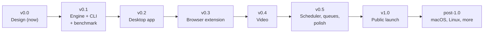

# Roadmap

Milestones from the first line of code to the public 1.0 launch, and what comes after. Each milestone has **exit criteria**: a milestone is done when every box is checked, not when a date passes. There are no dates on purpose; scope is fixed, time is not.

Feature-level detail, with the milestone for each feature, is in [FEATURES.md](FEATURES.md). Versioning rules are in [RELEASE.md](RELEASE.md).

## v0.0: Design (current)

Goal: a written design that a contributor can build from.

- [x] Vision, features, architecture, engine spec, browser integration, video, tech stack, design principles, website, roadmap, release process
- [x] License, contributing rules, governance, security policy, code of conduct, issue/PR templates
- [ ] Brand kit and `brand/BRAND.md` (in progress)
- [ ] GitHub org `boltget` and repo `boltget/boltget` configured: branch protection on `main`, labels synced, Discussions enabled, private vulnerability reporting enabled

## v0.1: Engine + CLI, with a benchmark against IDM

Goal: prove the core claim. A command-line downloader that is at least as fast as IDM and never loses progress.

Scope: `crates/engine`, `crates/cli`, `bench/`. HTTP/1.1 and HTTP/2, dynamic segmentation, adaptive connections, sparse preallocation, crash-safe checkpointing, retries, link refresh (manual), token-bucket limits, checksum verification, proxies, Content-Disposition, cookie files. Windows first; the engine must also build and pass tests on Linux in CI (cheap insurance for later ports).

Exit criteria:

- [x] Cargo workspace, CI on Windows and Linux: `cargo fmt --check`, `cargo clippy -- -D warnings`, tests, `cargo-deny` (licenses, advisories)
- [ ] Engine implements everything in [ENGINE.md](ENGINE.md) marked for v0.1; deviations are written back into ENGINE.md
  *Status (2026-10-28):* implemented and documented in ENGINE.md, except the exFAT write window (see below). Gaps recorded in ENGINE.md as later work: pausing on long `Retry-After` and on lost connectivity, Digest auth.
- [ ] Local test server covering every misbehaviour listed in [ENGINE.md, Testing strategy](ENGINE.md#testing-strategy)
  *Status (2026-10-28):* every listed misbehaviour except HTTP/2 (the server speaks HTTP/1.1 only; HTTP/2 needs TLS with a test certificate the engine trusts).
- [x] Property tests for the segment invariants pass at a high iteration count in CI
  *Status (2026-10-28):* `PROPTEST_CASES=4096` in regular CI, 262,144 in the nightly workflow.
- [x] Crash/kill-resume harness: at least 1,000 random kill-and-resume cycles across file sizes with byte-identical results, zero failures
  *Status (2026-10-28):* 1,000 kills over 349 downloads, all byte-identical (ENGINE.md, Testing strategy); the nightly workflow repeats 1,000 cycles on Windows and Linux.
- [ ] Sparse preallocation verified on NTFS (no zero-fill stall when the last segment writes first); exFAT and FAT32 behaviour handled as specified
  *Status (2026-10-28):* NTFS verified by a unit test, FAT32 4 GiB check in place; the exFAT write window is not implemented (ENGINE.md, open question 4).
- [x] `boltget get`, `list`, `pause`/`resume` (standalone), `refresh`, `bench` work; `--json` output is documented and stable enough to script against
- [ ] Benchmark harness in `bench/`, lab environment scripted, real-world target list versioned
  *Status (2026-10-28):* harness, `boltget bench`, `bench/idm-compare.ps1` and `bench/targets.toml` exist; the lab is `boltget-testserver` on loopback with per-connection throttling only. Added latency, loss, server-side connection limits and HTTP/2 are not scripted yet.
- [ ] **Benchmark report published** (in the repo, later on the website) comparing BoltGet with IDM per [ENGINE.md, Benchmarks plan](ENGINE.md#benchmarks-plan-vs-idm), with raw data. BoltGet is equal or faster on the majority of scenarios; every scenario where it is slower has an issue explaining why and a plan
  *Status (2026-10-28):* [BENCHMARK.md](BENCHMARK.md) published with raw data; BoltGet's default was equal to or faster than IDM's default on all 5 targets. Open: issues for the scenarios where the adaptive default is slower than a fixed connection count (per-connection-throttled servers), and the IDM-at-32-connections configuration, which was not run.
- [x] Default tunables (connection count, `min_split_size`, intervals) set from benchmark data, and ENGINE.md updated with the measured values
  *Status (2026-10-28):* start 4, maximum 16, `min_split_size` 1 MiB, with the measurements in ENGINE.md, open question 1.
- [ ] Fuzz targets for header parsers run in CI for a fixed time budget without findings
  *Status (2026-10-28):* seven targets in `fuzz/`, run nightly for 60 s each (`.github/workflows/nightly.yml`); their seed corpus also runs in `cargo test`. To tick once the nightly run has passed on `main`.

## v0.2: Desktop app

Goal: a daily-usable Windows app on top of the engine.

Scope: `apps/desktop`, `packages/ui`. Main list, add sheet (with probe preview), details pane with live segment map, settings, categories, basic queues, tray with animated icon, single instance, clipboard monitoring (opt-in), system proxy, notifications, dark and light themes, keyboard shortcuts and command palette, CLI client mode over the named pipe.

Exit criteria:

- [ ] pnpm workspace, CI builds the app on Windows; Prettier, ESLint, `svelte-check`, Vitest
- [ ] TypeScript bindings for engine messages are generated, not hand-written; CI fails if they are stale
- [ ] All [DESIGN-PRINCIPLES.md](DESIGN-PRINCIPLES.md) checklist items pass for every screen: themes, keyboard, reduced motion, screen reader basics
- [ ] All user-facing strings come from the string catalog (a lint rule enforces no literals in components)
- [ ] 500 downloads in the list stay smooth (no dropped frames during progress updates on a mid-range laptop) — design target, verified with the WebView2 performance profiler
- [ ] Idle memory, startup time and installer size measured and published; compared with the targets in [VISION.md](VISION.md#what-beating-idm-means-measurably)
- [ ] App survives forced kill during active downloads and resumes everything on next start
- [ ] Unsigned preview builds available from GitHub Releases as pre-releases, clearly labelled
- [ ] Shutdown/logoff handling: downloads checkpoint and resume after reboot

## v0.3: Browser extension

Goal: downloads from the browser go to BoltGet automatically, with cookies and referrer, on Chrome, Edge and Firefox.

Scope: `apps/extension`, native host binary, installer registration. See [BROWSER-INTEGRATION.md](BROWSER-INTEGRATION.md).

Exit criteria:

- [ ] Native host registers for Chrome, Edge and Firefox from the installer (per-user), with "Repair browser integration" in settings
- [ ] Capture rules, size threshold, site lists and modifier-key bypass/force work as specified
- [ ] Failed handoff always falls back to the browser download (tested with app missing, app hung, app rejecting, one-time links)
- [ ] Context menus: link, selection, all links (with picker in the app)
- [ ] Browser-assisted link refresh: re-starting an expired download in the browser offers to resume the existing one
- [ ] Playwright end-to-end tests with a stub host run in CI; manual capture matrix passes on all three browsers
- [ ] Message schema validated on both sides; fuzzing of the host decoder in CI
- [ ] Extension submitted to Chrome Web Store, Edge Add-ons and Firefox Add-ons (listing, privacy disclosures, permission justifications) and accepted (can be unlisted until v1.0)

## v0.4: Video

Goal: download video and audio from web pages through yt-dlp and ffmpeg, with a picker that a non-technical user understands. See [VIDEO.md](VIDEO.md).

Exit criteria:

- [ ] On-demand install of yt-dlp and ffmpeg with signature/hash verification, side-by-side versions, automatic rollback on failed smoke test
- [ ] Daily yt-dlp update check and update-on-extractor-failure, never using yt-dlp's self-update
- [ ] Sidecars run with explicit arguments in a Job Object; no shell; no command-executing options ever passed (test enforces the argument allowlist)
- [ ] Media detection panel in the extension, respecting the store policy constraints (tested: nothing appears on excluded domains in store builds)
- [ ] Picker: presets with resolution, container and size estimates; subtitles; advanced format table
- [ ] Playlists: select entries, one preset for all, each entry its own download
- [ ] Error mapping to the user-facing categories in VIDEO.md
- [ ] Pause/resume of media jobs

## v0.5: Scheduler, queues and polish

Goal: everything a heavy IDM user expects day to day, and a round of polish on the whole product.

Exit criteria:

- [ ] Multiple queues with concurrency limits and per-queue speed limits; drag to reorder
- [ ] Scheduler: time windows per queue, days of week, start/stop, speed-limit schedules, "when done" actions (sleep, shut down, with a cancelable countdown)
- [ ] Batch add (URL lists, numbered patterns like `file[001-100].zip`)
- [ ] Automatic checksum discovery from server headers; "Repair" mode for corrupted files
- [ ] Optional Microsoft Defender scan after download
- [ ] Settings search; import/export settings as a file
- [ ] Accessibility pass with NVDA and Narrator on every screen; issues fixed
- [ ] Performance pass: profile engine and UI under 32 connections at the highest available bandwidth; fix top regressions
- [ ] Benchmark re-run against IDM; report updated
- [ ] Beta update channel live (signed builds; see [RELEASE.md](RELEASE.md#channels))

## v1.0: Public launch

Goal: a signed, auto-updating, documented Windows release that we are proud to put in front of IDM users.

Exit criteria:

- [ ] Azure Trusted Signing (or the documented fallback) signs every executable and installer; SmartScreen behaviour verified on a clean machine
- [ ] Auto-update via the Tauri updater, signed, stable and beta channels, tested upgrade paths from each previous 0.x release
- [ ] NSIS per-user installer (default) and MSI (per-machine) both tested, including uninstall cleanup (registry keys, native host manifests, autostart)
- [ ] winget manifest submitted
- [ ] boltget.app live: home with hero, download, features, compare, benchmarks, docs, changelog, privacy; Lighthouse budget met ([WEBSITE.md](WEBSITE.md#performance-budget))
- [ ] User docs cover install, extension setup, video, CLI, troubleshooting
- [ ] Published benchmark for the 1.0 build shows BoltGet equal or faster than IDM on every scenario in the suite (see [VISION.md](VISION.md#what-beating-idm-means-measurably)); any exception is disclosed on the benchmarks page
- [ ] Zero known data-loss bugs; zero open issues labelled `priority:critical`
- [ ] Security review of native messaging, IPC, sidecar handling and updater completed; findings fixed
- [ ] Release checklist in [RELEASE.md](RELEASE.md) executed end to end

## Post-1.0

Ordered by current intent, each to be scoped by an RFC before work starts:

1. **macOS** (Apple Silicon and Intel): notarized builds, native host manifests, quarantine attribute, Safari is out of scope initially.
2. **Linux**: AppImage and/or Flatpak, `.deb`/`.rpm`; native host manifests per browser.
3. **FTP / FTPS**, then SFTP.
4. **Mirrors / Metalink / multi-source** downloads with per-piece verification ([ENGINE.md](ENGINE.md#mirrors-and-multi-source-later)).
5. **HTTP/3** (QUIC) for workers, if benchmarks justify it.
6. **Engine-driven media downloads** (BoltGet segmentation for progressive video formats, see [VIDEO.md](VIDEO.md#engine-involvement)), if not already shipped as an experiment.
7. **BitTorrent / magnet** (maybe): only if it can be done without compromising the core; possibly via a well-maintained library.
8. **Settings sync** (maybe): end-to-end encrypted, opt-in, no account required (for example via a user-provided folder).
9. **Localization** (possible, community-driven): the string catalog makes it feasible; it happens if and when contributors want to maintain translations.
10. **PAC/WPAD, NTLM/Negotiate proxy auth** for enterprise networks.
11. **Portable build**, **Microsoft Store** listing, **ARM64** Windows builds if not already done.
