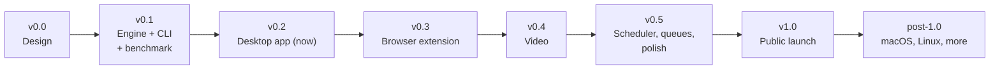

# Roadmap

Milestones from the first line of code to the public 1.0 launch, and what comes after. Each milestone has **exit criteria**: a milestone is done when every box is checked, not when a date passes. There are no dates on purpose; scope is fixed, time is not.

Feature-level detail, with the milestone for each feature, is in [FEATURES.md](FEATURES.md). Versioning rules are in [RELEASE.md](RELEASE.md).

## v0.0: Design

Goal: a written design that a contributor can build from.

- [x] Vision, features, architecture, engine spec, browser integration, video, tech stack, design principles, website, roadmap, release process
- [x] License, contributing rules, governance, security policy, code of conduct, issue/PR templates
- [x] Brand kit and `brand/BRAND.md`
- [x] GitHub org `boltget` and repo `boltget/boltget` configured: branch protection on `main`, labels synced, Discussions enabled, private vulnerability reporting enabled
  *Status (2026-10-31):* `main` requires a pull request and the `CI ok` check, without force pushes or deletion; administrators are exempt, so maintainers can still commit directly (see [AGENTS.md](../AGENTS.md#git)). Labels from `.github/labels.yml` are applied; GitHub's default labels are kept until open issues are relabelled.

## v0.1: Engine + CLI, with a benchmark against IDM (done)

Goal: prove the core claim. A command-line downloader that is at least as fast as IDM and never loses progress.

Scope: `crates/engine`, `crates/cli`, `bench/`. HTTP/1.1 and HTTP/2, dynamic segmentation, adaptive connections, sparse preallocation, crash-safe checkpointing, retries, link refresh (manual), token-bucket limits, checksum verification, proxies, Content-Disposition, cookie files. Windows first; the engine must also build and pass tests on Linux in CI (cheap insurance for later ports).

Exit criteria:

- [x] Cargo workspace, CI on Windows and Linux: `cargo fmt --check`, `cargo clippy -- -D warnings`, tests, `cargo-deny` (licenses, advisories)
- [x] Engine implements everything in [ENGINE.md](ENGINE.md) marked for v0.1; deviations are written back into ENGINE.md
  *Status (2026-10-31):* implemented and documented in ENGINE.md, including the exFAT write window. Gaps recorded in ENGINE.md as later work: pausing on long `Retry-After` and on lost connectivity, Digest auth.
- [x] Local test server covering every misbehaviour listed in [ENGINE.md, Testing strategy](ENGINE.md#testing-strategy)
  *Status (2026-10-31):* every listed misbehaviour, over HTTP/1.1 and over HTTP/2 with TLS (a CA generated at start-up, trusted by the engine through `extra_root_certificates`, the CLI's `--ca-cert`).
- [x] Property tests for the segment invariants pass at a high iteration count in CI
  *Status (2026-10-28):* `PROPTEST_CASES=4096` in regular CI, 262,144 in the nightly workflow.
- [x] Crash/kill-resume harness: at least 1,000 random kill-and-resume cycles across file sizes with byte-identical results, zero failures
  *Status (2026-10-28):* 1,000 kills over 349 downloads, all byte-identical (ENGINE.md, Testing strategy); the nightly workflow repeats 1,000 cycles on Windows and Linux.
- [x] Sparse preallocation verified on NTFS (no zero-fill stall when the last segment writes first); exFAT and FAT32 behaviour handled as specified
  *Status (2026-10-31):* NTFS verified by a unit test, FAT32 4 GiB check in place, and a 64 MiB write window on non-sparse files (exFAT, FAT32, shares that refuse sparse files; ENGINE.md, open question 4), tested by forcing it on NTFS. A run on a real exFAT USB drive is part of the file system matrix in ENGINE.md, Testing strategy.
- [x] `boltget get`, `list`, `pause`/`resume` (standalone), `refresh`, `bench` work; `--json` output is documented and stable enough to script against
- [x] Benchmark harness in `bench/`, lab environment scripted, real-world target list versioned
  *Status (2026-10-31):* harness, `boltget bench`, `bench/idm-compare.ps1` and `bench/targets.toml` exist; the lab is `boltget-testserver` on loopback with per-connection and per-line throttling, added latency, a server-side connection limit and HTTP/2, each with targets in `bench/targets.toml`. Packet loss cannot be modelled honestly on loopback and moves to the second-machine `tc netem` lab with the v0.5 benchmark re-run.
- [x] **Benchmark report published** (in the repo, later on the website) comparing Boltget with IDM per [ENGINE.md, Benchmarks plan](ENGINE.md#benchmarks-plan-vs-idm), with raw data. Boltget is equal or faster on the majority of scenarios; every scenario where it is slower has an issue explaining why and a plan
  *Status (2026-10-31):* [BENCHMARK.md](BENCHMARK.md) published with raw data; Boltget's default was equal to or faster than IDM's default on all 5 targets. The scenarios where the adaptive default is slower than a fixed connection count have issues with a plan: [#3](https://github.com/boltget/boltget/issues/3) (fixed) and [#4](https://github.com/boltget/boltget/issues/4) (repeat contact fixed, first contact open). The IDM-at-32-connections configuration ([#5](https://github.com/boltget/boltget/issues/5)) needs a manual change of IDM's settings and moves to the v0.5 benchmark re-run.
- [x] Default tunables (connection count, `min_split_size`, intervals) set from benchmark data, and ENGINE.md updated with the measured values
  *Status (2026-10-28):* start 4, maximum 16, `min_split_size` 1 MiB, with the measurements in ENGINE.md, open question 1.
- [x] Fuzz targets for header parsers run in CI for a fixed time budget without findings
  *Status (2026-10-28):* seven targets in `fuzz/`, run nightly for 60 s each (`.github/workflows/nightly.yml`); their seed corpus also runs in `cargo test`. First green nightly on `main`: 2026-10-29 (run 40842976937).

## v0.2: Desktop app (current)

Goal: a daily-usable Windows app on top of the engine.

Scope: `apps/desktop`, `packages/ui`. Main list, add sheet (with probe preview), details pane with live segment map, settings, categories, basic queues, tray with animated icon, single instance, clipboard monitoring (opt-in), system proxy, notifications, dark and light themes, keyboard shortcuts and command palette, CLI client mode over the named pipe.

Exit criteria:

- [x] pnpm workspace, CI builds the app on Windows; Prettier, ESLint, `svelte-check`, Vitest
  *Done (2026-11-01):* the app shell, `packages/ui` and `.github/workflows/desktop.yml` (generated-file checks, `svelte-check`, ESLint, Prettier, Vitest and a release build on Windows), green on `main`.
- [x] TypeScript bindings for engine messages are generated, not hand-written; CI fails if they are stale
  *Done (2026-11-01):* tauri-specta generates `apps/desktop/src/lib/bindings.ts` (commands, the engine stream and their types) from the Rust IPC types ([TECH-STACK.md, ADR-017](TECH-STACK.md#adr-017-tauri-specta-for-generated-ipc-bindings)); a Rust test fails when it is stale, in `ci.yml` and in `desktop.yml`'s `bindings:check` step.
- [x] All [DESIGN-PRINCIPLES.md](DESIGN-PRINCIPLES.md) checklist items pass for every screen: themes, keyboard, reduced motion, screen reader basics
  *Progress (2026-11-06):* Settings, categories, clipboard monitoring (opt-in), the system proxy and the command palette with the shortcut list are built ([APP-DESIGN.md](APP-DESIGN.md#settings-the-palette-and-shortcuts-as-built)) and were checked in the running app in light and dark, keyboard only for the palette and Settings. Still to do for this item: a pass with Narrator and NVDA over every screen.
  *Progress (2026-11-06, step 7):* basic queues, the last piece of v0.2's scope, are built ([APP-DESIGN.md](APP-DESIGN.md#queues-as-built), [ENGINE.md](ENGINE.md#queues)): queues with a limit and an order, reordered by dragging or Alt+arrow keys, started and stopped by hand or at daily times, start later, a cancellable finish action, and `boltget get --queue`. They were checked in the running app in light and dark, with the reordering also done from the keyboard.
  *Done (2026-11-07):* every screen checked in the release build's UI Automation tree, by keyboard, with reduced motion, forced colours and at 200%, and contrast computed from the tokens in both themes (now a CI test); the problems found were fixed ([ACCESSIBILITY.md](ACCESSIBILITY.md)). "Screen reader basics" means roles, names, states and polite announcements as Windows exposes them; listening with Narrator and NVDA remains the v0.5 accessibility pass.
- [x] All user-facing strings come from the string catalog (a lint rule enforces no literals in components)
  *Done (2026-11-07):* `boltget/no-literal-strings` ([TECH-STACK.md, ADR-015](TECH-STACK.md#adr-015-english-only-product-with-a-central-string-catalog)) runs in `lint` for `apps/desktop` and `packages/ui`, with RuleTester tests and a narrow allowlist (text without letters, catalog keys, tests and the development-only simulated engine). It found no literals in the app; the Rust side's strings come from the same catalog (`catalog.rs`).
- [x] 500 downloads in the list stay smooth (no dropped frames during progress updates on a mid-range laptop) — design target, verified with the WebView2 performance profiler
  *Progress (2026-11-01):* the list is virtualised and was measured with 500 simulated downloads in Chromium with the CPU throttled 4× (no long tasks, no frame over 33 ms while flinging through it; [APP-DESIGN.md](APP-DESIGN.md#the-list-and-the-details-pane-as-built)). Still to do: the WebView2 profiler on a real mid-range laptop.
  *Done (2026-11-07):* measured in the release build's WebView2 with 500 real downloads, 20 of them running: no long tasks and no frame over 12.3 ms, also with the CPU slowed 4× while flinging the list ([APP-PERFORMANCE.md](APP-PERFORMANCE.md#method)). The machine is a mid-range desktop (Ryzen 5 5500); the 4× slowdown stands in for the laptop.
- [x] Idle memory, startup time and installer size measured and published; compared with the targets in [VISION.md](VISION.md#what-beating-idm-means-measurably)
  *Done (2026-11-07):* [APP-PERFORMANCE.md](APP-PERFORMANCE.md), with the scripts in `bench/app/`. Start-up 0.5 to 0.6 s warm and 0.6 to 0.7 s on a first start (target under 1 s: met), installer 4.96 MiB (target under 15 MB: met). Idle memory misses "lower than IDM": 172 to 189 MiB private across the WebView2 processes against IDM's 9.4 MiB (`Boltget.exe` alone: 7 MiB). Hidden in the tray the WebView now trims to 54 MiB working set; closing the WebView while hidden is the plan for v0.5.
- [x] App survives forced kill during active downloads and resumes everything on next start
  *Done (2026-11-04):* `Engine::recovered` and the app's recovery on start (ARCHITECTURE.md, "Recovery on start"), tested in `bridge/tests.rs`, and checked in the running app: killed with `Stop-Process -Force` mid-download, it continued the download on the next start, also with a `boltget list` run in between.
- [x] Unsigned preview builds available from GitHub Releases as pre-releases, clearly labelled
  *Progress (2026-11-07):* `release.yml` builds the per-user NSIS installer (`boltget-<version>-windows-x64-setup.exe`) for `v*` tags and drafts the pre-release titled "(unsigned preview)", with a note about SmartScreen and verification ([RELEASE.md](RELEASE.md#installer)). The 0.2.0-preview.1 installer was built and tested locally: installed per user into a chosen folder, toasts show as "Boltget", and uninstalling leaves nothing behind. 
  *Done (2026-11-08):* `v0.2.0-preview.1` published as a pre-release; `v0.2.0-preview.2` (2026-11-14) brings the monochrome brand, the taskbar-aware icon and Red Hat type.
- [x] Shutdown/logoff handling: downloads checkpoint and resume after reboot
  *Done (2026-11-04):* on `WM_ENDSESSION` the app records what runs, checkpoints it within 4 s and continues it on the next start; a download the user paused stays paused (ARCHITECTURE.md, "Recovery on start"). Tested in `bridge/tests.rs` and checked in the running app by sending its windows the logoff messages Windows sends (`WM_QUERYENDSESSION`, `WM_ENDSESSION` with `ENDSESSION_LOGOFF`): it exited with both running downloads checkpointed, and the next start continued both. A real reboot was not part of the check.

## v0.3: Browser extension

Goal: downloads from the browser go to Boltget automatically, with cookies and referrer, on Chrome, Edge and Firefox.

Scope: `apps/extension`, native host binary, installer registration. See [BROWSER-INTEGRATION.md](BROWSER-INTEGRATION.md).

Exit criteria:

- [ ] Native host registers for Chrome, Edge and Firefox from the installer (per-user), with "Repair browser integration" in settings
  *Progress (2026-11-14, step 1):* `crates/native-host` (`boltget-native-host.exe`) relays the extension to the app's pipe and starts the app when a download arrives; it registers itself (`--register`), the installer ships it and runs that, and Settings, Browser shows each browser's state with Repair ([BROWSER-INTEGRATION.md](BROWSER-INTEGRATION.md#native-messaging-host-registration-on-windows)). Tested with unit and process-level tests and a stand-in app. Still to do: the store IDs in place of the placeholders, and an installed-build check that install, repair and uninstall leave the registry as expected.
  *Progress (2026-11-14, step 2):* a real Edge talks to the registered development host, which starts the app from cold and relays its answers ([BROWSER-INTEGRATION.md, Testing](BROWSER-INTEGRATION.md#testing)); that run found and fixed the host taking the command-line tool for the app in a build folder.
  *Progress (2026-11-16):* other Chromium browsers need no keys of their own: Brave reads Chrome's key (measured, and the whole Playwright suite passes in Brave), Vivaldi and Opera do too by KeePassXC's and IDM's registrations, not yet run here ([BROWSER-INTEGRATION.md, Host manifest](BROWSER-INTEGRATION.md#host-manifest)).
- [ ] Capture rules, size threshold, site lists and modifier-key bypass/force work as specified
  *Progress (2026-11-14, step 2):* `apps/extension` (WXT, Manifest V3, Chrome/Edge and Firefox builds) decides with a pure `shouldCapture`, unit-tested over every combination of its inputs, and the Playwright tests check the threshold, the types, the never list, the app's rules, the switch and Alt / Alt+Shift in Chromium. Still to do: the same in Firefox, which has not been run yet.
  *Progress (2026-11-16):* the rules are edited in the app (Settings, Browser: the switch, smallest file, file types as groups plus others, never and always sites, private windows, Restore defaults), stored with its settings and sent with every `hello`; the extension asks again before a download when its last answer is over 30 s old, and a change made in the app replaces edits made in the extension's options (the latest change wins). Entries are normalised alike in the app, its page and the extension (one shared table of cases) and bounded (200 types, 500 sites per list). Tested with Rust tests (validation, storage and migration, the `hello` answer), Vitest in the app and the extension, and an end-to-end test of an app change replacing an options edit. Still to do: a run with the real app and a browser.
  *Progress (2026-11-16):* "Forget private-window downloads" (Settings, Browser; off by default): downloads from a private window are marked private in the database (schema version 6) and, with the setting on, leave the list once they complete while the file stays; unfinished ones stay until they complete. Their notification does not name them. Tested with Rust tests (the mark through restarts and the add sheet, removal keeping the file, the setting off, turning it on, the start-up sweep) and Vitest; the row was checked in the browser-only UI. Still to do: a private-window run with the real app and a browser.
- [ ] Failed handoff always falls back to the browser download (tested with app missing, app hung, app rejecting, one-time links)
  *Progress (2026-11-14, step 1):* the native side answers every message, and only `accepted` lets the browser drop its copy: tested for no app to start, an app that starts late, a refused link (403, 404, 410: the app's own first request fails, so it rejects) and invalid or oversized messages. The extension's half (pausing, resuming, its timeout) is the next step.
  *Progress (2026-11-14, step 2):* the extension pauses the browser's download, waits up to 20 s and drops it only on `accepted`, otherwise resuming it or, if the pause lost it, starting it again: unit-tested against a fake `downloads` API and end-to-end in Chromium with a stub host that refuses a one-time link (finished from its single request), is missing, exits, answers garbage or hangs; and by hand in Edge with the real host and app (an accepted capture and a refused one-time link). Still to do: Firefox.
- [ ] Context menus: link, selection, all links (with picker in the app)
  *Progress (2026-11-14, step 2):* the extension has Download with Boltget (a forced `capture`, the browser downloads it if the app does not take it), Download selected links and Download all links (`add_links`, which the app opens in its add sheet), and Send page to Boltget (answered "not yet" until v0.4). Not driven by the automated tests; to be checked in the manual matrix.
- [ ] Browser-assisted link refresh: re-starting an expired download in the browser offers to resume the existing one
  *Progress (2026-11-16):* a capture with the name and size of exactly one download waiting for a new link is not added: the app asks "Use this link to resume *file.iso* (73% done)?", and Resume refreshes the old download with the browser's link, cookies and headers (validated as for a manual refresh) and continues it; declining or a refused link adds it as usual, so the browser's copy is never lost ([BROWSER-INTEGRATION.md](BROWSER-INTEGRATION.md#protocol)). `refresh_link` now lets new cookies replace the download's. Tested with Rust tests (matching, offer, resume, decline, refusal, cookies replaced) and Vitest. Still to do: a run with a real browser and an expiring signed link.
- [ ] Playwright end-to-end tests with a stub host run in CI; manual capture matrix passes on all three browsers
  *Progress (2026-11-14, step 2):* 22 Playwright tests with a stub host run in `.github/workflows/extension.yml` on Windows. The manual matrix is still to run.
- [x] Message schema validated on both sides; fuzzing of the host decoder in CI
  *Progress (2026-11-14, step 1):* protocol version 1 in `crates/ipc/src/browser.rs`, strict and bounded, checked by the host and again by the app, with generated TypeScript types in `packages/native-messaging` (CI fails when they are stale); the host's decoder is the fuzz target `native_message`, run nightly with the others. *Status (2026-11-14, step 2):* the extension builds its messages from the generated types and leaves out any value the host would refuse, and checks every reply's shape and id before acting on it; anything it does not understand keeps the browser's download.
- [ ] Extension submitted to Chrome Web Store, Edge Add-ons and Firefox Add-ons (listing, privacy disclosures, permission justifications) and accepted (can be unlisted until v1.0)

## v0.4: Video

Goal: download video and audio from web pages through yt-dlp and ffmpeg, with a picker that a non-technical user understands. See [VIDEO.md](VIDEO.md).

Plan, in order (each step ends with its docs, tests and changelog entry):

1. **Sidecars:** `crates/media` installs yt-dlp and FFmpeg on demand with the engine, verifies them, keeps versions side by side, smoke-tests before activating, rolls back, updates (daily and on extractor failure) and runs them safely; `boltget media` exposes it. *(Done 2026-11-16.)*
2. **Probing and the format model:** `yt-dlp -J` on a page URL (cookies through a temporary file), the info JSON parsed into a typed model (formats, subtitles, thumbnails, playlists), the presets of [VIDEO.md](VIDEO.md#format-and-quality-picker-ux) computed from it, the `media_job` table, and "this is a web page, not a file" in the add flow. *(Done 2026-11-16.)*
3. **The picker in the app:** the first-use install sheet (sizes from the release metadata), presets with resolution, container and size, subtitles, the advanced table; Settings, Video (tool status, channel, custom paths); a media download running yt-dlp with progress from `--progress-template`. *(Done 2026-11-17.)*
4. **The extension's media panel:** detection, `media_page`, the store-policy exclusions, tested. *(Done 2026-11-17.)* With it, the app offers copied video page links when clipboard monitoring is on, which covers the sites the store builds leave out ([VIDEO.md](VIDEO.md#copied-video-links-as-built)).
5. **Playlists:** entries with `--flat-playlist`, selection, one preset for all, one download per entry in its own queue. *(Done 2026-11-17.)*
6. **Errors and pause/resume:** yt-dlp's errors mapped to the user-facing categories (the "site changed" one calls the update-on-failure hook from step 1), the Processing state, pause and resume of media jobs. *(Done 2026-11-18.)*

Exit criteria:

- [ ] On-demand install of yt-dlp and ffmpeg with signature/hash verification, side-by-side versions, automatic rollback on failed smoke test
  *Progress (2026-11-16, step 1):* `crates/media` (`boltget-media`) downloads both with the engine, pinned to GitHub's hosts over HTTPS (`EngineConfig::allowed_hosts`, redirects included). yt-dlp's `SHA2-256SUMS` must carry a valid signature by yt-dlp's release key, pinned in the code (RSA 4096, `AC0C BBE6 … 3B5A 7581`; verified with `ring`), and the binary must match its line; FFmpeg is BtbN's 9.0 GPL shared build, pinned by URL, size and SHA-256 in the code. Each version is unpacked into its own directory, smoke-tested (`--version` / `-version`, with the printed version checked) and only then made active by rewriting `tools/manifest.json` atomically; the previous version is kept, older ones are pruned, and an active version that fails its smoke test is rolled back and never reinstalled automatically ([VIDEO.md, As built](VIDEO.md#install-verification-and-updates-as-built)). Tested against a fake release server (verify, bad hash, bad signature, another key, foreign hosts and redirects, failed smoke test, update, prune, rollback) and against yt-dlp 2026.10.26's real signed checksums; a real install of yt-dlp 2026.10.26 and FFmpeg n9.0.2 with `boltget media install` took 17 s. Still to do: the install sheet in the app (step 3); the Boltget-signed FFmpeg manifest for out-of-band updates.
  *Progress (2026-11-17, step 3):* the app's first-use install sheet shows both tools with their versions and download sizes from the release metadata, the rights notice and the install's progress per tool, then continues to the picker; Settings, Video shows the installed versions and the last check, checks for updates on demand, reinstalls and removes, chooses yt-dlp's channel, and accepts programs of the user's own after a start-up check (not verified or updated by Boltget).
- [x] Daily yt-dlp update check and update-on-extractor-failure, never using yt-dlp's self-update
  *Progress (2026-11-16, step 1):* `Sidecars::update_if_due` checks yt-dlp at most once a day and FFmpeg when the pinned build changes; `Sidecars::on_extractor_failure` checks at once, at most once an hour; both install through the same verified path, and every yt-dlp command line starts with `--ignore-config --no-plugin-dirs --no-update` while `-U` and `--update-to` are refused. Tested with a fake clock. *Step 2:* the app's "Look for media on this page" and `boltget media probe` call `update_if_due` before probing. Still to do: step 6's error mapping calling `on_extractor_failure`.
  *Done (2026-11-18, step 6):* every probe (the add sheet, the extension's pages, copied video links) and every start of a media job runs the daily check in the background and waits for it at most 5 s, so a slow update never holds up a download; a probe or job that fails because "the site changed" calls `on_extractor_failure` (at most hourly), waits up to 60 s, and if a newer yt-dlp was installed tries once more and says so; the CLI's `probe` and `get` do the same ([VIDEO.md](VIDEO.md#errors-and-pauseresume-as-built)). Tested against a fake release server (each outcome; the daily check going on in the background after its wait). Real: `boltget media probe` on a page that made yt-dlp ask for a bug report ran the real check, which found 2026.10.26 current. Not yet seen: a real extractor fix arriving that way.
- [x] Sidecars run with explicit arguments in a Job Object; no shell; no command-executing options ever passed (test enforces the argument allowlist)
  *Progress (2026-11-16, step 1):* `boltget_media::runner` starts only absolute `.exe` paths with an explicit argument vector, a fixed working directory and a reduced environment, suspended, then inside a Job Object with `JOB_OBJECT_LIMIT_KILL_ON_JOB_CLOSE` (`crates/media/src/platform/windows.rs`), with a timeout. Every argument passes an allowlist (exact option names only); tests enumerate the forbidden options (`--exec`, `--netrc-cmd`, external downloaders, post-processor plugins, `--plugin-dirs`, `--config-locations`, `-U`, browser cookies, TLS weakening; for ffmpeg filters, protocol lists, non-local inputs) and check that a sidecar and the process it starts both end when the job closes. Still to do: the app's media jobs using it (steps 3 and 6).
  *Progress (2026-11-17, step 3):* media downloads run through the same runner; the allowlist now also checks values: proxies (`http`, `https`, `socks5`, `socks5h`), the output template (a file name, no folders), the folder (absolute), subtitle languages (codes only) and known formats.
  *Done (2026-11-18, step 6):* every use of yt-dlp and FFmpeg in the app and the CLI (installs' smoke tests, probes, downloads, custom-path checks) goes through the runner. Step 6 allows `--compat-options` with exactly one value, `no-keep-subs`; every other compatibility option stays refused (tested). Real: killing `boltget media get` mid-download ended its yt-dlp too (the Job Object).
- [ ] Media detection panel in the extension, respecting the store policy constraints (tested: nothing appears on excluded domains in store builds)
  *Progress (2026-11-17, step 4):* the extension notices the HLS and DASH manifests and the video and audio files a page loads (with site access; segments, small files and ranges grouped away; at most 20 per tab, cleared on navigation), counts them on its toolbar badge, and its popup offers "Download video from this page" with the page's own video elements found when it opens, plus each stream or file to send alone; the background sends `media_page` (protocol version 2: hints; every other message still goes at version 1, so a 0.3 app keeps taking downloads) with the page's cookies, `User-Agent` and the page as `Referer`; the app opens its media sheet with them, yt-dlp gets them for the probe and for every run of the job in that session (memory only), and when yt-dlp finds nothing the sheet offers the hints: a stream to yt-dlp, a file to the add sheet ([BROWSER-INTEGRATION.md](BROWSER-INTEGRATION.md#media-detection-panel), [VIDEO.md](VIDEO.md#the-extensions-media-panel-as-built)). **The store policy** is on in every build (a build-time flag, off only for a build no store sees): on `youtube.com`, `youtu.be`, `youtube-nocookie.com` and their subdomains nothing is noticed, badged, shown or sent, and YouTube's media hosts and players embedded elsewhere give no hints. Tested with Vitest (detection, grouping, the tab store, the policy matcher with subdomains and look-alikes) and Playwright with the stub host (the store build on four excluded sites shows and sends nothing, an embedded player gives no hints, an allowed page with a video sends a `media_page` with its hints, cookie and headers; an older app is told to update). A real run (Brave, the registered debug host, the debug app with real yt-dlp and FFmpeg) took a Wikimedia Commons video page from the popup to a finished download in the app; it also found that Prefer MP4 fails for a VP8 page (to fix in step 6, [VIDEO.md](VIDEO.md#the-extensions-media-panel-as-built)). Not yet run: Firefox, and the context menus by hand.
- [ ] Picker: presets with resolution, container and size estimates; subtitles; advanced format table
  *Progress (2026-11-16, step 2):* `boltget-media` probes a page with `yt-dlp -J` (cookies through a temporary file in the private tools folder, deleted when the probe ends), reads the info JSON leniently into a typed model (formats, subtitles and automatic captions, thumbnails, flat playlists, DRM), and resolves the presets of VIDEO.md (Best quality, 1080p, 720p, Smaller file, Audio only, for "Prefer MP4" and "Prefer original") the way yt-dlp would, with resolution, container, codecs and size (exact, estimated, or from the bit rate), collapsing presets that give the same file and leaving out heights the page does not have ([VIDEO.md, As built](VIDEO.md#probing-and-presets-as-built)). Tested against six realistic info JSON fixtures and a fake yt-dlp (arguments, cookie file contents and deletion, yt-dlp's error message). `boltget media probe` shows it; the app's add sheet offers "Look for media on this page" for a link that returns a web page and shows the best preset. Jobs are recorded in the new `media_job` table (schema version 7). Still to do: the picker itself, subtitles and the advanced table (step 3).
  *Progress (2026-11-17, step 3):* the app's media sheet shows the page's thumbnail, title, uploader and length, the presets with resolution, container, codecs and size ("about" for estimates), the Prefer MP4 switch, a subtitles drop-down (automatic captions marked; in the video or as a file), and under Advanced every format (ID, resolution, fps, codecs, bitrate, size, protocol) with a video and an audio stream to pick and a free format expression; the last preset is remembered per site; playlists and DRM say so ([VIDEO.md, As built](VIDEO.md#picker-and-media-downloads-as-built)). Media downloads run yt-dlp with progress from `--progress-template` lines, a Processing state, pause and resume by restarting yt-dlp on its partial files, and recovery on start, as rows of the main list. Tested with Vitest (the picker's logic), Rust tests with a fake yt-dlp (arguments and their value checks, the progress parser on recorded lines, stopping and continuing, failures, the bridge running a job to completion, pause, resume and removal), in the browser with the simulated engine in both themes, and with a real yt-dlp 2026.10.26 and FFmpeg n9.0.2 from `boltget media get` (a Creative Commons video from Wikimedia Commons, 720p preset with English subtitles embedded: 93 MiB in 13 s, marked with the Mark of the Web). Not yet run in the real app window with real tools.
- [ ] Playlists: select entries, one preset for all, each entry its own download
  *Progress (2026-11-17, step 5):* a playlist's page (or a channel's; a video's page that names a list offers "This video" or "The whole playlist") lists its entries with `--flat-playlist`, 200 at a time with Load more (`--playlist-items`, its values checked by the allowlist), with place, title, length and thumbnail; private and deleted entries are shown disabled. The user chooses entries (click, Shift ranges, keyboard, Select all or none) and one preset for all: the preset's format expression, whose own fallbacks choose for each entry, sizes unknown; subtitles in a common language "if available". Each entry becomes its own media job and row (the new `media_playlist` table, schema version 9), in a folder named after the playlist, numbered `07 - Title [id].ext`; a playlist runs one entry at a time inside the media runner's two slots (its "own queue", decided on the media side rather than in the engine's queues: [VIDEO.md](VIDEO.md#playlists-as-built)), with a sidebar entry and view, Pause all and Resume all. `boltget media probe` lists entries and `boltget media get --playlist [--items 1-5,8]` downloads them one after another. Tested with Rust (the model, folder names, templates, the allowlist, a fake yt-dlp answering a watch page in a list both ways, the store and its migration, the bridge running a playlist through the fake yt-dlp one entry at a time beside a single page), Vitest and in the browser with the simulated engine in both themes. A real CLI run with yt-dlp 2026.10.26 and FFmpeg n9.0.2 downloaded two chosen entries of a 23-entry Internet Archive item as numbered M4A files in its folder (52 s). Not yet run in the real app window with real tools.
- [x] Error mapping to the user-facing categories in VIDEO.md
  *Done (2026-11-18, step 6):* `boltget_media::failure` sorts yt-dlp's failures (probes and downloads) into sign-in needed, not available, the site changed, DRM, connection, nothing to download, processing and other, tested on a corpus of 49 messages after yt-dlp's wording; the app shows the category's sentence with a hint where useful (sign in through the extension; one's own yt-dlp), Try again, the update's outcome for "the site changed", and yt-dlp's message under a disclosure with a Copy button; jobs store the category's key ([VIDEO.md](VIDEO.md#errors-and-pauseresume-as-built)). Real: an unsupported page, a missing Vimeo video and a missing Wikimedia file through `boltget media probe` (the last shows as "the site changed", because yt-dlp asks for a bug report there: documented). Not yet run in the real app window.
- [x] Pause/resume of media jobs
  *Progress (2026-11-17, step 3):* the basic version: pause ends yt-dlp's process tree (no graceful step, VIDEO.md says why), resume runs it again and it continues from its `.part` files; jobs that ran when the app ended continue on the next start. Step 6 finishes it.
  *Done (2026-11-18, step 6):* a job that is processing is not paused but finishes (no Pause on its row; Pause all skips it); removing an unfinished job deletes its partial and temporary files, found by the stem yt-dlp names them after (recorded with the job, schema version 10), only in its folder and never the user's; paused jobs stay paused across restarts and running ones continue their `.part` files; playlists keep their order. Tested with the fake yt-dlp continuing a `.part` file from its length, and the bridge across a restart. Real: `boltget media get` killed after 25 MB of 97 MB continued from its `.part` file on the next run to a complete file. Not yet run in the real app window with real tools.

## v0.5: Scheduler, queues and polish

Goal: everything a heavy IDM user expects day to day, and a round of polish on the whole product.

Exit criteria:

- [ ] Multiple queues with concurrency limits and per-queue speed limits; drag to reorder
  *Status (2026-11-06):* queues with concurrency limits and drag to reorder shipped in v0.2 ([ENGINE.md, Queues](ENGINE.md#queues)); per-queue speed limits remain.
- [ ] Scheduler: time windows per queue, days of week, start/stop, speed-limit schedules, "when done" actions (sleep, shut down, with a cancelable countdown)
  *Status (2026-11-06):* a daily start and stop time per queue, start later for a download, and "when done" (sleep, shut down, with a 60 s cancellable countdown) shipped in v0.2; days of the week and speed-limit schedules remain.
- [ ] Batch add (URL lists, numbered patterns like `file[001-100].zip`)
- [ ] Automatic checksum discovery from server headers; "Repair" mode for corrupted files
- [ ] Optional Microsoft Defender scan after download
- [ ] Settings search; import/export settings as a file
- [ ] Accessibility pass with NVDA and Narrator on every screen; issues fixed
- [ ] Performance pass: profile engine and UI under 32 connections at the highest available bandwidth; fix top regressions
- [ ] Benchmark re-run against IDM on a second-machine lab with added loss (`tc netem`), including IDM at its maximum of 32 connections ([#5](https://github.com/boltget/boltget/issues/5)); report updated
- [ ] Beta update channel live (signed builds; see [RELEASE.md](RELEASE.md#channels))

## v1.0: Public launch

Goal: a signed, auto-updating, documented Windows release that we are proud to put in front of IDM users.

Exit criteria:

- [ ] Azure Trusted Signing (or the documented fallback) signs every executable and installer; SmartScreen behaviour verified on a clean machine
- [ ] Auto-update via the Tauri updater, signed, stable and beta channels, tested upgrade paths from each previous 0.x release
- [ ] NSIS per-user installer (default) and MSI (per-machine) both tested, including uninstall cleanup (registry keys, native host manifests, autostart)
- [ ] winget manifest submitted
- [ ] boltget.app live: home with hero, download, features, compare, benchmarks, docs, changelog, privacy; Lighthouse budget met ([WEBSITE.md](WEBSITE.md#performance-budget))
- [ ] User docs cover install, extension setup, video, CLI, troubleshooting
- [ ] Published benchmark for the 1.0 build shows Boltget equal or faster than IDM on every scenario in the suite (see [VISION.md](VISION.md#what-beating-idm-means-measurably)); any exception is disclosed on the benchmarks page
- [ ] Zero known data-loss bugs; zero open issues labelled `priority:critical`
- [ ] Security review of native messaging, IPC, sidecar handling and updater completed; findings fixed
- [ ] Release checklist in [RELEASE.md](RELEASE.md) executed end to end

## Post-1.0

Ordered by current intent, each to be scoped by an RFC before work starts:

1. **macOS** (Apple Silicon and Intel): notarized builds, native host manifests, quarantine attribute, Safari is out of scope initially.
2. **Linux**: AppImage and/or Flatpak, `.deb`/`.rpm`; native host manifests per browser.
3. **FTP / FTPS**, then SFTP.
4. **Mirrors / Metalink / multi-source** downloads with per-piece verification ([ENGINE.md](ENGINE.md#mirrors-and-multi-source-later)).
5. **HTTP/3** (QUIC) for workers, if benchmarks justify it.
6. **Engine-driven media downloads** (Boltget segmentation for progressive video formats, see [VIDEO.md](VIDEO.md#engine-involvement)), if not already shipped as an experiment.
7. **BitTorrent / magnet** (maybe): only if it can be done without compromising the core; possibly via a well-maintained library.
8. **Settings sync** (maybe): end-to-end encrypted, opt-in, no account required (for example via a user-provided folder).
9. **Localization** (possible, community-driven): the string catalog makes it feasible; it happens if and when contributors want to maintain translations.
10. **PAC/WPAD, NTLM/Negotiate proxy auth** for enterprise networks.
11. **Portable build**, **Microsoft Store** listing, **ARM64** Windows builds if not already done.
