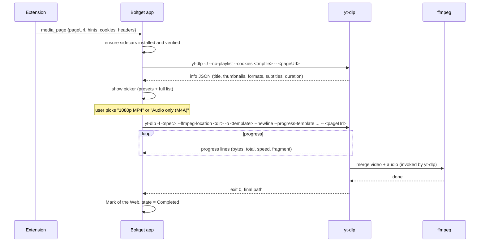

# Video and audio downloads

Boltget downloads video and audio from websites by running two well-established open-source tools as **sidecars**: [yt-dlp](https://github.com/yt-dlp/yt-dlp) for extraction and downloading, and [FFmpeg](https://ffmpeg.org) for merging and converting. Neither is bundled with the installer; both are installed on demand the first time the user needs them, verified, and kept up to date.

Target milestone: v0.4 (see [ROADMAP.md](ROADMAP.md)).

Related: [BROWSER-INTEGRATION.md](BROWSER-INTEGRATION.md#media-detection-panel) (how pages are detected), [ARCHITECTURE.md](ARCHITECTURE.md#sidecars) (process model and security).

## Why sidecars

- **yt-dlp is the best extractor in existence** and supports a very large number of sites. Its extractors break whenever sites change, and its maintainers fix them quickly. Re-implementing that in Rust would be an endless, losing race.
- **Separation of concerns.** The extension detects; the app decides; yt-dlp extracts. Site-specific logic never lives in the extension, which is what keeps the extension store-compliant.
- **Not bundled**, because:
  - yt-dlp must update far more often than Boltget releases.
  - It keeps the installer small for users who never download video.
  - FFmpeg builds are large (tens of MB) and have their own licensing considerations.
- **Separate processes.** A crash or hang in a sidecar cannot take down the app, and sidecars can be killed cleanly.

## Licensing

- yt-dlp is released under the Unlicense. Running it as a separate program is unproblematic.
- FFmpeg builds for Windows are commonly GPL-licensed builds (with `--enable-gpl`). Boltget is GPL-3.0-or-later, so there is no conflict. Boltget does not distribute FFmpeg in its installer; it downloads an upstream build on the user's request. If Boltget ever mirrors FFmpeg binaries itself, it must also provide the corresponding source as the GPL requires; the sidecar manifest would then point to the source archive too.

## Install, verification and updates

### Where they live

```
%LOCALAPPDATA%\Boltget\tools\
├── manifest.json                    # installed versions, hashes, install dates
├── yt-dlp\2026.xx.yy\yt-dlp.exe
└── ffmpeg\7.x\bin\ffmpeg.exe, ffprobe.exe
```

Versions are installed side by side; the new version becomes active only after it is verified and a smoke test (`yt-dlp --version`, `ffmpeg -version`) passes. The previous version is kept until the next successful update, so a bad update can be rolled back automatically.

### First-use install flow

1. The user pastes a video page URL, or the extension sends `media_page`.
2. If the tools are missing, the app shows a single sheet: "Video downloads need two free tools: yt-dlp (about N MB) and FFmpeg (about M MB). Install now?" with links to both projects. Sizes are read from the release metadata at that moment, not hard-coded.
3. On confirm, both are downloaded **with the Boltget engine itself** (segmented, resumable), verified, extracted and smoke-tested, with progress shown inline.
4. The original request continues automatically.

Users can also point Boltget at existing installations (Settings → Video → Use custom paths). Custom paths are not auto-updated or verified; the UI says so.

### Verification

Nothing is executed until it is verified:

- **yt-dlp:** upstream publishes checksum files (`SHA2-256SUMS`, `SHA2-512SUMS`) and detached signatures of those files with each release. Boltget pins yt-dlp's release-signing public key in the app, verifies the signature of the checksum file, then verifies the binary's SHA-256 against it. This lets Boltget pick up a new yt-dlp release the same day without waiting for Boltget infrastructure, while still trusting only yt-dlp's signing key. (The exact signature format and key are confirmed during v0.4 implementation; if upstream signing is unavailable for some release, Boltget falls back to the Boltget-signed manifest below.)
- **FFmpeg:** upstream FFmpeg does not publish official Windows binaries; well-known third-party builders do. Boltget chooses one builder (candidate: the widely used builds published on GitHub Releases by BtbN, which include checksums) and publishes a **Boltget-signed sidecar manifest** listing the exact version, URL and SHA-256 that Boltget has tested. The manifest is signed with a dedicated key (separate from the updater key) and verified by the app. FFmpeg needs updating rarely, so a manifest-driven process is fine.
- Downloads go over HTTPS from the pinned hosts only. Redirects to other hosts are refused for sidecar downloads.

### Updates

- **yt-dlp:** checked at most once a day while video features are in use (and immediately when an extraction fails with an error that suggests a broken extractor). Updated in the background; an in-progress download keeps using the old version.
- Boltget **does not use yt-dlp's built-in self-update** (`-U`), because that would replace a verified binary with one Boltget has not verified. The app always passes the option that disables update checks if the installed version supports it.
- Channel: yt-dlp stable by default; "nightly" is an advanced opt-in for users who need fixes before a stable release.
- **FFmpeg:** updated when the Boltget sidecar manifest changes, which happens with Boltget releases or out-of-band for security fixes.

### Known operational issues

- yt-dlp's Windows executable is a self-extracting bundle; its startup is slower than a native binary and some antivirus products flag such bundles. Boltget evaluates an unpacked (one-directory) build if upstream provides one for Windows, and documents how to report false positives.
- Some sites need additional components for full support (for example, upstream has introduced a requirement for an external JavaScript runtime for some YouTube formats). Boltget treats such components as additional sidecars with the same install/verify/update rules, decided case by case and documented here.

### Install, verification and updates: as built

*v0.4 step 1 (2026-11-16).* The decisions this section left open, and how the sidecar manager works.

**Where the code lives.** A crate of its own, `crates/media` (`boltget-media`), used by the CLI (`boltget media`) and, from step 3, by the app. Not part of the engine: the engine stays a download library, while this crate starts processes and unpacks archives. It downloads through the engine (an in-memory `Engine` per install: segmented and retried, not resumable across restarts) and builds and tests on Linux like the engine.

**Layout.** As sketched above, with these details:

```
%LOCALAPPDATA%\Boltget\tools\          (the CLI: <--state>\tools)
├── manifest.json        format 1; per tool: active, previous, channel, last_check,
│                        last_failure_check, rejected, and per version its URL,
│                        SHA-256, size, install time and program paths
├── .lock                held while installing, updating, rolling back or pruning
├── .downloads\          downloads in progress; removed after every install
├── yt-dlp\2026.10.26\yt-dlp.exe, _internal\...
└── ffmpeg\n9.0.2-39-g7adfbe40dc\bin\ffmpeg.exe, ffprobe.exe, *.dll
```

- The manifest is the "active" pointer: it is rewritten to a temporary file, flushed, and renamed over the old one, so the switch is atomic. A manifest that cannot be parsed is moved aside (`manifest.json.bad`) and treated as empty, so the tools are installed again rather than never. A second process that wants the lock gets "busy" (CLI exit code 7).
- Version directory names come from the release (yt-dlp's tag) and must match `[A-Za-z0-9._-]{1,64}`, not starting with a dot.

**Trust model.**

- **Hosts:** HTTPS only, to `api.github.com`, `github.com`, `objects.githubusercontent.com` and `release-assets.githubusercontent.com`. The engine enforces the list for every request, redirects included (`EngineConfig::allowed_hosts`, [ENGINE.md, Redirects](ENGINE.md#redirects)), and the manager refuses a release whose asset URL points elsewhere before fetching anything.
- **yt-dlp:** the latest release comes from the GitHub releases API (`yt-dlp/yt-dlp`, or `yt-dlp/yt-dlp-nightly-builds` on the nightly channel; both are signed with the same key). The release must have `SHA2-256SUMS` and `SHA2-256SUMS.sig`. The signature is a binary OpenPGP version 4 signature by yt-dlp's release key, "Simon Sawicki (yt-dlp signing key)", RSA 4096, created 2023-02-26, fingerprint `AC0C BBE6 848D 6A87 3464 AF4E 57CF 6593 3B5A 7581` (`public.key` in yt-dlp's repository). Boltget pins the key's modulus, exponent and creation time in `crates/media/src/sources.rs`; a test recomputes the fingerprint from them. The binary's SHA-256 must then match its single line in the verified file (checked by the engine on completion, and again before unpacking).
- **Why no OpenPGP library:** one signature format from one pinned key needs a few hundred lines; `crates/media/src/pgp.rs` parses exactly one version 4 signature packet over a binary document (RSA, SHA-256/384/512) and refuses anything else (armor, other packet or signature types, unknown critical subpackets, an issuer other than the pinned key, an expired signature), and `ring`, already Boltget's crypto provider, does the RSA verification. A full OpenPGP implementation (rPGP, Sequoia) would add a large dependency tree for this. The parser is tested with yt-dlp 2026.10.26's real signed checksums (every changed byte fails) and with signatures made by an independent test signer.
- **No fallback:** a yt-dlp release without a valid signature is not installed. The Boltget-signed manifest this section mentions as a fallback is not built (nor needed so far).
- **FFmpeg:** the builder is BtbN's FFmpeg-Builds (now published as `FFmpeg-Builds/FFmpeg-Builds` on GitHub), release branch 9.0, GPL, **shared** libraries (an 86 MB zip instead of 195 MB for the static build), from a month-end autobuild (`autobuild-2026-10-31-12-59`, n9.0.2-39-g7adfbe40dc): the builder prunes daily builds but keeps month-end ones. Windows x64 and Arm64 are pinned by URL, size and SHA-256 in `sources.rs`; this compiled-in pin is the "Boltget sidecar manifest" for now, as trustworthy as the Boltget binary that carries it (Authenticode and the updater's signature). Other platforms have no pin yet (BtbN ships `.tar.xz` there; the system's FFmpeg through custom paths is the plan). The separately signed manifest for out-of-band FFmpeg updates, with its own key, is still to come; until then FFmpeg changes with Boltget releases.
- **Windows build of yt-dlp:** the unpacked "onedir" build (`yt-dlp_win.zip`, `yt-dlp_win_arm64.zip`), which upstream now publishes: it starts faster than the self-extracting `yt-dlp.exe` and is flagged less often (see Known operational issues). Linux and macOS use the single-file builds.
- **No Mark of the Web** on these downloads: they are verified and never opened by the user, and a zip's mark would not reach the unpacked files anyway.

**Install.** Download, verify, unpack (zip only, with the pure-Rust `zip` crate: entries that would leave the directory, symbolic links, more than 20,000 entries or more than 2 GiB unpacked are refused; FFmpeg keeps only `bin/`, and since step 2 not `ffplay.exe`) into a staging directory, rename it to the version directory, then the **smoke test**: yt-dlp `--ignore-config --no-plugin-dirs --no-update --version` must print exactly the release tag; `ffmpeg -version` and `ffprobe -version` must start with `ffmpeg version` / `ffprobe version` and name the pinned version; 120 s at most each. Only then is the version made active. A version that fails is deleted and the active one stays as it was.

**Rollback.** The previous version is kept; every other version (and any leftover staging directory) is pruned after each switch; a directory still in use is left for the next prune. `verify_active` (CLI: `boltget media check`) smoke-tests the active version; if it fails and the previous one passes, the previous one becomes active again and the failed version is recorded as rejected: it is never installed again automatically (a newer release is). `boltget media rollback <tool>` does the same by hand.

**Updates.** `update_if_due` checks yt-dlp at most once every 24 hours, and FFmpeg when Boltget's pin differs from the active version (no network check). The app calls it while video features are in use (step 3). `on_extractor_failure` checks yt-dlp at once, at most once an hour; step 6's error mapping calls it for "the site changed". A job that is running keeps using its version's files: versions live in separate directories. `--no-update` is always passed (yt-dlp versions without it fail the smoke test; they are older than anything Boltget installs), and `-U` and `--update-to` are refused by the argument allowlist ([ARCHITECTURE.md, Sidecars](ARCHITECTURE.md#sidecars-1)). The channel is chosen with `boltget media channel stable|nightly` (in the app: Settings, Video, step 3).

**Not yet built:** the signed FFmpeg manifest, FFmpeg pins for Linux and macOS. (Custom paths and the first-use install sheet arrived with step 3: [Picker and media downloads: as built](#picker-and-media-downloads-as-built).)

## How a media download flows



- Pasting a URL into the app's add box follows the same path: the app recognises "this is a web page, not a file" (probe returns `text/html`) and offers "Look for media on this page".
- **Playlists and channels:** if the info JSON is a playlist, the picker shows the entries (with `--flat-playlist` for speed) and lets the user select items and one format preset for all. Each entry becomes its own `media` download in a dedicated queue. *Built in step 5 as a queue of the media runner, one entry at a time: [Playlists: as built](#playlists-as-built).*
- **Cookies:** yt-dlp receives cookies through a temporary Netscape-format cookie file built from the cookies the extension sent, created with an ACL restricted to the current user and deleted when the job ends. Boltget does not use yt-dlp's option to read cookies directly from browser profiles: that touches the browser's databases, and recent Chromium versions on Windows encrypt cookies in a way that external tools cannot read reliably.
- **Hints:** if yt-dlp has no specific extractor for the site, it falls back to its generic extractor. If that also fails and the extension supplied a direct media URL hint (an `.m3u8`, `.mpd` or direct `video/*` response), the app offers to download that URL directly (HLS/DASH via yt-dlp's generic handling of the manifest URL; direct files via the Boltget engine).

### Engine involvement

- v0.4: yt-dlp downloads the media itself. For HLS/DASH, Boltget passes `--concurrent-fragments` (design target: 4) to parallelize fragment downloads.
- Later (experiment, v0.5+): for formats that are plain progressive HTTP files, take the format URL and per-format `http_headers` from the info JSON, download with the Boltget engine (dynamic segmentation, resume, link refresh), then mux with ffmpeg directly. Some sites throttle per connection, so this could be much faster. It is an experiment because format URLs can be bound to the requesting client and may expire quickly; it ships only if it is reliable across the test matrix.

## Format and quality picker UX

Principles from [DESIGN-PRINCIPLES.md](DESIGN-PRINCIPLES.md) apply: one obvious choice, details on demand.

**Default view: presets.** A short list, computed from the available formats:

| Preset | yt-dlp format selection (sketch) |
|---|---|
| Best quality | `bv*+ba/b` |
| 1080p (if available) | `bv*[height<=1080]+ba/b[height<=1080]` |
| 720p | `bv*[height<=720]+ba/b[height<=720]` |
| Smaller file | `bv*[height<=480]+ba/b[height<=480]` |
| Audio only | `ba/b` with extraction to the chosen audio format |

- Each preset shows the **resulting resolution, container, codecs and estimated size** (from `filesize` or `filesize_approx` in the info JSON; marked "about" when approximate, hidden when unknown).
- Presets that would produce the same result as another are collapsed.
- **Container preference:** "Prefer MP4" (default, for compatibility) vs "Prefer original" (often WebM/MKV, sometimes higher quality). Shown as a single toggle.
- **Subtitles:** a dropdown of available languages plus auto-generated captions (marked), with "embed" or "save as file".
- **Advanced:** a disclosure revealing the full format table (ID, resolution, fps, codec, bitrate, size, protocol), multi-select of one video and one audio stream, and a free-text format expression for experts.
- The thumbnail, title, uploader and duration are shown at the top so the user knows they picked the right page.
- The last-used preset is remembered per site.

**Output naming** uses a yt-dlp output template with a safe default (`%(title)s [%(id)s].%(ext)s`), sanitized by yt-dlp's Windows-safe filename handling, written to the "Video" category folder.

### Probing and presets: as built

*v0.4 step 2 (2026-11-16).* What the sections above left open, and how probing works.

**The command line.** `Prober` (`crates/media/src/probe.rs`; `Sidecars::prober` takes the active yt-dlp, and FFmpeg's directory when it is installed) runs, through the guarded runner: `yt-dlp --ignore-config --no-plugin-dirs --no-update [--ffmpeg-location <dir>] -J --flat-playlist --no-playlist --ignore-no-formats-error --encoding utf-8 --socket-timeout 20 [--cookies <file>] [--referer <url>] [--add-headers User-Agent:<ua>] [--proxy <url>] -- <page>`.

- `--flat-playlist` is always passed: with `--no-playlist` a watch page that names a video still gets that video in full, while a page that is only a playlist lists its entries without resolving each (which could take minutes). `PlaylistMode::Entries` (`--yes-playlist` instead) lists the playlist a watch page belongs to, and `ProbeOptions::items` adds `--playlist-items START:END` (*step 5*, [Playlists: as built](#playlists-as-built)).
- `--ignore-no-formats-error`: a page whose formats are all DRM-protected is still described (with `_has_drm` set and no formats) instead of failing, so DRM is a flag rather than an error to classify. It is the only option added to the allowlist in this step.
- Header values must not contain control characters (no smuggled second header). The URL always follows `--` and must be `http(s)`, as the allowlist requires.
- 60 s timeout (`PROBE_TIMEOUT`); at most 32 MiB of JSON is read (`MAX_INFO_JSON`), more is an error.
- A non-zero exit is `Error::Extraction` with yt-dlp's last `ERROR:` line (without the prefix; else its last line of output), cut at 2,000 characters, key `error.media.extraction`. Sorting these into the categories of [Progress and errors](#progress-and-errors) is step 6. Output that is not a JSON object is `Error::InfoJson`.
- **Proxy** (*step 3*): yt-dlp gets a reduced environment, so no proxy variables reach it; Boltget passes the proxy itself, with `--proxy`, for probes and downloads alike: the one Boltget's own downloads would use for the page's address (the app's setting, Windows' system proxy resolved as for downloads, its bypass list honoured; the CLI reads `HTTPS_PROXY`/`ALL_PROXY`/`NO_PROXY`), with `socks5://` passed as `socks5h://` so names are resolved by the proxy as in Boltget's own SOCKS5. No credentials: Boltget keeps none for proxies.

**Cookies.** The engine's `CookieJar::to_netscape` writes the jar ([ENGINE.md](ENGINE.md#authentication-and-cookies)); `CookieFile` puts it in `tools\.jobs\cookies-<pid>-<n>-<nanos>.txt`, created new (never overwriting), and deletes it when dropped, so on success, failure and timeout alike; files older than an hour that a crashed process left behind are deleted when the next one is created. **The ACL decision:** rather than setting an ACL on each file (which would need Win32 security calls and `unsafe` code), the file lives in a folder that is already private: `%LOCALAPPDATA%\Boltget\tools` inherits the user profile's permissions, which admit only the user, `SYSTEM` and administrators (who could read the browser's cookie store anyway). On Unix the file is created with mode 0600. A CLI `--state` directory elsewhere has whatever permissions its folder has. yt-dlp writes the jar back to the file when it exits; that copy is deleted with it.

**The model.** `MediaInfo` (`crates/media/src/info.rs`) reads the fields the picker needs: `_type`, id, title, uploader (else channel), duration, webpage URL, extractor, thumbnails, formats (`format_id`, `ext`, `protocol`, `vcodec`/`acodec`, width, height, fps, `tbr`/`vbr`/`abr`, `filesize`/`filesize_approx`, `dynamic_range`, `has_drm`, `format_note`, `language`), subtitles and automatic captions (language to `{ext, name}`; `live_chat` is not a subtitle), `is_live`, `_has_drm`, and a playlist's entries (`id`, `title`, `url`, `duration`) and `playlist_count`. Everything is read leniently: unknown fields are ignored, missing and `null` fields are empty, numbers may be integers, floats or numeric strings, a codec of `"none"` means the stream is absent while a missing codec means unknown (counted as present, as yt-dlp does), `has_drm` counts only when `true` (not yt-dlp's `"maybe"`), and a list element of the wrong shape is skipped. Fixtures in `crates/media/tests/fixtures/info/` (hand-made, after real output): a YouTube-like page with DASH formats up to 2160p, a progressive-only site, an HLS-only site, an audio-only page, a flat playlist and a DRM-protected page.

**Presets** (`crates/media/src/presets.rs`). Each preset is built from yt-dlp's own selectors and resolved here as yt-dlp resolves it: yt-dlp lists formats worst first, so a selector takes the **last** match; `A+B` needs both, `/` falls back; `[height<=N]` does not match a format without a height; DRM-protected formats are never chosen.

| Preset | Prefer MP4 (default) | Prefer original |
|---|---|---|
| Best quality | `bv*[ext=mp4]+ba[ext=m4a]/b[ext=mp4]/bv*+ba/b` | `bv*+ba/b` |
| 1080p, 720p, Smaller file (480p) | `bv*[height<=N][ext=mp4]+ba[ext=m4a]/b[height<=N][ext=mp4]/bv*[height<=N]+ba/b[height<=N]` | `bv*[height<=N]+ba/b[height<=N]` |
| Audio only | `ba[ext=m4a]/ba/b` | `ba/b` |

- Each resolved preset reports its formats, resolution, fps, dynamic range (not for SDR), codecs (`codec_label` gives the everyday names: H.264, VP9, AV1, AAC, Opus, ...), container and size.
- **Container:** with "Prefer MP4" video is MP4 (step 3 passes `--merge-output-format mp4` and `--remux-video mp4` for the fallbacks that are not MP4) and audio is M4A (`--audio-format m4a`). With "Prefer original": one format keeps its extension; two are MP4 when both are MP4-family (`mp4`, `m4a`, ...), WebM when both are WebM, else MKV, as yt-dlp merges; audio keeps its codec's container (Opus `opus`, AAC `m4a`, Vorbis `ogg`, MP3, FLAC).
- **Size:** the chosen formats' `filesize`, else `filesize_approx`, else bit rate (`tbr`, or `vbr` + `abr`) times the duration, added up; approximate if any part was; unknown if any part is.
- **Which presets are shown:** height presets above the page's highest video are left out; a preset that selects the same formats into the same kind of file (video or audio) and container as an earlier one is collapsed into it (on the YouTube-like fixture with "Prefer MP4", 1080p is Best quality again, since the best MP4 video is 1080p); a preset nothing matches is left out (an audio-only page has only Audio only). Audio only on a page without separate audio extracts it from the best combined format. A page whose formats are all DRM-protected has no presets and reports `drm`.
- The last-used preset per site, the subtitle choice and the advanced table are step 3 ([below](#picker-and-media-downloads-as-built)).

**`media_job` table** (schema version 7, [ARCHITECTURE.md](ARCHITECTURE.md#data-model)): one row per job with the page, the chosen expression, preset, container preference, subtitle choice, output template, folder, state and error; jobs are recorded, not yet run.

**Front ends.** `boltget media probe <url> [--cookies <file>] [--original] [--playlist] [--json]` installs due updates, then prints the title, uploader, length, presets with their sizes and the subtitle languages (or a playlist's entries); `--json` is described in `boltget help media probe`. In the app, the add sheet's "This link returns a web page" notice offers **Look for media on this page** (`probe_media`): with the tools missing it answers "Video tools are not installed yet" without running anything (the install sheet is step 3); otherwise it installs due updates, probes, and shows the title, uploader, length and Best quality's resolution, container, codecs and size, or "No video or audio found" (also for yt-dlp's failures, until step 6), DRM, or a playlist's size. *Step 3 replaced that compact result with the media sheet ([below](#picker-and-media-downloads-as-built)).*

**Fuzzing.** `pgp_signature` (`fuzz/fuzz_targets/`, `boltget_media::pgp::fuzz` behind the crate's `fuzzing` feature) feeds arbitrary bytes as the signature of yt-dlp 2026.10.26's real `SHA2-256SUMS`: no panic, and nothing may verify over a changed document. Its seeds run in `cargo test`. **FFmpeg** installs no longer unpack `ffplay.exe` (`Layout::Zip::skip`).

### Picker and media downloads: as built

*v0.4 step 3 (2026-11-17).* The first-use install sheet, the picker, media downloads in the list, Settings, Video and `boltget media get`. What the sections above left open:

**The download command line.** `Downloader` (`crates/media/src/download.rs`; `Sidecars::downloader` needs FFmpeg) runs, through the guarded runner (prefix and `--ffmpeg-location` as for probes): `--newline --progress --no-simulate --no-playlist --no-mtime --encoding utf-8 --socket-timeout 20 --progress-template "download:[boltget] download %(progress)j" --progress-template "postprocess:[boltget] postprocess %(progress)j" --print "after_move:[boltget] file %(filepath)j" -f <expr> -P <folder> -o <template> [--concurrent-fragments 4] [Prefer MP4: --merge-output-format mp4 --remux-video mp4 | audio: -x --audio-format m4a] [Prefer original, audio: -x] [--write-subs [--write-auto-subs] --sub-langs <codes> (--embed-subs | --convert-subs srt)] [--cookies <file>] [--referer ...] [--add-headers User-Agent:...] [--proxy <url>] -- <page>`.

- `--print` implies `--quiet`, which would hide the progress; `--progress` brings it back, and `--no-simulate` keeps the download from being skipped. `--no-mtime`: the file is dated when it was downloaded, like Boltget's other downloads. Subtitles saved as files are converted to SubRip, which every player reads; audio files cannot carry them, so they are always files there.
- **Values checked by the allowlist** (`args.rs`), on top of the option names: `--proxy` must be `http`, `https`, `socks5` or `socks5h` with a host (or empty); `-o` is a file name template only (no `/`, `\`, `:`, `..`, not empty: no folders, no drive, no `TYPES:` prefix; the folder is `-P`); `-P` is one absolute folder, without a `TYPES:` prefix; `--sub-langs` is language codes of letters, digits, `-` and `_`, separated by commas (no regular expressions, not `all`); `--merge-output-format`, `--audio-format` and `--convert-subs` take known formats only. The forbidden-option tests still pass.
- **Progress** comes only from Boltget's own lines (`crates/media/src/progress.rs`); every other line of yt-dlp's output is ignored, nothing human-readable is parsed. `%(progress)j` is yt-dlp's progress dictionary as JSON (`downloaded_bytes`, `total_bytes` or `total_bytes_estimate`, `speed`, `eta`, `fragment_index`/`fragment_count`, `filename`, `status`). A job's files (the video, then the audio) are added up: its total is the picker's size estimate until what the files report is more, so the bar does not jump back when the audio starts; it is exact once every file reported a real size. A post-processor's `started` line is the **Processing** phase (merging, remuxing, extracting audio, embedding subtitles; indeterminate). Progress reaches the caller at most every 250 ms, and at once when the phase changes. Tested on lines recorded from yt-dlp 2026.10.26 with these templates.
- **The finished file** is the `after_move` line: printed once per video, after merging and moving, also when the file was already there, with the name yt-dlp chose (`%(title)s [%(id)s].%(ext)s`, made Windows-safe by yt-dlp). A run that ends with exit code 0 but no such line fails ("finished without naming the file"). The file gets the **Mark of the Web** like Boltget's own downloads (`boltget_engine::mark_of_the_web`, now public): zone 3 and the page's address without query or credentials as `HostUrl`.
- **Failure** is `Error::Failed` (`error.media.failed`) with yt-dlp's last `ERROR:` line, as for probes. The app shows it as a generic failure with yt-dlp's message under the details pane's "Technical details"; the categories of [Progress and errors](#progress-and-errors) are step 6. A run with no output for 15 minutes (`STALL_TIMEOUT`) is stopped as stuck; there is no overall time limit.
- **Stopping** (pause, remove, quit) ends the process tree at once: the Job Object on Windows. There is no "graceful" attempt first: yt-dlp writes `.part` files and its fragment state (`.ytdl`) as it goes, so a restart with the same arguments continues from them (`--continue` is yt-dlp's default), and a console Ctrl+Break would need the app and yt-dlp to share a console, which a GUI app does not have. Tested with the fake sidecar: a stopped download keeps its `.part` file and the next run continues from it.

**Install sheet.** "Look for media on this page" opens the media sheet; with yt-dlp or FFmpeg missing (neither installed nor chosen in Settings) it first asks "Install the video tools?": one paragraph on what the two tools do, each tool with its version and download size read from the release metadata at that moment (`media_install_plan`: yt-dlp's from GitHub's release API, FFmpeg's from the build Boltget pins), the total, links to both projects (`open_media_project` opens only their two fixed addresses), the line from [Boundaries](#boundaries) about rights, and Install / Cancel. Install (`install_media_tools`, progress streamed over a channel) shows a line and a bar per tool (checking, the download's bytes, checking the signature, unpacking, testing, Ready); a failure says so under it and Install can be tried again; afterwards the sheet looks at the page by itself. If the sizes cannot be read, it says so and installing still works.

**The picker** (in the same sheet, 600 px wide, 780 px while Advanced is open; `apps/desktop/src/lib/media/`):
- **Header:** the thumbnail, fetched by the backend through the app's proxy (`media_thumbnail`: http(s), at most 2 MiB, JPEG, PNG or WebP recognised by their bytes, anything else refused) and handed over as a `data:` URL, since the window's content security policy loads no image from the network; then the title, the uploader and the length.
- **Presets** are a radio group: the preset's name, then resolution (with the frame rate above 30), container, codecs and size ("about" when estimated, nothing when unknown). Collapsed presets do not appear (VIDEO.md above). `probe_media` sends both preset lists (`presets` for Prefer MP4, `originalPresets`), so the **Prefer MP4** switch changes the list at once without a second probe; its starting position is Settings, Video. When the chosen preset collapsed into another on the other list, the first one (the same file) is chosen.
- **Last preset per site** is stored in the engine's database (`app.media_presets`: the 200 most recent sites, a site being the host without `www.`), set when a download starts from a preset, and returned with the next probe of that site (`remembered`); it is chosen if the page offers it.
- **Subtitles:** a drop-down with None, the site's own subtitles by name, then automatic captions marked "(automatic)"; with a language chosen, a second drop-down chooses "In the video" or "As a file next to it". One language per download.
- **Advanced** (a disclosure) shows every format but storyboards and DRM-protected ones as a table: video and audio radio columns ("No separate video/audio" first), ID, resolution, fps, codecs, bitrate, size and protocol (HTTPS, HLS, DASH). Choosing streams fills the **format expression** field (`137+140`), which can also be typed; while it holds something it replaces the preset (the presets are greyed out) and the job has no preset.
- **Playlists:** *step 5* lists the entries to choose from, with one quality for all ([Playlists: as built](#playlists-as-built)). **DRM:** "DRM-protected: Boltget cannot download this." **Nothing found**, or yt-dlp failing to read the page: one sentence, yt-dlp's message under Details, and Try again.
- **Destination:** the Video category's folder (else the default download folder, else Downloads), shown as "Saves to Videos" with the full path as tooltip; the name comes from yt-dlp's template. Download (Enter) starts it; the sheet closes, the new row is selected and a screen reader hears "Downloading …".

**Media downloads in the list** (`apps/desktop/src-tauri/src/bridge/media.rs`):
- **A media job is a row of the list, not a `download` row.** A `download` row is something the engine runs; a media job is run by yt-dlp. So the job keeps its own table and the bridge shows it as a `DownloadRow` with `media: {title, preset}` and the id `2^50 + job id` (exact as a JavaScript number, far above any download id), so the page keeps one list keyed by one kind of id. The `download_id` column stays empty. Commands that take a download's id (pause, resume, wait in queue, remove, open, show in folder, details) recognise media ids and act on the job; the rest (speed limit, start time, queues, link refresh) are not offered for media rows. Progress goes through the hub like the engine's (`Request::MediaSample`), so speeds, ETA, the tray, the taskbar and notifications treat both alike; **Processing** is a state of the app's rows (`processing`), not the engine's.
- **Concurrency:** at most two media jobs run at once; more wait ("Waiting for a free slot") and start as others end. They do not take slots of the engine's queues: those count the engine's downloads, and a yt-dlp process with four fragment connections is not one of them. Media rows are in no queue (queue 0): they show in All, Active, Completed and the categories, not in a queue's view, and cannot be dragged onto one.
- **States** are the job's (`queued`, `downloading`, `processing`, `paused`, `completed`, `failed`) and are stored as they change, with the finished file's path and size (**schema version 8** adds `file_path` and `size` to `media_job`; `size` holds the picker's estimate until then). Before yt-dlp names the file, the row shows the title with the extension it will most likely have.
- **Pause** ends yt-dlp; **Resume** (or Try again) runs it again with the same arguments and it continues from its partial files. "Download again" is not offered for media rows. **Remove** stops it first; **Remove and delete file** deletes the finished file, or the partial files the job wrote in this session (names yt-dlp reported, inside the job's folder only).
- **Recovery on start:** jobs left `downloading`, `processing` or `queued` (the app was killed, quit or the session ended) run again once the engine is ready; paused, failed and completed ones stay. Quitting stops every yt-dlp without changing its job, so the next start continues it. The tray's Pause all and Resume all include media jobs.
- **Updates:** each run first installs a due update (yt-dlp at most once a day), as probes do; a running job keeps its version.

**Settings, Video:** Video tools (each tool's version, or "your copy" with the version it reports; when updates were last checked; Check for updates now, which checks both at once; Install while one is missing; Reinstall, which removes then installs; Remove, with a confirmation, refused while media downloads run), Update channel (Stable or Nightly: both channels are signed with the same key, step 1), Prefer MP4 (the picker's starting position) and Use your own tools: a path to a yt-dlp and an FFmpeg of the user's own (`app.video`). A path must be absolute (an `.exe` on Windows) and the program must start and print a version before it is accepted (`Sidecars::check_custom`); it is then used instead of the installed tool, as it is: **not verified, not updated, not rolled back** (the trade-off the description states: such a program runs with the user's rights and Boltget cannot vouch for it, but the guarded runner, the argument allowlist and the Job Object still apply). FFmpeg's folder must also hold `ffprobe`.

**`boltget media get <url>`** (CLI): installs due updates, probes the page, resolves `--preset best|1080p|720p|small|audio` (default best; a collapsed preset resolves to the one it collapsed into) or takes `--format <expr>`, with `--original`, `--subs en,de [--auto-subs] [--embed-subs]`, `--cookies <file>` and `-o <dir>` (the current folder by default), then downloads with a progress bar on stderr and prints the file's path. Ctrl-C stops it (exit 130) and the same command continues it. It does not install the tools (`boltget media install` does). DRM-protected pages are refused with a message (exit 4), and playlists too unless `--playlist` is given (*step 5*, [Playlists: as built](#playlists-as-built)).

**Not built in this step:** yt-dlp's error categories and the update-on-extractor-failure hook (step 6), playlists (step 5, [below](#playlists-as-built)), the extension's `media_page` (step 4, [below](#the-extensions-media-panel-as-built)), cookies and headers for media jobs from the add sheet (the add sheet has none to give; the extension's media panel gives them since step 4), several subtitle languages at once. **Known:** in the real run (yt-dlp 2026.10.26, Wikimedia Commons) an embedded subtitle's `.vtt` file was left next to the video; the subtitle is in the file, the leftover is harmless and is cleaned up with step 6.

### The extension's media panel: as built

*v0.4 step 4 (2026-11-17).* The extension's side (detection, the popup, the store policy) is in [BROWSER-INTEGRATION.md, Media detection panel](BROWSER-INTEGRATION.md#media-detection-panel); this is the app's.

**`media_page`** (protocol version 2, [BROWSER-INTEGRATION.md, Native messaging](BROWSER-INTEGRATION.md#native-messaging)): `page_url`, `title`, `incognito`, `cookies` (for the page and the sites its media come from), `headers` (the browser's `User-Agent`, the page as `Referer`), `media_url` (a video or audio element the user right-clicked) and `hints` (`{url, kind: hls | dash | file, mime?, size?}`, at most 20). The app keeps the page in memory (`MediaPages` in `apps/desktop/src-tauri/src/media.rs`: 30 minutes, at most 16 pages, never saved), brings its window forward and asks the page to open the media sheet (`ShellRequest::MediaPage`; the page takes the new pages with `take_media_pages`, also when it starts, since the extension may have started the app), and answers `accepted {confirm: true}` at once: the user picks in the app, which may take longer than the extension waits. Several pages arriving at once open the newest.

**The browser's context goes to yt-dlp.** The sheet passes the page's number to `probe_media` and `add_media_download`. yt-dlp then gets the cookies through the temporary cookie file of [Probing and presets](#probing-and-presets-as-built), the browser's `User-Agent` (`--add-headers User-Agent:…`) and the `Referer` the browser sent, else the page (`--referer`). The argument allowlist now checks those values too: `--add-headers` takes only `User-Agent:` or `Referer:` with a value (no cookies or credentials that way), `--referer` only an `http(s)` URL, and neither a control character.

**Cookies live with the job in memory only.** A media job started from such a page keeps the browser's cookies, `User-Agent` and `Referer` in the app's memory (`MediaAuth`, in `bridge/media.rs`) for every run of it while the app runs: the first, and each resume after a pause or a failure. They go when the job completes or is removed. The `media_job` table never holds them. **A job continued after Boltget restarts runs without them**, as a captured download does ([BROWSER-INTEGRATION.md](BROWSER-INTEGRATION.md#capture-flow)): fine for public pages; a page that needs the sign-in fails then, and sending the page again from the browser starts it afresh (yt-dlp continues from its partial files when the name is the same).

**Hints** ([How a media download flows](#how-a-media-download-flows)): when yt-dlp cannot read the page, or finds nothing to download there (not for a playlist or DRM), the sheet lists "Seen on the page": the element's source first, then the hints, each with its kind, a resolution named in its link, its host and size, and a Download button. An HLS or DASH manifest is looked at by yt-dlp like a page (its generic extractor reads the manifest; the page's cookies and the page as `Referer` go with it), which leads to the same picker; a direct file goes to the add sheet, its request (`media_hint_link`: the cookies, `User-Agent` and the page as `Referer`) waiting there like a captured link's, so the engine downloads it with the browser's context. Only the page's own hints are accepted. When a hint fails too, the others stay offered.

**Private windows.** A page from a private window marks a direct file from its hints private (through the add sheet, as a capture would). Media jobs have no private mark yet, so "Forget private-window downloads" does not apply to them; their cookies are not saved either way.

**Tested:** Rust: the protocol (hints, their limits and version, round trips, logs without secrets), the allowlist's new value checks, the app keeping a page with its context and opening the sheet once, a hint going to the add sheet with the browser's request (and no other link), and a media job given the browser's cookies, `User-Agent` and `Referer` on its first run and again after pause and resume (the fake yt-dlp records its arguments and cookie file); Vitest: which hints the sheet offers and how it names them; the browser with the simulated engine: the hints in both themes, a stream leading to the picker and a file to the add sheet.

**Real run (2026-11-17, `e2e:real`, Brave):** yt-dlp 2026.10.26 and FFmpeg n9.0.2 installed by `boltget media install` into the run's data folder; the e2e flavor of the extension (for `?tab=` and site access) talking to the registered debug host; a Creative Commons video page on Wikimedia Commons (`File:Urmia_lake_drought.webm`). The popup found the page's video, "Download video from this page" made the host start the debug app, which opened its media sheet on the page; yt-dlp read it with the browser's cookies and headers and showed the presets; Download (Prefer MP4 off) finished the 1,632,033-byte WebM as a row of the list, in 38 s in all. **Found:** with Prefer MP4 on, the same page failed: its only format is VP8 with Vorbis, which `--remux-video mp4` cannot put into MP4 (yt-dlp: "Postprocessing: Conversion failed!"), although the picker had offered "MP4". A step 3 issue for step 6 (keep the original container, or convert, when the codecs do not fit MP4); the real-run test switches Prefer MP4 off for this page. The harness also showed that closing its second browser could hang; it now waits at most 15 s for that.

### Copied video links: as built

*v0.4, after step 4 (2026-11-17).* With clipboard monitoring on ([APP-DESIGN.md, Clipboard monitoring](APP-DESIGN.md#settings-the-palette-and-shortcuts-as-built)), copying a link to a video page (a site's Share > Copy link, or the address bar) offers "Download video from this *Site* page?" (audio on music sites). Taking it brings the window forward and opens the media sheet for the page, with the first-use install sheet before it when the tools are missing; nothing happens without the click. It is how the app covers sites the store builds of the extension leave out ([Store policy](#boundaries)): the app has no such restriction, so a copied link works for them like any other.

- **Which links:** clipboard text that is one http(s) link and nothing else, on a site of a short, curated list of well-known video and music sites and in one of that site's page shapes (a watch page, a short, a clip, a post with a video; not the site's home page, search, channel or settings pages). The list is data, `apps/desktop/src-tauri/src/clipboard/video_sites.json`: hosts (`*.example.com` takes subdomains), path patterns (`*` any segment, `{n}` digits, `x*y`, and a query key that must be present, as in `/watch?v`), exceptions, an audio flag, and example links with lookalikes that must not match (other hosts ending in the name, the name as a subdomain of another host, a user name before `@`, the address in a query, other schemes). It is not yt-dlp's extractor list: it only decides what is offered, and the probe decides what the page holds. Adding a site is an entry with examples; the tests check every example.
- **Before files:** a link that matches is offered as a page even when it also looks like a file (a Wikimedia Commons `File:….webm` page); several links, or a link that matches nothing, are offered as files as before.
- **Same rules as file offers:** offered once per session (the same memory of recent links), only while monitoring is on, never for Boltget's own copies or content marked private by password managers, in the page as a quiet notice for 12 s and, while the window is not in front, as a notification (`ShellRequest::MediaLink` when it is clicked).
- **The setting:** "Offer to download videos from copied page links" (`app.clipboard_video`, on by default) under "Offer copied links" in Settings, General; it only applies while clipboard monitoring, which stays opt-in, is on. Off, a copied video page is a web page and is not offered.
- **Dev mode:** the UI alone in a browser simulates the listener (`src/lib/engine/mock-clipboard.ts`, reading the same list): it reads the clipboard when the page gains focus, and `__boltget.copy(text)` stands in for another app copying `text`; `?clipboard=on` starts with monitoring on.

**Tested:** Rust: every example of the list is its site's page and every lookalike is not, host and segment matching, a page winning over a file only when the setting is on, prose and several links, the notification's words, the setting's default, patch and storage. Vitest: the dev simulation against the same examples and lookalikes, the setting row's search.

### Playlists: as built

*v0.4 step 5 (2026-11-17).* A playlist (or a channel's or tab's page, which yt-dlp also lists as entries) in the media sheet and the CLI. What [How a media download flows](#how-a-media-download-flows) left open:

**Listing.** Every probe already passes `--flat-playlist`, so a playlist's entries come back unresolved: place, id, title, page, length, and, where the site gives them in the flat list, uploader, thumbnails and availability (`Entry` in `info.rs`; `boltget_media::playlist::entries` numbers them with yt-dlp's `playlist_index` when present, else their place in the list counted from the first one asked for). An entry is **unavailable** when it has no `http(s)` page, its title is a placeholder (`[Private video]`, `[Deleted video]`, `[Unavailable video]`) or its availability is `private`; it is listed, disabled.

**Large playlists: pages of 200.** The app probes with `--playlist-items START:END` (`ItemRange::page`, `PAGE_SIZE` = 200 entries): the first page when the sheet opens, the next with **Load more**, which probes again from the place after the last one listed (yt-dlp's playlist extractors stop paging once they have the range). More is offered while a page came back full or the site's `playlist_count` says there are more. New entries are chosen when every entry before was. The CLI's `probe` lists the whole playlist; `get --items` lists it up to the last place named (all of it for an open range such as `10-`). `--playlist-items` joins the allowlist with its values checked: places and ranges only (digits, `:` or `-` between them, `,` between items; no negative places), at most 256 characters.

**"This video" or "the whole playlist".** A video's page whose address names a list (a query parameter `list` with a value, as YouTube's watch pages opened from a playlist have; `playlist::names_a_list`) is probed as the video (`--no-playlist`), and the sheet offers a two-way choice above the presets; "The whole playlist" probes again with `--yes-playlist` and lists its entries. A heuristic over the address only: the probe decides what the list holds. The CLI's `--playlist` does the same for `probe` and `get`.

**One preset for all.** Entries are not probed one by one (a probe each would take minutes for a long playlist), so a playlist offers the five presets as format expressions, without sizes: Best quality ("the best each video has"), 1080p, 720p and Smaller file ("up to N p") and Audio only, each with MP4/M4A or "original format" as the Prefer MP4 switch says; the expression is the preset's own (`Preset::expression`, the same as for one video), whose `/` alternatives choose, for each entry, the nearest it has, down to the best single format. The sheet says sizes are known once each one starts. **Subtitles** are a choice of common languages (English, Spanish, French, German, Portuguese, Italian, Dutch, Polish, Turkish, Russian, Ukrainian, Arabic, Hindi, Japanese, Korean, Chinese (Simplified); named by the browser's language list) "if available": `--write-subs --write-auto-subs --sub-langs <code>`, so an entry gets its own subtitles in that language, else automatic captions, else none (yt-dlp only warns). The code must match the site's exactly (`en`, not `en-US`): the allowlist takes no patterns. The preset last used on the site for one video is chosen first when the sheet opens on a playlist of that site; starting a playlist does not change it.

**One download per entry.** Each chosen entry becomes a media job of its own with its own page (`--no-playlist`, as every media download), so a failed entry (a format it lacks beyond the fallbacks, an entry made private since) fails alone and can be tried again alone. The jobs are recorded together with their playlist in one transaction (`Engine::add_media_playlist`, the new `media_playlist` table, schema version 9, [ARCHITECTURE.md](ARCHITECTURE.md#data-model)).
- **Folder:** a folder named after the playlist inside the Video category's folder (`playlist::folder_name`: the title made safe as one Windows folder name by the engine's file name rules, now public as `boltget_engine::safe_file_name`, cut at 80 characters; the playlist's id, else "Playlist", when nothing is left). Two playlists with one title share the folder; their files keep apart by their ids.
- **File names:** `NN - %(title)s [%(id)s].%(ext)s`, the entry's place written by Boltget and zero-padded to the width of the playlist's size (at least two digits: `07 -`, `007 -` for a playlist of more than 99). Not yt-dlp's `%(playlist_index)s`: each entry is downloaded from its own page, where yt-dlp knows no playlist. The template is a file name, so the `-o` check holds.
- **Cookies and headers** from the extension's `media_page` go with every entry for the session (memory only, as for single jobs).

**"Its own queue": a playlist runs one entry at a time inside the media slots.** The decision between grouping media jobs on the media side and moving them into the engine's queues: the media side. Media jobs are run by yt-dlp, not by the engine; the engine's queues count and start the engine's own downloads (connections, the scheduler's windows, "when done" actions), and teaching them to start yt-dlp processes would put a process runner into the engine and change the scheduler at a late step of v0.4. So a playlist is a queue of the media runner (`bridge/media.rs`): its entries wait in the playlist's order and run **one at a time** (`PLAYLIST_RUNNING`), within the two media slots (`MAX_RUNNING`), so a long playlist leaves the other slot to a single video added meanwhile. A Resume of one entry puts it first in line; it still waits while another entry of its playlist runs. **Pause all** pauses the playlist's waiting entries, then its running one; **Resume all** lets its paused and failed entries wait their turn again, in order. The tray's Pause all and Resume all include them as before. On start, unfinished entries continue in the order they were added. Per-playlist concurrency other than one, and a playlist's own speed limit, are not offered (v0.5's queue work may revisit both).

**In the list.** Each entry is a row like any other media download, with the playlist's id, title and the entry's place in `media.playlist`; before yt-dlp names the file, the row shows `07 - Title.mp4`. A waiting entry says "Waiting in *playlist*". The sidebar lists **Playlists** after the queues while they have entries still to download (a finished playlist leaves the sidebar; its rows stay in All, Completed and Video), each with that count; its context menu has Pause all and Resume all. A playlist's **view** shows its entries in the playlist's order as one flat list, its header saying "One video at a time · 3 of 12 done" with Pause all or Resume all. Starting a playlist from the sheet opens its view. The `media_playlist` row goes with its last job.

**The sheet** (`MediaSheet.svelte`, `PlaylistEntries.svelte`, logic in `media/playlist.ts`): the playlist's title, uploader and size in the header card; the entries as one listbox (`aria-multiselectable`, `aria-activedescendant`, `aria-setsize`/`aria-posinset` since it is virtualised at 40 px a row, thumbnails fetched four at a time for the rows on screen through `media_thumbnail`), all choosable entries chosen to begin with, "12 of 58 selected" with Select all and Select none; click or Space chooses one, Shift with a click or Space applies the state of the entry the range starts from to the whole range (as check boxes in a file manager), Shift with the arrows extends, Ctrl+A chooses all, Home/End/Page Up/Page Down move; then Quality (a drop-down with the chosen preset's details under its label), Prefer MP4, Subtitles, and "Saves to Videos\\*playlist*". The button says "Download 12 videos".

**CLI.** `boltget media probe` lists a playlist's entries with place, title, length and "(unavailable)" (`--json`: `entries: [{index, id, title, url, duration, uploader, thumbnail, available}]`). `boltget media get --playlist [--items 1-5,8]` downloads the chosen entries (`--items`: places and ranges, `10-` to the end; parsed by Boltget, never passed to yt-dlp) one after another into `<-o>/<playlist folder>`, with the preset's expression (or `--format`) for all, printing each file's path; unavailable entries are skipped, a failed entry is reported and the others go on (exit code 4 at the end if any failed); Ctrl-C stops (130). Without `--playlist` a playlist page is refused with a hint.

**Development:** in the UI alone in a browser, links with `list` are a 60-video playlist (two private, one deleted) and `biglist` one of 450 listed 200 at a time; a `watch` link with `list` offers this video or the whole playlist; the simulated runner runs a playlist's entries one at a time.

**Tested:** Rust: the info model's entries (thumbnails, availability, places), folder names (reserved names, separators, length, fallbacks), entry templates and the allowlist's `--playlist-items` values, `names_a_list`, the item parser of the CLI, a fake yt-dlp answering a watch page in a list as the video (`--no-playlist`) and as the playlist (`--yes-playlist --playlist-items 1:200`, fixture `watch_in_playlist.json`), the store (a playlist and its jobs in one transaction, all or nothing, the playlist going with its last job), the migration from version 8, the command's request becoming one job per entry (folder, template, preset expression, refusals), and the bridge running a playlist's entries through the fake yt-dlp (which records how many ran at once): entries one at a time, a single page beside them, never more than two, numbered files in the playlist's folder, Pause all and Resume all, removal. Vitest: choosing, ranges either way, keyboard movement, merging pages, labels, preset details, the request, the list's playlist summary, sidebar and view order. In the browser with the simulated engine, both themes: choosing with mouse, Shift and keys, Load more to 400, starting, Pause all and Resume all.

**Real run (2026-11-17, CLI):** yt-dlp 2026.10.26 and FFmpeg n9.0.2 installed by `boltget media install` into a scratch state folder; `boltget media get --playlist --items 1,4 --preset audio` on an Internet Archive item that yt-dlp lists as a 23-entry playlist (a Live Music Archive recording, `gd1977-05-08…flac16`): two FLAC tracks downloaded one after the other and converted to M4A (1.7 MB and 13.2 MB) in a folder named after the item, as `01 - … .m4a` and `04 - … .m4a`, in 52 s. **Found:** that site's flat entries point straight at the files, so yt-dlp names each by its file (`gd1977-05-08d01t01`) rather than the track's title the listing showed ("Turning"); sites whose entries are pages (YouTube and most video sites) give the title. Not run: the app window with real tools, and a YouTube playlist.

**Not built:** per-playlist concurrency and speed limits, renaming or moving a playlist's folder, choosing entries by date or by a search, re-listing a playlist later to fetch new entries (a channel's new videos), the palette's playlist commands.

## Progress and errors

- Progress is parsed from yt-dlp's `--progress-template` output, configured to emit one machine-readable line per update (downloaded bytes, total or estimate, speed, ETA, fragment index/count). Boltget does not scrape yt-dlp's human-readable output.
- Merging/converting shows a separate "Processing" state (indeterminate unless ffmpeg progress is available). *Built in step 3: yt-dlp's post-processor lines; no FFmpeg progress.*
- yt-dlp errors are mapped into a few user-facing categories: "This site needs you to be signed in" (suggest using the extension so cookies are passed), "This video is not available in your region or has been removed", "The site changed and the downloader needs an update" (triggers a yt-dlp update check), "DRM-protected: Boltget cannot download this", and "Other" (with the raw message under a disclosure).
- Pause/resume: yt-dlp supports continuing partial downloads (`.part` files) on restart. Pause stops the process (Job Object terminate after a graceful attempt); resume restarts it with the same arguments. *Step 3 built the basic version without the graceful attempt ([why](#picker-and-media-downloads-as-built)).*

## Boundaries

- **No DRM circumvention.** Streams protected by DRM (Widevine, PlayReady, FairPlay) are reported as not downloadable. Boltget will not integrate tools that remove DRM.
- **User responsibility.** The app's first-run video sheet includes one line: downloading may be restricted by a site's terms or by copyright law; download only what you have the right to. No more preaching than that.
- **Store policy:** the extension never offers media downloading on YouTube domains in the store builds (see [BROWSER-INTEGRATION.md, Store policy constraints](BROWSER-INTEGRATION.md#store-policy-constraints)). The app accepts any URL the user pastes, and with clipboard monitoring on it offers copied video page links of those sites too ([Copied video links](#copied-video-links-as-built)).
