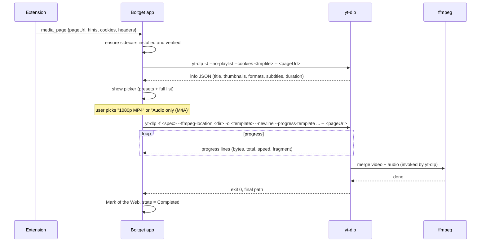

# Video and audio downloads

Boltget downloads video and audio from websites by running two well-established open-source tools as **sidecars**: [yt-dlp](https://github.com/yt-dlp/yt-dlp) for extraction and downloading, and [FFmpeg](https://ffmpeg.org) for merging and converting. Neither is bundled with the installer; both are installed on demand the first time the user needs them, verified, and kept up to date.

Target milestone: v0.4 (see [ROADMAP.md](ROADMAP.md)).

Related: [BROWSER-INTEGRATION.md](BROWSER-INTEGRATION.md#media-detection-panel) (how pages are detected), [ARCHITECTURE.md](ARCHITECTURE.md#sidecars) (process model and security).

## Why sidecars

- **yt-dlp is the best extractor in existence** and supports a very large number of sites. Its extractors break whenever sites change, and its maintainers fix them quickly. Re-implementing that in Rust would be an endless, losing race.
- **Separation of concerns.** The extension detects; the app decides; yt-dlp extracts. Site-specific logic never lives in the extension, which is what keeps the extension store-compliant.
- **Not bundled**, because:
  - yt-dlp must update far more often than Boltget releases.
  - It keeps the installer small for users who never download video.
  - FFmpeg builds are large (tens of MB) and have their own licensing considerations.
- **Separate processes.** A crash or hang in a sidecar cannot take down the app, and sidecars can be killed cleanly.

## Licensing

- yt-dlp is released under the Unlicense. Running it as a separate program is unproblematic.
- FFmpeg builds for Windows are commonly GPL-licensed builds (with `--enable-gpl`). Boltget is GPL-3.0-or-later, so there is no conflict. Boltget does not distribute FFmpeg in its installer; it downloads an upstream build on the user's request. If Boltget ever mirrors FFmpeg binaries itself, it must also provide the corresponding source as the GPL requires; the sidecar manifest would then point to the source archive too.

## Install, verification and updates

### Where they live

```
%LOCALAPPDATA%\Boltget\tools\
├── manifest.json                    # installed versions, hashes, install dates
├── yt-dlp\2026.xx.yy\yt-dlp.exe
└── ffmpeg\7.x\bin\ffmpeg.exe, ffprobe.exe
```

Versions are installed side by side; the new version becomes active only after it is verified and a smoke test (`yt-dlp --version`, `ffmpeg -version`) passes. The previous version is kept until the next successful update, so a bad update can be rolled back automatically.

### First-use install flow

1. The user pastes a video page URL, or the extension sends `media_page`.
2. If the tools are missing, the app shows a single sheet: "Video downloads need two free tools: yt-dlp (about N MB) and FFmpeg (about M MB). Install now?" with links to both projects. Sizes are read from the release metadata at that moment, not hard-coded.
3. On confirm, both are downloaded **with the Boltget engine itself** (segmented, resumable), verified, extracted and smoke-tested, with progress shown inline.
4. The original request continues automatically.

Users can also point Boltget at existing installations (Settings → Video → Use custom paths). Custom paths are not auto-updated or verified; the UI says so.

### Verification

Nothing is executed until it is verified:

- **yt-dlp:** upstream publishes checksum files (`SHA2-256SUMS`, `SHA2-512SUMS`) and detached signatures of those files with each release. Boltget pins yt-dlp's release-signing public key in the app, verifies the signature of the checksum file, then verifies the binary's SHA-256 against it. This lets Boltget pick up a new yt-dlp release the same day without waiting for Boltget infrastructure, while still trusting only yt-dlp's signing key. (The exact signature format and key are confirmed during v0.4 implementation; if upstream signing is unavailable for some release, Boltget falls back to the Boltget-signed manifest below.)
- **FFmpeg:** upstream FFmpeg does not publish official Windows binaries; well-known third-party builders do. Boltget chooses one builder (candidate: the widely used builds published on GitHub Releases by BtbN, which include checksums) and publishes a **Boltget-signed sidecar manifest** listing the exact version, URL and SHA-256 that Boltget has tested. The manifest is signed with a dedicated key (separate from the updater key) and verified by the app. FFmpeg needs updating rarely, so a manifest-driven process is fine.
- Downloads go over HTTPS from the pinned hosts only. Redirects to other hosts are refused for sidecar downloads.

### Updates

- **yt-dlp:** checked at most once a day while video features are in use (and immediately when an extraction fails with an error that suggests a broken extractor). Updated in the background; an in-progress download keeps using the old version.
- Boltget **does not use yt-dlp's built-in self-update** (`-U`), because that would replace a verified binary with one Boltget has not verified. The app always passes the option that disables update checks if the installed version supports it.
- Channel: yt-dlp stable by default; "nightly" is an advanced opt-in for users who need fixes before a stable release.
- **FFmpeg:** updated when the Boltget sidecar manifest changes, which happens with Boltget releases or out-of-band for security fixes.

### Known operational issues

- yt-dlp's Windows executable is a self-extracting bundle; its startup is slower than a native binary and some antivirus products flag such bundles. Boltget evaluates an unpacked (one-directory) build if upstream provides one for Windows, and documents how to report false positives.
- Some sites need additional components for full support (for example, upstream has introduced a requirement for an external JavaScript runtime for some YouTube formats). Boltget treats such components as additional sidecars with the same install/verify/update rules, decided case by case and documented here.

### Install, verification and updates: as built

*v0.4 step 1 (2026-11-16).* The decisions this section left open, and how the sidecar manager works.

**Where the code lives.** A crate of its own, `crates/media` (`boltget-media`), used by the CLI (`boltget media`) and, from step 3, by the app. Not part of the engine: the engine stays a download library, while this crate starts processes and unpacks archives. It downloads through the engine (an in-memory `Engine` per install: segmented and retried, not resumable across restarts) and builds and tests on Linux like the engine.

**Layout.** As sketched above, with these details:

```
%LOCALAPPDATA%\Boltget\tools\          (the CLI: <--state>\tools)
├── manifest.json        format 1; per tool: active, previous, channel, last_check,
│                        last_failure_check, rejected, and per version its URL,
│                        SHA-256, size, install time and program paths
├── .lock                held while installing, updating, rolling back or pruning
├── .downloads\          downloads in progress; removed after every install
├── yt-dlp\2026.10.26\yt-dlp.exe, _internal\...
└── ffmpeg\n9.0.2-39-g7adfbe40dc\bin\ffmpeg.exe, ffprobe.exe, *.dll
```

- The manifest is the "active" pointer: it is rewritten to a temporary file, flushed, and renamed over the old one, so the switch is atomic. A manifest that cannot be parsed is moved aside (`manifest.json.bad`) and treated as empty, so the tools are installed again rather than never. A second process that wants the lock gets "busy" (CLI exit code 7).
- Version directory names come from the release (yt-dlp's tag) and must match `[A-Za-z0-9._-]{1,64}`, not starting with a dot.

**Trust model.**

- **Hosts:** HTTPS only, to `api.github.com`, `github.com`, `objects.githubusercontent.com` and `release-assets.githubusercontent.com`. The engine enforces the list for every request, redirects included (`EngineConfig::allowed_hosts`, [ENGINE.md, Redirects](ENGINE.md#redirects)), and the manager refuses a release whose asset URL points elsewhere before fetching anything.
- **yt-dlp:** the latest release comes from the GitHub releases API (`yt-dlp/yt-dlp`, or `yt-dlp/yt-dlp-nightly-builds` on the nightly channel; both are signed with the same key). The release must have `SHA2-256SUMS` and `SHA2-256SUMS.sig`. The signature is a binary OpenPGP version 4 signature by yt-dlp's release key, "Simon Sawicki (yt-dlp signing key)", RSA 4096, created 2023-02-26, fingerprint `AC0C BBE6 848D 6A87 3464 AF4E 57CF 6593 3B5A 7581` (`public.key` in yt-dlp's repository). Boltget pins the key's modulus, exponent and creation time in `crates/media/src/sources.rs`; a test recomputes the fingerprint from them. The binary's SHA-256 must then match its single line in the verified file (checked by the engine on completion, and again before unpacking).
- **Why no OpenPGP library:** one signature format from one pinned key needs a few hundred lines; `crates/media/src/pgp.rs` parses exactly one version 4 signature packet over a binary document (RSA, SHA-256/384/512) and refuses anything else (armor, other packet or signature types, unknown critical subpackets, an issuer other than the pinned key, an expired signature), and `ring`, already Boltget's crypto provider, does the RSA verification. A full OpenPGP implementation (rPGP, Sequoia) would add a large dependency tree for this. The parser is tested with yt-dlp 2026.10.26's real signed checksums (every changed byte fails) and with signatures made by an independent test signer.
- **No fallback:** a yt-dlp release without a valid signature is not installed. The Boltget-signed manifest this section mentions as a fallback is not built (nor needed so far).
- **FFmpeg:** the builder is BtbN's FFmpeg-Builds (now published as `FFmpeg-Builds/FFmpeg-Builds` on GitHub), release branch 9.0, GPL, **shared** libraries (an 86 MB zip instead of 195 MB for the static build), from a month-end autobuild (`autobuild-2026-10-31-12-59`, n9.0.2-39-g7adfbe40dc): the builder prunes daily builds but keeps month-end ones. Windows x64 and Arm64 are pinned by URL, size and SHA-256 in `sources.rs`; this compiled-in pin is the "Boltget sidecar manifest" for now, as trustworthy as the Boltget binary that carries it (Authenticode and the updater's signature). Other platforms have no pin yet (BtbN ships `.tar.xz` there; the system's FFmpeg through custom paths is the plan). The separately signed manifest for out-of-band FFmpeg updates, with its own key, is still to come; until then FFmpeg changes with Boltget releases.
- **Windows build of yt-dlp:** the unpacked "onedir" build (`yt-dlp_win.zip`, `yt-dlp_win_arm64.zip`), which upstream now publishes: it starts faster than the self-extracting `yt-dlp.exe` and is flagged less often (see Known operational issues). Linux and macOS use the single-file builds.
- **No Mark of the Web** on these downloads: they are verified and never opened by the user, and a zip's mark would not reach the unpacked files anyway.

**Install.** Download, verify, unpack (zip only, with the pure-Rust `zip` crate: entries that would leave the directory, symbolic links, more than 20,000 entries or more than 2 GiB unpacked are refused; FFmpeg keeps only `bin/`) into a staging directory, rename it to the version directory, then the **smoke test**: yt-dlp `--ignore-config --no-plugin-dirs --no-update --version` must print exactly the release tag; `ffmpeg -version` and `ffprobe -version` must start with `ffmpeg version` / `ffprobe version` and name the pinned version; 120 s at most each. Only then is the version made active. A version that fails is deleted and the active one stays as it was.

**Rollback.** The previous version is kept; every other version (and any leftover staging directory) is pruned after each switch; a directory still in use is left for the next prune. `verify_active` (CLI: `boltget media check`) smoke-tests the active version; if it fails and the previous one passes, the previous one becomes active again and the failed version is recorded as rejected: it is never installed again automatically (a newer release is). `boltget media rollback <tool>` does the same by hand.

**Updates.** `update_if_due` checks yt-dlp at most once every 24 hours, and FFmpeg when Boltget's pin differs from the active version (no network check). The app calls it while video features are in use (step 3). `on_extractor_failure` checks yt-dlp at once, at most once an hour; step 6's error mapping calls it for "the site changed". A job that is running keeps using its version's files: versions live in separate directories. `--no-update` is always passed (yt-dlp versions without it fail the smoke test; they are older than anything Boltget installs), and `-U` and `--update-to` are refused by the argument allowlist ([ARCHITECTURE.md, Sidecars](ARCHITECTURE.md#sidecars-1)). The channel is chosen with `boltget media channel stable|nightly` (in the app: Settings, Video, step 3).

**Not yet built:** custom paths (Settings, Video), the first-use install sheet, the signed FFmpeg manifest, FFmpeg pins for Linux and macOS.

## How a media download flows



- Pasting a URL into the app's add box follows the same path: the app recognises "this is a web page, not a file" (probe returns `text/html`) and offers "Look for media on this page".
- **Playlists and channels:** if the info JSON is a playlist, the picker shows the entries (with `--flat-playlist` for speed) and lets the user select items and one format preset for all. Each entry becomes its own `media` download in a dedicated queue.
- **Cookies:** yt-dlp receives cookies through a temporary Netscape-format cookie file built from the cookies the extension sent, created with an ACL restricted to the current user and deleted when the job ends. Boltget does not use yt-dlp's option to read cookies directly from browser profiles: that touches the browser's databases, and recent Chromium versions on Windows encrypt cookies in a way that external tools cannot read reliably.
- **Hints:** if yt-dlp has no specific extractor for the site, it falls back to its generic extractor. If that also fails and the extension supplied a direct media URL hint (an `.m3u8`, `.mpd` or direct `video/*` response), the app offers to download that URL directly (HLS/DASH via yt-dlp's generic handling of the manifest URL; direct files via the Boltget engine).

### Engine involvement

- v0.4: yt-dlp downloads the media itself. For HLS/DASH, Boltget passes `--concurrent-fragments` (design target: 4) to parallelize fragment downloads.
- Later (experiment, v0.5+): for formats that are plain progressive HTTP files, take the format URL and per-format `http_headers` from the info JSON, download with the Boltget engine (dynamic segmentation, resume, link refresh), then mux with ffmpeg directly. Some sites throttle per connection, so this could be much faster. It is an experiment because format URLs can be bound to the requesting client and may expire quickly; it ships only if it is reliable across the test matrix.

## Format and quality picker UX

Principles from [DESIGN-PRINCIPLES.md](DESIGN-PRINCIPLES.md) apply: one obvious choice, details on demand.

**Default view: presets.** A short list, computed from the available formats:

| Preset | yt-dlp format selection (sketch) |
|---|---|
| Best quality | `bv*+ba/b` |
| 1080p (if available) | `bv*[height<=1080]+ba/b[height<=1080]` |
| 720p | `bv*[height<=720]+ba/b[height<=720]` |
| Smaller file | `bv*[height<=480]+ba/b[height<=480]` |
| Audio only | `ba/b` with extraction to the chosen audio format |

- Each preset shows the **resulting resolution, container, codecs and estimated size** (from `filesize` or `filesize_approx` in the info JSON; marked "about" when approximate, hidden when unknown).
- Presets that would produce the same result as another are collapsed.
- **Container preference:** "Prefer MP4" (default, for compatibility) vs "Prefer original" (often WebM/MKV, sometimes higher quality). Shown as a single toggle.
- **Subtitles:** a dropdown of available languages plus auto-generated captions (marked), with "embed" or "save as file".
- **Advanced:** a disclosure revealing the full format table (ID, resolution, fps, codec, bitrate, size, protocol), multi-select of one video and one audio stream, and a free-text format expression for experts.
- The thumbnail, title, uploader and duration are shown at the top so the user knows they picked the right page.
- The last-used preset is remembered per site.

**Output naming** uses a yt-dlp output template with a safe default (`%(title)s [%(id)s].%(ext)s`), sanitized by yt-dlp's Windows-safe filename handling, written to the "Video" category folder.

## Progress and errors

- Progress is parsed from yt-dlp's `--progress-template` output, configured to emit one machine-readable line per update (downloaded bytes, total or estimate, speed, ETA, fragment index/count). Boltget does not scrape yt-dlp's human-readable output.
- Merging/converting shows a separate "Processing" state (indeterminate unless ffmpeg progress is available).
- yt-dlp errors are mapped into a few user-facing categories: "This site needs you to be signed in" (suggest using the extension so cookies are passed), "This video is not available in your region or has been removed", "The site changed and the downloader needs an update" (triggers a yt-dlp update check), "DRM-protected: Boltget cannot download this", and "Other" (with the raw message under a disclosure).
- Pause/resume: yt-dlp supports continuing partial downloads (`.part` files) on restart. Pause stops the process (Job Object terminate after a graceful attempt); resume restarts it with the same arguments.

## Boundaries

- **No DRM circumvention.** Streams protected by DRM (Widevine, PlayReady, FairPlay) are reported as not downloadable. Boltget will not integrate tools that remove DRM.
- **User responsibility.** The app's first-run video sheet includes one line: downloading may be restricted by a site's terms or by copyright law; download only what you have the right to. No more preaching than that.
- **Store policy:** the extension never offers media downloading on YouTube domains in the store builds (see [BROWSER-INTEGRATION.md, Store policy constraints](BROWSER-INTEGRATION.md#store-policy-constraints)). The app accepts any URL the user pastes.
