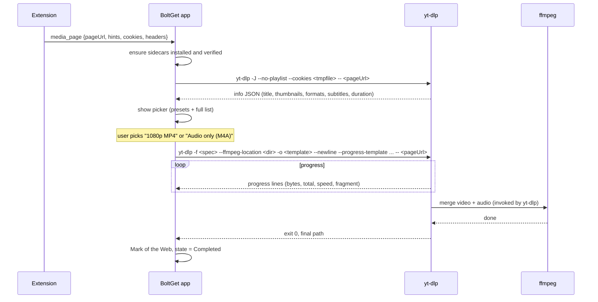

# Video and audio downloads

BoltGet downloads video and audio from websites by running two well-established open-source tools as **sidecars**: [yt-dlp](https://github.com/yt-dlp/yt-dlp) for extraction and downloading, and [FFmpeg](https://ffmpeg.org) for merging and converting. Neither is bundled with the installer; both are installed on demand the first time the user needs them, verified, and kept up to date.

Target milestone: v0.4 (see [ROADMAP.md](ROADMAP.md)).

Related: [BROWSER-INTEGRATION.md](BROWSER-INTEGRATION.md#media-detection-panel) (how pages are detected), [ARCHITECTURE.md](ARCHITECTURE.md#sidecars) (process model and security).

## Why sidecars

- **yt-dlp is the best extractor in existence** and supports a very large number of sites. Its extractors break whenever sites change, and its maintainers fix them quickly. Re-implementing that in Rust would be an endless, losing race.
- **Separation of concerns.** The extension detects; the app decides; yt-dlp extracts. Site-specific logic never lives in the extension, which is what keeps the extension store-compliant.
- **Not bundled**, because:
  - yt-dlp must update far more often than BoltGet releases.
  - It keeps the installer small for users who never download video.
  - FFmpeg builds are large (tens of MB) and have their own licensing considerations.
- **Separate processes.** A crash or hang in a sidecar cannot take down the app, and sidecars can be killed cleanly.

## Licensing

- yt-dlp is released under the Unlicense. Running it as a separate program is unproblematic.
- FFmpeg builds for Windows are commonly GPL-licensed builds (with `--enable-gpl`). BoltGet is GPL-3.0-or-later, so there is no conflict. BoltGet does not distribute FFmpeg in its installer; it downloads an upstream build on the user's request. If BoltGet ever mirrors FFmpeg binaries itself, it must also provide the corresponding source as the GPL requires; the sidecar manifest would then point to the source archive too.

## Install, verification and updates

### Where they live

```
%LOCALAPPDATA%\BoltGet\tools\
├── manifest.json                    # installed versions, hashes, install dates
├── yt-dlp\2026.xx.yy\yt-dlp.exe
└── ffmpeg\7.x\bin\ffmpeg.exe, ffprobe.exe
```

Versions are installed side by side; the new version becomes active only after it is verified and a smoke test (`yt-dlp --version`, `ffmpeg -version`) passes. The previous version is kept until the next successful update, so a bad update can be rolled back automatically.

### First-use install flow

1. The user pastes a video page URL, or the extension sends `media_page`.
2. If the tools are missing, the app shows a single sheet: "Video downloads need two free tools: yt-dlp (about N MB) and FFmpeg (about M MB). Install now?" with links to both projects. Sizes are read from the release metadata at that moment, not hard-coded.
3. On confirm, both are downloaded **with the BoltGet engine itself** (segmented, resumable), verified, extracted and smoke-tested, with progress shown inline.
4. The original request continues automatically.

Users can also point BoltGet at existing installations (Settings → Video → Use custom paths). Custom paths are not auto-updated or verified; the UI says so.

### Verification

Nothing is executed until it is verified:

- **yt-dlp:** upstream publishes checksum files (`SHA2-256SUMS`, `SHA2-512SUMS`) and detached signatures of those files with each release. BoltGet pins yt-dlp's release-signing public key in the app, verifies the signature of the checksum file, then verifies the binary's SHA-256 against it. This lets BoltGet pick up a new yt-dlp release the same day without waiting for BoltGet infrastructure, while still trusting only yt-dlp's signing key. (The exact signature format and key are confirmed during v0.4 implementation; if upstream signing is unavailable for some release, BoltGet falls back to the BoltGet-signed manifest below.)
- **FFmpeg:** upstream FFmpeg does not publish official Windows binaries; well-known third-party builders do. BoltGet chooses one builder (candidate: the widely used builds published on GitHub Releases by BtbN, which include checksums) and publishes a **BoltGet-signed sidecar manifest** listing the exact version, URL and SHA-256 that BoltGet has tested. The manifest is signed with a dedicated key (separate from the updater key) and verified by the app. FFmpeg needs updating rarely, so a manifest-driven process is fine.
- Downloads go over HTTPS from the pinned hosts only. Redirects to other hosts are refused for sidecar downloads.

### Updates

- **yt-dlp:** checked at most once a day while video features are in use (and immediately when an extraction fails with an error that suggests a broken extractor). Updated in the background; an in-progress download keeps using the old version.
- BoltGet **does not use yt-dlp's built-in self-update** (`-U`), because that would replace a verified binary with one BoltGet has not verified. The app always passes the option that disables update checks if the installed version supports it.
- Channel: yt-dlp stable by default; "nightly" is an advanced opt-in for users who need fixes before a stable release.
- **FFmpeg:** updated when the BoltGet sidecar manifest changes, which happens with BoltGet releases or out-of-band for security fixes.

### Known operational issues

- yt-dlp's Windows executable is a self-extracting bundle; its startup is slower than a native binary and some antivirus products flag such bundles. BoltGet evaluates an unpacked (one-directory) build if upstream provides one for Windows, and documents how to report false positives.
- Some sites need additional components for full support (for example, upstream has introduced a requirement for an external JavaScript runtime for some YouTube formats). BoltGet treats such components as additional sidecars with the same install/verify/update rules, decided case by case and documented here.

## How a media download flows



- Pasting a URL into the app's add box follows the same path: the app recognises "this is a web page, not a file" (probe returns `text/html`) and offers "Look for media on this page".
- **Playlists and channels:** if the info JSON is a playlist, the picker shows the entries (with `--flat-playlist` for speed) and lets the user select items and one format preset for all. Each entry becomes its own `media` download in a dedicated queue.
- **Cookies:** yt-dlp receives cookies through a temporary Netscape-format cookie file built from the cookies the extension sent, created with an ACL restricted to the current user and deleted when the job ends. BoltGet does not use yt-dlp's option to read cookies directly from browser profiles: that touches the browser's databases, and recent Chromium versions on Windows encrypt cookies in a way that external tools cannot read reliably.
- **Hints:** if yt-dlp has no specific extractor for the site, it falls back to its generic extractor. If that also fails and the extension supplied a direct media URL hint (an `.m3u8`, `.mpd` or direct `video/*` response), the app offers to download that URL directly (HLS/DASH via yt-dlp's generic handling of the manifest URL; direct files via the BoltGet engine).

### Engine involvement

- v0.4: yt-dlp downloads the media itself. For HLS/DASH, BoltGet passes `--concurrent-fragments` (design target: 4) to parallelize fragment downloads.
- Later (experiment, v0.5+): for formats that are plain progressive HTTP files, take the format URL and per-format `http_headers` from the info JSON, download with the BoltGet engine (dynamic segmentation, resume, link refresh), then mux with ffmpeg directly. Some sites throttle per connection, so this could be much faster. It is an experiment because format URLs can be bound to the requesting client and may expire quickly; it ships only if it is reliable across the test matrix.

## Format and quality picker UX

Principles from [DESIGN-PRINCIPLES.md](DESIGN-PRINCIPLES.md) apply: one obvious choice, details on demand.

**Default view: presets.** A short list, computed from the available formats:

| Preset | yt-dlp format selection (sketch) |
|---|---|
| Best quality | `bv*+ba/b` |
| 1080p (if available) | `bv*[height<=1080]+ba/b[height<=1080]` |
| 720p | `bv*[height<=720]+ba/b[height<=720]` |
| Smaller file | `bv*[height<=480]+ba/b[height<=480]` |
| Audio only | `ba/b` with extraction to the chosen audio format |

- Each preset shows the **resulting resolution, container, codecs and estimated size** (from `filesize` or `filesize_approx` in the info JSON; marked "about" when approximate, hidden when unknown).
- Presets that would produce the same result as another are collapsed.
- **Container preference:** "Prefer MP4" (default, for compatibility) vs "Prefer original" (often WebM/MKV, sometimes higher quality). Shown as a single toggle.
- **Subtitles:** a dropdown of available languages plus auto-generated captions (marked), with "embed" or "save as file".
- **Advanced:** a disclosure revealing the full format table (ID, resolution, fps, codec, bitrate, size, protocol), multi-select of one video and one audio stream, and a free-text format expression for experts.
- The thumbnail, title, uploader and duration are shown at the top so the user knows they picked the right page.
- The last-used preset is remembered per site.

**Output naming** uses a yt-dlp output template with a safe default (`%(title)s [%(id)s].%(ext)s`), sanitized by yt-dlp's Windows-safe filename handling, written to the "Video" category folder.

## Progress and errors

- Progress is parsed from yt-dlp's `--progress-template` output, configured to emit one machine-readable line per update (downloaded bytes, total or estimate, speed, ETA, fragment index/count). BoltGet does not scrape yt-dlp's human-readable output.
- Merging/converting shows a separate "Processing" state (indeterminate unless ffmpeg progress is available).
- yt-dlp errors are mapped into a few user-facing categories: "This site needs you to be signed in" (suggest using the extension so cookies are passed), "This video is not available in your region or has been removed", "The site changed and the downloader needs an update" (triggers a yt-dlp update check), "DRM-protected: BoltGet cannot download this", and "Other" (with the raw message under a disclosure).
- Pause/resume: yt-dlp supports continuing partial downloads (`.part` files) on restart. Pause stops the process (Job Object terminate after a graceful attempt); resume restarts it with the same arguments.

## Boundaries

- **No DRM circumvention.** Streams protected by DRM (Widevine, PlayReady, FairPlay) are reported as not downloadable. BoltGet will not integrate tools that remove DRM.
- **User responsibility.** The app's first-run video sheet includes one line: downloading may be restricted by a site's terms or by copyright law; download only what you have the right to. No more preaching than that.
- **Store policy:** the extension never offers media downloading on YouTube domains in the store builds (see [BROWSER-INTEGRATION.md, Store policy constraints](BROWSER-INTEGRATION.md#store-policy-constraints)). The app accepts any URL the user pastes.
